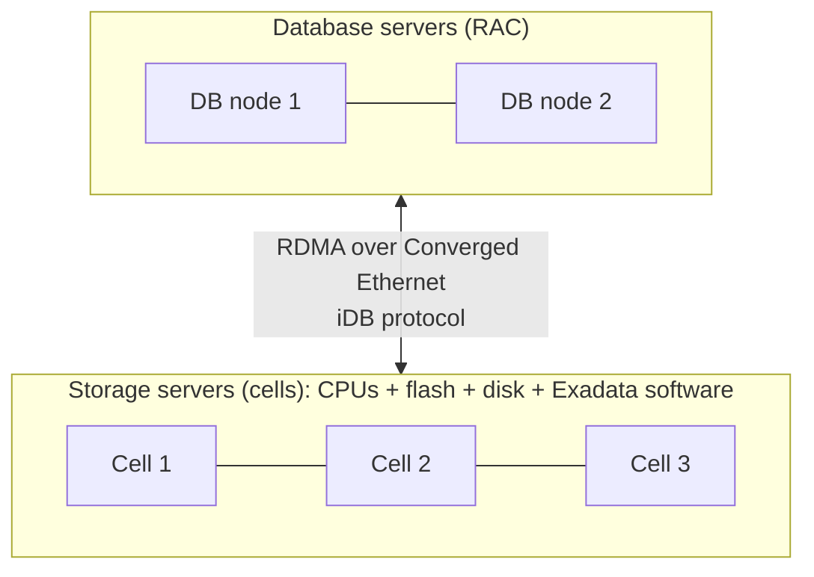

# 5.1 Cloud, Exadata and Autonomous Database

!!! abstract "Chapter card"
    **Stage:** 5 · **Prerequisites:** Stages 3 and 4 · **Time:** 4 hours

!!! warning "Service catalogs change"
    Service names, shapes, limits and prices change often. Use this chapter for
    the decision framework and confirm specifics in the provider's current
    documentation.

## At a glance

| Subtopic | In one line |
|---|---|
| Deployment models | On-premises, IaaS, PaaS, Autonomous, Cloud@Customer, multicloud |
| Exadata architecture | Why the engineered system behaves differently |
| Autonomous Database | What is automated and what you give up |
| Service selection | A decision matrix |
| Cloud migration | Methods, phases, risks |
| Hybrid and multicloud | Latency, egress, operations |
| Cost | Licence models, sizing, optimization |

## 1. Deployment models

| Model | You manage | Provider manages | Examples |
|---|---|---|---|
| On-premises | Everything | Nothing | Own data center, Exadata Database Machine |
| IaaS | OS, Grid Infrastructure, database, backups, patching | Hardware, virtualization | Oracle on OCI compute, EC2, Azure VMs |
| PaaS, co-managed | Database administration, schema, when to patch | Infrastructure, tooling for patching, backup, Data Guard | OCI Base Database Service, Exadata Database Service (dedicated infrastructure or Exascale) |
| PaaS, fully managed | Schema, SQL, users, data | Everything else | Autonomous Database (Serverless, Dedicated) |
| Cloud in your data center | Varies | Hardware and service run by Oracle on your premises | Exadata Cloud@Customer, Dedicated Region |
| Multicloud | Varies | Oracle database services running inside other clouds' data centers | Oracle Database@Azure, @Google Cloud, @AWS |
| Third-party managed | Schema and data | Provider's automation | Amazon RDS for Oracle (no RAC; restricted privileges and options) |

The trade is constant: **control for responsibility**. The less you manage, the
fewer knobs you have (OS access, SYSDBA, custom patches, parameter freedom).

## 2. Exadata architecture

Exadata is database servers and **intelligent storage servers** joined by a
low-latency RDMA network. The storage is not passive: it runs software that
understands Oracle blocks.

| Feature | What it does | Benefit |
|---|---|---|
| **Smart Scan** (query offload) | Filters rows and columns *in the storage cells* for full scans | Only matching data crosses the network; large scans far faster |
| **Storage indexes** | In-memory min/max per storage region | Skip regions that cannot match: I/O avoided entirely |
| **Hybrid Columnar Compression** | Columnar compression units | 6x to 15x and more for history |
| **Smart Flash Cache / Log**, persistent memory and RDMA access (XRMEM) | Automatic tiering; very low commit and read latency | OLTP latency |
| **I/O Resource Manager** | Prioritize I/O by database, PDB, consumer group | Safe consolidation |
| Columnar flash cache, In-Memory on storage | Analytics acceleration | |
| **Exascale** | Pooled, loosely coupled storage with thin clones and elastic sizing | Smaller entry point, fast cloning |

Consequences for design:

- Analytic queries may run **better with fewer indexes**, because Smart Scan needs full scans (direct path reads). Indexes built for a conventional platform can prevent offload.
- Some database features exist only here: HCC, automatic indexing, real-time statistics, several automatic tuning features.
- It is a consolidation platform: its economics depend on running many databases on it.

## 3. Autonomous Database

Autonomous Database is Oracle Database on Exadata with operations automated:
provisioning, patching, backups, tuning, scaling and security configuration.

| Automated | Details |
|---|---|
| Patching and upgrades | Applied by the service, online where possible |
| Backups | Automatic, with point-in-time recovery |
| Scaling | CPU and storage online; auto-scaling |
| Tuning | Automatic indexing, plan management, statistics |
| Security | Encryption always on, restricted admin, auditing, Data Safe |
| High availability | RAC-based; Autonomous Data Guard as an option |

| Variant | Meaning |
|---|---|
| Workload types | Transaction Processing (ATP), Data Warehouse / Lakehouse (ADW), JSON, APEX |
| **Serverless** | Shared Exadata infrastructure; simplest, elastic |
| **Dedicated** | Your own Exadata infrastructure and control over maintenance schedules and isolation |
| Autonomous on Cloud@Customer / in multicloud | Same service in other locations |

What you give up: no SYSDBA or OS access; some parameters, features and
tablespace choices are fixed; maintenance timing is constrained (more control
in Dedicated); behavior can change with service updates. Applications that need
unusual configurations, OS-level integrations or strict version pinning fit
co-managed services better.

## 4. Service selection

| Requirement | Points toward |
|---|---|
| Minimal operations staff; standard application | Autonomous Serverless |
| Regulatory isolation, control of patch timing | Autonomous Dedicated or Exadata Database Service |
| Full control of versions, parameters, agents | Base Database / Exadata Database Service, or IaaS |
| RAC required | Exadata Database Service, Base DB (2-node RAC, EE Extreme Performance), Autonomous |
| Data must stay on-premises | Cloud@Customer, on-premises Exadata |
| Application lives in Azure / Google Cloud / AWS and needs low latency | Oracle Database@ that cloud |
| Small departmental database, low cost | Base Database (single instance, SE2 or EE), Autonomous with small ECPU counts, Always Free for trials |
| Heavy consolidation of many databases | Exadata (any location) with multitenant |
| Existing licences | BYOL options |

Evaluate each candidate against the same list: availability SLA and what it
covers, RPO/RTO options, version and patch policy, feature and option
availability, limits (storage, sessions, IOPS), network placement, exit path.

## 5. Cloud migration

| Phase | Work |
|---|---|
| **Discover** | Inventory: versions, sizes, options used, dependencies (links, jobs, files, interfaces), SLAs, data classification |
| **Assess** | Compatibility (Cloud Premigration Advisor Tool), target service choice, sizing from AWR peaks, licence position, network |
| **Plan** | Method per database, wave plan by dependency groups, rollback, cutover rehearsals |
| **Migrate** | Build target, move data, validate, performance-test |
| **Cut over** | Freeze, final sync, repoint, verify, hypercare |
| **Optimize** | Right-size, automate, decommission the source |

| Method | Downtime | Notes |
|---|---|---|
| Data Pump | Hours, by size | Simplest; cross-version and into Autonomous |
| RMAN restore / duplicate, transportable tablespaces | Short with incremental roll-forward | Same or convertible platform |
| Data Guard (hybrid standby in the cloud) | Minutes | Physical; same version family; also a fallback |
| GoldenGate | Near zero | Cross-version, into Autonomous; most engineering |
| PDB unplug/plug, remote clone, relocate | Short to near zero | Multitenant sources |
| **Zero Downtime Migration (ZDM)** / OCI Database Migration | Orchestrated | Wraps the above with automation |

Risks that derail migrations: undiscovered dependencies (a nightly file drop, a
database link); network latency between an application left behind and its
database; licence assumptions; performance differences from changed storage and
optimizer versions; and big-bang cutovers. Migrate **dependency groups**
together and rehearse.

## 6. Hybrid and multicloud

| Issue | Guidance |
|---|---|
| **Latency** | Chatty applications need the database in the same region and network domain. Measure round trips per transaction and multiply by the latency |
| **Data egress cost** | Replication and reporting across providers are billed per GB |
| **Connectivity** | Private interconnects (FastConnect, ExpressRoute, Direct Connect, Interconnect); no databases on public endpoints |
| **Identity and keys** | Federate identity; decide who holds encryption keys (customer-managed keys, external key management) |
| **Operations** | One monitoring, backup and patch standard across locations, or the estate fragments |
| **DR across locations** | Data Guard between on-premises and cloud, or between regions, is a common first cloud step |

## 7. Cost

| Lever | Notes |
|---|---|
| Licence model | Licence-included versus bring-your-own-licence (BYOL); unlimited agreements; support cost on-premises continues until licences are terminated |
| Unit of charge | OCPU, ECPU, vCPU: check the conversion and what options are included in each edition bundle |
| Right-sizing | Size from measured peaks (AWR), not from the old server's core count |
| Elasticity | Auto-scaling for spiky load; scale down or stop non-production out of hours |
| Consolidation | Multitenant and Exadata reduce licensed cores; cap PDBs |
| Storage tiers | Compression, partition tiering, backup retention policy, archive storage |
| Standby | A full standby doubles compute: Active Data Guard reads, or cross-region backup-based DR for lower tiers |
| Egress and interconnect | Include in the model |
| Commitments | Committed-use discounts versus flexibility |

Model **total cost of ownership** over three to five years: licences and
support, infrastructure, data center, staff time, migration project, risk.
Cloud is often not cheaper per core; the savings come from elasticity,
consolidation and operations you no longer perform.

## 8. Common mistakes

- Lift-and-shift of an oversized on-premises configuration, paying for idle cores forever.
- Splitting an application and its database across clouds.
- Assuming managed means no DBA: schema design, SQL, security and cost still need owners.
- No exit plan.
- Treating the provider's availability SLA as the application's.

## FreshMart example

=== "Scenario"

    FreshMart (1 million customers, a 4-person platform team, applications on
    Kubernetes in a public cloud region in Mumbai) must choose where its
    database runs for the next five years.

=== "Options"

    | Criterion (weight) | Self-managed on VMs | Co-managed database service + Data Guard | Autonomous (Serverless) |
    |---|---|---|---|
    | Operations effort (30%) | High: patching, backups, HA scripts | Medium | Low |
    | Control and feature freedom (15%) | Full | High | Restricted |
    | HA/DR to meet 99.95%, RPO 0 in-region (20%) | Build it | Tooling provided | Built in + Autonomous Data Guard |
    | Elasticity for festival peaks (15%) | Manual | Scale shapes | Auto-scaling |
    | Cost at steady load (10%) | Lowest infrastructure, highest staff | Middle | Higher unit price, lowest staff |
    | Exit path (10%) | Easy | Easy | Data Pump / GoldenGate |

=== "Decision"

    *Illustrative:* Autonomous Transaction Processing with auto-scaling and a
    cross-region standby, in the same region and private network as the
    Kubernetes cluster. The deciding factors are the small team and spiky
    load. Conditions recorded with the decision: an annual review of unit
    cost against a co-managed alternative; no use of features that would
    block an export; and a tested Data Pump exit each year.

=== "Takeaway"

    The weights, not the technology, made the decision, and they came from
    FreshMart's constraints (team size, peak pattern). A bank with a large DBA
    team and strict patch-timing rules would score the same table differently.

## Check yourself

??? question "Interview questions"
    1. **(Senior)** What does Exadata Smart Scan do?
    2. **(Senior)** What do you lose by moving to Autonomous Database?
    3. **(Principal)** How do you choose a migration method?
    4. **(Principal)** Why can an Exadata migration make some queries slower until indexes are reviewed?
    5. **(Architect)** The CFO asks whether to renew the unlimited licence agreement or move to cloud licence-included. How do you frame the answer? *Model 5-year TCO for both under growth scenarios; quantify certification and exit positions of the agreement, cloud elasticity benefits, migration cost and risk; separate the licence decision from the platform decision; present options with break-even points, not a single number.*

??? example "Exercises"
    1. Fill in the service-selection table for a system you know.
    2. From an AWR report, derive the peak CPU and IOPS and size a cloud shape with 30% headroom.
    3. List every dependency you would need to discover before migrating FreshMart.

## Related

Next: [5.2 Global and multi-region architecture](../enterprise-architecture/01-global-architecture.md).
