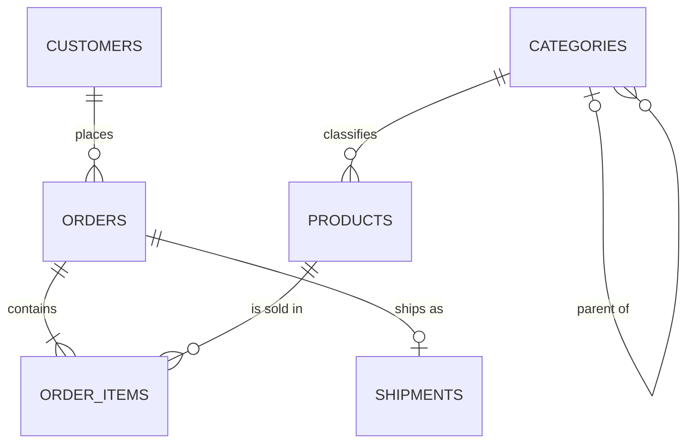

# 1.3 Data modeling and ER diagrams

!!! abstract "Chapter card"
    **Stage:** 1 · **Prerequisites:** 1.2 · **Time:** 3 hours · **Applies to:** all releases

## At a glance

A data model states what the business must remember and how those things relate, before any table exists.

| Subtopic | In one line |
|---|---|
| Conceptual, logical, physical | Three levels, in that order |
| Entities, attributes, relationships | The building blocks |
| Cardinality and optionality | How many, and whether required |
| Weak and associative entities | Identity that depends on a parent; resolving many-to-many |
| Logical to physical mapping | Tables, foreign keys, data types |
| Naming and design standards | Conventions that make errors readable |

## 1. Overview

A **data model** is a precise description of what the business needs to remember
and how those things relate. You draw it *before* you create tables, because a
wrong model is the most expensive mistake in a database: every query, index and
application screen is built on top of it.

## 2. Three levels of modeling

| Level | Audience | Contains | Does not contain |
|---|---|---|---|
| **Conceptual** | Business | Entities and relationships: *Customer places Order* | Columns, types, keys |
| **Logical** | Designers | Attributes, keys, cardinality, normalization | Storage, indexes, vendor types |
| **Physical** | DBAs, developers | Oracle data types, constraints, indexes, partitions, tablespaces | |

Work in that order. Skipping to the physical level is how tables end up shaped
like the first screen someone designed.

## 3. Building blocks

**Entity**: a thing the business tracks (Customer, Product, Order).
**Attribute**: a fact about one entity (email, unit price).
**Relationship**: an association between entities (Customer *places* Order).

### Cardinality and optionality

Cardinality says **how many**; optionality says **whether it must exist**.

| Relationship | Read as | FreshMart example |
|---|---|---|
| One-to-one (1:1) | Each A has at most one B | `orders` and `shipments` |
| One-to-many (1:N) | Each A has many B, each B has one A | `customers` and `orders` |
| Many-to-many (M:N) | Each A has many B and each B has many A | `orders` and `products` |

Crow's-foot notation, as drawn by Mermaid in this playbook:

- two bars: exactly one (mandatory)
- circle and bar: zero or one (optional)
- bar and crow's foot: one or many
- circle and crow's foot: zero or many



Read the first line both ways: *each customer places zero or many orders; each
order is placed by exactly one customer.*

### Resolving many-to-many

A relational table cannot hold a many-to-many relationship directly. You
introduce an **associative entity** (also called junction or bridge table) whose
key combines the two parents. `ORDER_ITEMS` resolves Order M:N Product, and it
has attributes of its own (`quantity`, `unit_price`) that belong to neither
parent.

### Strong, weak and associative entities

| Kind | Meaning | Example |
|---|---|---|
| Strong | Identified by its own key | `customers` |
| Weak | Cannot be identified without its parent | `order_items` (line 2 of *which* order?) |
| Associative | Exists to link two entities | `cart_items`, `inventory` |

A weak entity's primary key includes the parent's key: `(order_id, line_no)`.
This is an **identifying relationship**.

### Recursive relationships

An entity can relate to itself. `employees.manager_id` points to
`employees.employee_id`; `categories.parent_category_id` builds a category tree.
Chapter [2.3](../advanced-sql/03-cte-hierarchical.md) queries these.

## 4. From logical model to Oracle tables

| Logical construct | Physical rule |
|---|---|
| Entity | Table |
| Attribute | Column with the narrowest correct data type |
| 1:N relationship | Foreign key column on the "many" side |
| 1:1 relationship | Foreign key with a `UNIQUE` constraint on one side |
| M:N relationship | Associative table with two foreign keys |
| Mandatory relationship | Foreign key is `NOT NULL` |
| Subtype / supertype | One table with a type column, or one table per subtype (decide by how often subtypes are queried together) |

### Choosing data types

| Need | Use | Avoid | Why |
|---|---|---|---|
| Money, quantities | `NUMBER(p,s)` | `FLOAT`, `BINARY_DOUBLE` | Binary floats cannot represent 0.10 exactly |
| Text | `VARCHAR2(n)` | `CHAR(n)`, `VARCHAR` | `CHAR` pads with spaces; `VARCHAR` is reserved by Oracle for future use |
| Date with time to the second | `DATE` | Storing dates as strings or numbers | Oracle `DATE` always includes a time |
| Sub-second or time-zone aware | `TIMESTAMP`, `TIMESTAMP WITH TIME ZONE` | | |
| True/false | `BOOLEAN` :material-tag: **23ai+**; before that `CHAR(1)` with a `CHECK` | Numbers with undocumented meaning | |
| Large text / binary | `CLOB` / `BLOB` (SecureFiles) | `LONG`, `LONG RAW` | Legacy types with heavy restrictions |
| JSON documents | `JSON` :material-tag: **21c+**; before that `VARCHAR2`/`CLOB`/`BLOB` with `IS JSON` | | |
| Generated keys | Identity column or sequence | `MAX(id) + 1` | The `MAX` approach breaks under concurrency |

Size columns from the real domain. `VARCHAR2(4000)` everywhere removes a
validation rule and inflates memory estimates in client drivers and sort
operations.

## 5. Naming conventions used in this playbook

| Object | Convention | Example |
|---|---|---|
| Table | Plural noun, snake_case | `order_items` |
| Column | Singular, no table prefix except keys | `unit_price`, `customer_id` |
| Primary key | `pk_<table>` | `pk_orders` |
| Foreign key | `fk_<child>_<parent>` | `fk_orders_customer` |
| Unique | `uq_<table>_<cols>` | `uq_products_sku` |
| Check | `ck_<table>_<rule>` | `ck_orders_status` |
| Index | `ix_<table>_<cols>` | `ix_orders_cust_date` |
| View / materialized view | `v_` / `mv_` | `v_low_stock` |
| Package | `<domain>_pkg` | `order_pkg` |

Name every constraint. A system-generated name such as `SYS_C0012345` in an
error message tells the support team nothing, and it differs between
environments, which breaks migration scripts.

Never use quoted mixed-case identifiers (`"OrderItems"`). Unquoted names are
stored in upper case and are case-insensitive; quoted names must be quoted
forever.

## 6. Design standards checklist

- [ ] Every table has a primary key.
- [ ] Every natural key is protected by a unique constraint.
- [ ] Every relationship is a declared foreign key (not just a matching column name).
- [ ] Mandatory attributes are `NOT NULL`.
- [ ] Allowed values are enforced by `CHECK` constraints or reference tables.
- [ ] Money is `NUMBER` with scale; each amount column has one documented currency.
- [ ] Historical facts are snapshotted (`order_items.unit_price` copies the price at order time).
- [ ] Derived values are either not stored, or their consistency is enforced (`ck_orders_total`).

## 7. Common mistakes

- **Storing the current price only.** If `order_items` joined to `products.unit_price`, changing a price would rewrite history.
- **One "status" table for everything** (the one-true-lookup-table). It makes foreign keys impossible to declare properly.
- **Entity-attribute-value (EAV) tables** for ordinary data. Queries become self-joins per attribute and types cannot be enforced.
- **Modeling the screen, not the business.** A form with three phone fields is not a reason for three phone columns.
- **Optional foreign keys used to mean two different things.** Split the entity instead.

## FreshMart example

=== "Scenario"

    Product wants customers to rate products. Requirements: a customer rates a product at most once, with 1 to 5 stars and optional text. Model it, then implement it.

=== "SQL"

    ```sql
    -- Associative entity between CUSTOMERS and PRODUCTS, with its own attributes
    CREATE TABLE reviews (
        review_id   NUMBER(12) GENERATED BY DEFAULT ON NULL AS IDENTITY,
        product_id  NUMBER(10) NOT NULL,
        customer_id NUMBER(10) NOT NULL,
        rating      NUMBER(1)  NOT NULL,
        review_text VARCHAR2(1000),
        CONSTRAINT pk_reviews PRIMARY KEY (review_id),
        CONSTRAINT uq_reviews_product_customer UNIQUE (product_id, customer_id),
        CONSTRAINT fk_reviews_product  FOREIGN KEY (product_id)  REFERENCES products (product_id),
        CONSTRAINT fk_reviews_customer FOREIGN KEY (customer_id) REFERENCES customers (customer_id),
        CONSTRAINT ck_reviews_rating CHECK (rating BETWEEN 1 AND 5)
    );
    ```

=== "Result"

    | Requirement | Model element |
    |---|---|
    | A review belongs to one customer and one product | Two mandatory foreign keys |
    | At most one review per customer and product | Unique constraint on the pair |
    | 1 to 5 stars | Check constraint |
    | Text optional | Nullable column |

    This is the table in the installed schema (the `created_at` column is omitted here).

=== "Takeaway"

    Every sentence of the requirement became a declared rule. The many-to-many relationship "customers review products" became an associative table with attributes of its own.

## 8. Check yourself

??? question "Interview questions"
    1. **(Beginner)** How do you implement a many-to-many relationship? *With an associative table holding a foreign key to each side.*
    2. **(Intermediate)** What is a weak entity? *One whose identity depends on a parent; its key includes the parent key.*
    3. **(Intermediate)** How do you enforce a one-to-one relationship? *Foreign key plus unique constraint, as in `uq_shipments_order`.*
    4. **(Senior)** A product can belong to several categories. What changes? *Remove `products.category_id`, add `product_categories (product_id, category_id)` with a composite key; decide whether one category is "primary".*
    5. **(Architect)** When is EAV justified? *When attributes are truly user-defined and unbounded. In current Oracle releases a JSON column is usually the better tool because it can be indexed and validated.*

??? example "Exercises"
    1. A customer may save several delivery addresses, and each order ships to one of them. Draw the relationships. *Customer 1:N Address; Address 1:N Order; matches `addresses` and `orders.address_id`.*
    2. FreshMart wants a wishlist. Model it. *`wishlist_items (customer_id, product_id, added_at)`, primary key on both ids.*
    3. Why does `inventory` use a composite primary key instead of `inventory_id`? *The pair (warehouse, product) is the natural identity, must be unique anyway, and is how the table is always accessed.*

## 9. Related

Next: [1.4 Normalization](02-normalization.md). The full model:
[FreshMart data model](../grocery-application/02-data-model.md).
