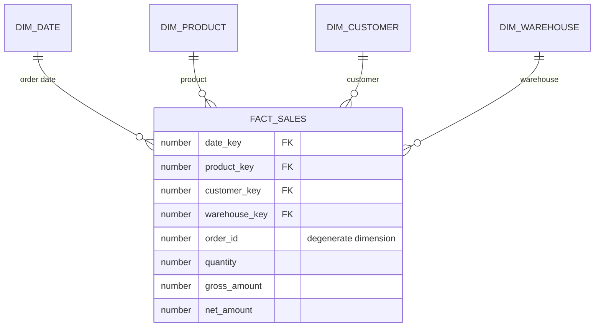
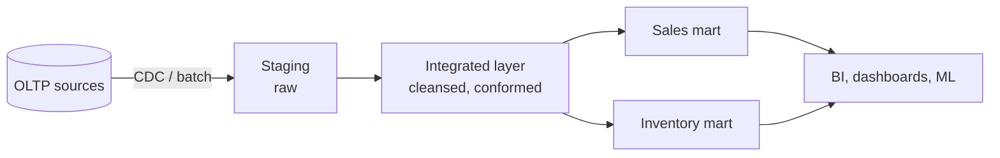

# 4.6 Data warehousing and analytics

!!! abstract "Chapter card"
    **Stage:** 4 · **Prerequisites:** 1.4, 2.4, 2.5, 4.5 · **Time:** 4 hours

## At a glance

| Subtopic | In one line |
|---|---|
| OLTP versus OLAP | Two workloads, two designs |
| Dimensional modeling | Facts, dimensions, grain |
| Star and snowflake schemas | Shapes of a dimensional model |
| Slowly changing dimensions | Types 0 to 7: keeping history |
| Data marts and architecture | Layers from source to report |
| Physical design | Partitioning, bitmap indexes, MVs, In-Memory, parallel query |
| Data lifecycle | History, archiving, retention |

## 1. OLTP versus OLAP

| | OLTP | OLAP / warehouse |
|---|---|---|
| Question | "Place this order" | "Revenue by category and city, by month" |
| Rows per statement | Few | Millions |
| Schema | Normalized (3NF) | Dimensional (star) |
| Indexes | B-tree on keys | Bitmap, few; scans and partition pruning |
| Concurrency | Thousands of short transactions | Tens of long queries |
| History | Current state | Years, with changes over time |
| Freshness | Now | Minutes to a day |

Running heavy analytics on the OLTP schema hurts both: queries fight
transactions, and the model has no history.

## 2. Dimensional modeling

**Fact table**: measurements of a business event (quantity, amount).
**Dimension tables**: the context (who, what, where, when).

Design steps (Kimball):

1. **Choose the business process**: order sales.
2. **Declare the grain**: one row per order line. *The most important decision.* Never mix grains in one fact table.
3. **Choose the dimensions**: date, product, customer, warehouse, promotion.
4. **Choose the facts**: quantity, gross amount, discount, net amount.



| Term | Meaning |
|---|---|
| **Surrogate key** | Warehouse-generated dimension key, independent of source keys; required for history |
| **Additive fact** | Can be summed across all dimensions (quantity, amount) |
| **Semi-additive** | Summable across some dimensions only (stock level: not across time) |
| **Non-additive** | Ratios and percentages: store the components, compute the ratio |
| **Degenerate dimension** | An identifier kept in the fact with no dimension table (`order_id`) |
| **Conformed dimension** | One dimension shared by several facts, so results can be compared |
| **Junk dimension** | Low-cardinality flags combined into one small dimension |
| **Role-playing dimension** | One dimension used several times (order date, ship date) |
| **Factless fact** | Records that an event happened (a promotion was active) |

| Fact table type | Grain | Example |
|---|---|---|
| Transaction | One row per event | Order line |
| Periodic snapshot | One row per period per entity | Daily stock per product and warehouse |
| Accumulating snapshot | One row per process instance, updated as milestones pass | Order: placed, packed, shipped, delivered dates |

## 3. Star and snowflake

| | Star | Snowflake |
|---|---|---|
| Dimensions | Denormalized: one table each (`dim_product` contains category and supplier names) | Normalized into sub-dimensions (`dim_product` → `dim_category`) |
| Joins | Fewer | More |
| Storage | Slightly more | Less |
| Ease of use | High | Lower |
| Choose | By default | Very large or shared hierarchies; when a tool requires it |

The date dimension is a table, not a function: it carries fiscal periods,
holidays, weekday names and flags that calculations cannot derive.

## 4. Slowly changing dimensions (SCD)

Customers move; products change category. How much history do you keep?

| Type | Technique | History | Use |
|---|---|---|---|
| **0** | Never change | Original value kept | Date of first purchase |
| **1** | Overwrite | None | Corrections of errors |
| **2** | Add a new row with validity dates and a current flag | Full | The standard for attributes you analyze by |
| **3** | Add a "previous value" column | One prior value | Before/after comparison of one reorganization |
| **4** | Current table + separate history table (or mini-dimension for fast-changing attributes) | Full, separated | Volatile attributes |
| **5** | 4 + a Type 1 reference to the current mini-dimension row | | |
| **6** | 1 + 2 + 3 combined: history rows that also carry the current value | Full, with easy "as is" reporting | Both "as was" and "as is" needed |
| **7** | Fact carries both the surrogate key (as was) and the durable key (as is) | Full, dual view | Same goal as 6, different mechanics |

### Type 2 example

`dim_customer` after Rahul moves from Mumbai to Pune on 2025-06-01:

| CUSTOMER_KEY | CUSTOMER_ID | NAME | CITY | VALID_FROM | VALID_TO | IS_CURRENT |
|---:|---:|---|---|---|---|---|
| 1 | 101 | Rahul Sharma | Mumbai | 2025-01-10 | 2025-05-31 | N |
| 7 | 101 | Rahul Sharma | Pune | 2025-06-01 | 9999-12-31 | Y |

Facts loaded before June carry key 1; later facts carry key 7. Sales by city
are then correct *as of the time of sale*.

```sql
-- Step 1: close the current row when a tracked attribute changed
UPDATE dim_customer d
SET    d.valid_to = TRUNC(SYSDATE) - 1, d.is_current = 'N'
WHERE  d.is_current = 'Y'
AND    EXISTS (SELECT 1 FROM stg_customers s
               WHERE  s.customer_id = d.customer_id AND s.city <> d.city);

-- Step 2: insert a new current row for changed and new customers
INSERT INTO dim_customer (customer_key, customer_id, name, city, valid_from, valid_to, is_current)
SELECT dim_customer_seq.NEXTVAL, s.customer_id, s.customer_name, s.city,
       TRUNC(SYSDATE), DATE '9999-12-31', 'Y'
FROM   stg_customers s
WHERE  NOT EXISTS (SELECT 1 FROM dim_customer d
                   WHERE  d.customer_id = s.customer_id AND d.is_current = 'Y');
```

Step 2 works because step 1 has just removed the "current" row for changed
customers. Run both in one transaction.

## 5. Architecture



| Term | Meaning |
|---|---|
| **Data warehouse** | Integrated, historical, subject-oriented store for the enterprise |
| **Data mart** | A subject-specific subset for one group (sales, finance) |
| **Kimball** (bottom-up) | Conformed dimensional marts form the warehouse |
| **Inmon** (top-down) | A normalized enterprise warehouse feeds marts |
| **Data Vault** | Hubs, links and satellites for auditable, agile integration |
| **Lakehouse** | Files in object storage with table formats (Iceberg), queried by engines including Oracle external tables |

## 6. Physical design in Oracle

| Technique | Role in a warehouse |
|---|---|
| **Partitioning** | Fact tables by date: pruning, rolling window load and purge by partition exchange |
| **Bitmap indexes** on fact foreign keys | Enable **star transformation**: bitmaps for each filtered dimension are combined before touching the fact table |
| **Bitmap join indexes** | Pre-join a dimension attribute to the fact |
| **Materialized views + query rewrite** | Summary tables the optimizer uses transparently |
| `RELY` constraints, dimensions (`CREATE DIMENSION`) | Tell the optimizer about keys and hierarchies without validation cost |
| **Parallel execution** | Scans, joins, loads |
| **Compression** | Advanced Row or Hybrid Columnar for history |
| **In-Memory column store** | Fast ad hoc aggregation; can replace many indexes and summaries |
| **Zone maps, attribute clustering** | Skip blocks by clustered value ranges (zone maps on Exadata) |
| **Analytic views** (12.2+) | A semantic layer: hierarchies and measures defined once in the database |
| Exadata Smart Scan, storage indexes | Push filtering to storage |

Bitmap indexes and star transformation are Enterprise Edition features, and
bitmap indexes belong on tables loaded in bulk, not on OLTP tables
([2.12](../indexing/01-indexing.md)).

### A star query

```sql
SELECT d.calendar_month, p.category_name, c.city,
       SUM(f.net_amount) AS revenue, SUM(f.quantity) AS units
FROM   fact_sales f
JOIN   dim_date     d ON d.date_key     = f.date_key
JOIN   dim_product  p ON p.product_key  = f.product_key
JOIN   dim_customer c ON c.customer_key = f.customer_key
WHERE  d.calendar_year = 2025
AND    p.category_name IN ('Dairy and Eggs', 'Staples')
GROUP  BY ROLLUP (d.calendar_month, p.category_name, c.city);
```

## 7. Data lifecycle

| Stage | Treatment |
|---|---|
| Hot (current year) | Full indexes, light compression, fast storage |
| Warm (1 to 3 years) | Heavier compression, read-only partitions, fewer indexes |
| Cold (older) | Archive compression, cheaper storage, or external/hybrid partitions on object storage |
| Expired | Dropped by partition, per retention policy |

Decide retention **per data class** with legal and business owners, automate it
(ADO policies, partition maintenance jobs), and keep summaries longer than
detail where that satisfies the need. For history of *changes* in OLTP tables,
use Flashback Data Archive or Type 2 dimensions rather than keeping every
source row forever.

## 8. Common mistakes

- No declared grain; a fact table mixing order-level and line-level rows.
- Natural keys as dimension keys, which makes Type 2 impossible.
- Summing semi-additive facts across time.
- Snowflaking everything out of OLTP habit.
- Bitmap indexes maintained row by row during trickle loads.
- A warehouse without reconciliation to its sources.

## FreshMart example

=== "Scenario"

    Marketing asks: revenue and units by category and month. Build the smallest
    star that answers it from the FreshMart OLTP data.

=== "SQL"

    ```sql
    CREATE TABLE dim_product AS
    SELECT p.product_id AS product_key, p.product_id, p.sku, p.product_name,
           c.category_name, s.supplier_name
    FROM   products p
    JOIN   categories c ON c.category_id = p.category_id
    JOIN   suppliers  s ON s.supplier_id = p.supplier_id;

    CREATE TABLE fact_sales AS
    SELECT TO_NUMBER(TO_CHAR(o.order_date, 'YYYYMMDD')) AS date_key,
           oi.product_id   AS product_key,
           o.customer_id   AS customer_key,
           o.warehouse_id  AS warehouse_key,
           o.order_id,
           oi.quantity,
           oi.line_total   AS gross_amount
    FROM   orders o
    JOIN   order_items oi ON oi.order_id = o.order_id
    WHERE  o.status <> 'CANCELLED';

    SELECT SUBSTR(f.date_key, 1, 6) AS month, d.category_name,
           SUM(f.quantity) AS units, SUM(f.gross_amount) AS revenue
    FROM   fact_sales f
    JOIN   dim_product d ON d.product_key = f.product_key
    GROUP  BY SUBSTR(f.date_key, 1, 6), d.category_name
    ORDER  BY month, revenue DESC;
    ```

=== "Result"

    | MONTH | CATEGORY_NAME | UNITS | REVENUE |
    |---|---|---:|---:|
    | 202503 | Staples | 1 | 650 |
    | 202503 | Dairy and Eggs | 8 | 614 |
    | 202503 | Fruits | 4 | 480 |
    | 202503 | Vegetables | 5 | 190 |
    | 202503 | Beverages | 1 | 150 |
    | 202503 | Bakery | 1 | 45 |
    | 202504 | Staples | 1 | 650 |
    | 202504 | Dairy and Eggs | 4 | 304 |
    | 202504 | Beverages | 2 | 270 |
    | 202504 | Fruits | 1 | 180 |
    | 202504 | Bakery | 3 | 135 |

    Derived by hand from the sample data; the per-category totals across both
    months match the verified figures (Staples 1300, Dairy and Eggs 918,
    Fruits 660, Beverages 420, Vegetables 190, Bakery 180; 19 fact rows).

=== "Takeaway"

    The fact table has 19 rows: the 20 order lines minus the cancelled order's
    line. This toy uses source ids as dimension keys; a real warehouse
    generates surrogate keys so that Type 2 history is possible, and allocates
    order-level discounts to lines so that net revenue is additive.

## Check yourself

??? question "Interview questions"
    1. **(Intermediate)** Fact versus dimension? Star versus snowflake?
    2. **(Senior)** Explain SCD Types 1, 2 and 3 with an example.
    3. **(Senior)** What is the grain and why does it matter?
    4. **(Principal)** How does star transformation work?
    5. **(Architect)** Warehouse, lakehouse, or analytics on the OLTP database with In-Memory? *Decide by data variety, history needs, concurrency and freshness: In-Memory/standby analytics for operational reporting on current data; a warehouse for integrated history with governance; lakehouse formats when open-file access by several engines is required. Many estates need two of the three.*

??? example "Exercises"
    1. Add `dim_date` (generated with `CONNECT BY`) and join it to the fact.
    2. Implement Type 2 for `dim_customer` and test a city change.
    3. Design a periodic snapshot fact for daily inventory. Which facts are semi-additive?

## Related

Next: [4.7 Oracle AI Database 26ai](../oracle-26ai/01-oracle-26ai.md).
