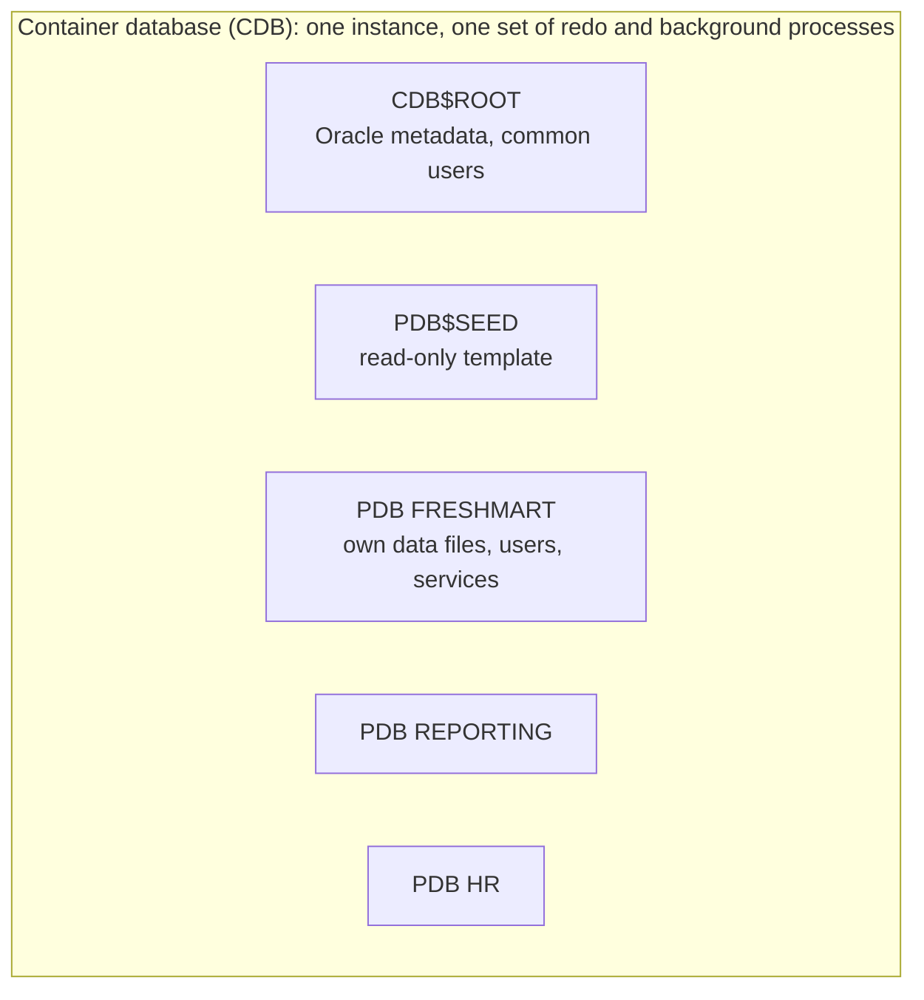

# 3.3 Administration and multitenant

!!! abstract "Chapter card"
    **Stage:** 3 · **Prerequisites:** 3.1, 3.2 · **Time:** 6 hours · **Applies to:** 19c+ (CDB-only from 21c)

## At a glance

| Subtopic | In one line |
|---|---|
| Tools | SQL*Plus, SQLcl, SQL Developer, DBCA, Enterprise Manager |
| Install, create, configure | Software, DBCA, parameters |
| Startup and shutdown | NOMOUNT → MOUNT → OPEN; shutdown modes |
| Multitenant | CDB, PDBs, common and local users |
| Users, roles, profiles | Accounts and password policy |
| Sessions and processes | Seeing and controlling what is connected |
| Scheduler | Jobs, windows, automatic maintenance |
| Diagnostics | Alert log, trace files, ADR, health checks |
| Patching, upgrade, cloning, migration | Keeping current and moving |

## 1. Tools

| Tool | Use |
|---|---|
| **SQL*Plus** | Classic command line; on every server |
| **SQLcl** (`sql`) | Modern command line: history, formatting (`SET SQLFORMAT`), Liquibase, Data Pump, scripting |
| **SQL Developer** (desktop and VS Code extension) | Graphical development and DBA tasks |
| **DBCA** | Create, configure, clone and delete databases (GUI or `-silent`) |
| **Enterprise Manager / OCI Database Management** | Fleet monitoring and administration |
| **RMAN**, **Data Pump**, **AutoUpgrade**, **opatch / datapatch** | Backup, logical movement, upgrades, patching |
| **srvctl / crsctl / dgmgrl** | Clusterware, RAC and Data Guard control |

## 2. Installation and database creation

1. Prepare the OS (packages, kernel parameters, users, HugePages); Oracle's preinstall RPM does most of it.
2. Install software into a new **Oracle home** (`ORACLE_HOME`). Homes are image-based and should be read-only where possible.
3. Create the database with **DBCA** using a template and a response file, so it is repeatable:

```bash
dbca -silent -createDatabase -templateName General_Purpose.dbc \
  -gdbName FMPRD -sid FMPRD -createAsContainerDatabase true \
  -numberOfPDBs 1 -pdbName FRESHMART -characterSet AL32UTF8 \
  -memoryPercentage 40 -storageType ASM -diskGroupName +DATA -recoveryGroupName +RECO \
  -enableArchive true
```

*Illustrative: verify flags with `dbca -help` for your release; passwords are prompted or supplied securely.*

Choices that are hard to change later: **character set** (use `AL32UTF8`),
block size, and for 19c the CDB-or-not decision (always choose CDB).

### Parameters

Parameters live in the **SPFILE** (binary, server-side).

```sql
SHOW PARAMETER sga_target
ALTER SYSTEM SET open_cursors = 500 SCOPE = BOTH;       -- now and after restart
ALTER SYSTEM SET processes = 1500 SCOPE = SPFILE;       -- static: needs restart
ALTER SYSTEM RESET optimizer_index_cost_adj SCOPE = SPFILE;
CREATE PFILE = '/tmp/init_backup.ora' FROM SPFILE;      -- readable copy
```

Change as few parameters as possible, record why, and never set underscore
(`_`) parameters without Oracle Support's direction.

## 3. Startup and shutdown

| Stage | What is read | What you can do |
|---|---|---|
| `STARTUP NOMOUNT` | Parameter file; instance (SGA, processes) starts | Create a database, restore a control file |
| `MOUNT` | Control file | Recovery, enable ARCHIVELOG, Data Guard operations |
| `OPEN` | Data files and redo logs | Normal use (`READ WRITE`, or `READ ONLY`) |

| Shutdown mode | Waits for sessions | Rolls back active transactions | Recovery at next start |
|---|---|---|---|
| `NORMAL` | Yes, indefinitely | n/a | No |
| `TRANSACTIONAL` | Until current transactions end | No | No |
| `IMMEDIATE` | No | Yes | No |
| `ABORT` | No | No | **Yes** (instance recovery) |

`SHUTDOWN IMMEDIATE` is the normal choice. `ABORT` is safe for data but should
be reserved for hangs and emergencies. In a CDB, PDBs do not open
automatically after a restart unless you saved their state:
`ALTER PLUGGABLE DATABASE ALL SAVE STATE;`. With Grid Infrastructure, start and
stop through `srvctl` so Clusterware knows the intended state.

## 4. Multitenant architecture



| Concept | Meaning |
|---|---|
| **CDB** | The container database: owns the instance, redo logs, control files, and (shared or per-PDB) undo |
| **CDB$ROOT** | Oracle-supplied metadata and common users. No application data |
| **PDB** | A self-contained set of schemas and data files that looks like a database to the application |
| **Application container** | An optional root for PDBs that share an application definition (SaaS) |
| **Common user** | Exists in every container; name starts with `C##` |
| **Local user** | Exists in one PDB (the normal application accounts) |
| **Local undo** | Each PDB has its own undo tablespace; required for hot clone, relocation and PDB flashback |

Why it exists: consolidate many databases onto one set of memory and processes,
patch and back up many as one, and provision or move a database in minutes.

```sql
SHOW CON_NAME
ALTER SESSION SET CONTAINER = freshmart;
SELECT con_id, name, open_mode, restricted FROM v$pdbs;

CREATE PLUGGABLE DATABASE fm_test ADMIN USER fm_admin IDENTIFIED BY "...";   -- from the seed
CREATE PLUGGABLE DATABASE fm_copy FROM freshmart;                            -- hot clone
CREATE PLUGGABLE DATABASE fm_dr   FROM freshmart@prod_link REFRESH MODE EVERY 60 MINUTES; -- refreshable clone
ALTER  PLUGGABLE DATABASE fm_test OPEN;
ALTER  PLUGGABLE DATABASE fm_test UNPLUG INTO '/u01/stage/fm_test.xml';
```

`DBA_*` views show the current container; `CDB_*` views (from the root) show all
containers with a `CON_ID` column.

**Licensing:** from 19c, up to **3 user-created PDBs** per CDB need no
Multitenant option; more requires it (Enterprise Edition). Check the current
licensing manual, since the rules differ by release and edition.

**Isolation controls per PDB:** Resource Manager shares and limits, memory
parameters (`SGA_TARGET`, `PGA_AGGREGATE_LIMIT` in the PDB), I/O limits
(`MAX_IOPS`, `MAX_MBPS`), **PDB lockdown profiles** (restrict features and
statements), and `PATH_PREFIX` for directory objects.

## 5. Users, roles, profiles

```sql
CREATE USER fm_app IDENTIFIED BY "..."
    DEFAULT TABLESPACE fm_data TEMPORARY TABLESPACE temp
    QUOTA 0 ON fm_data PROFILE app_profile ACCOUNT UNLOCK;

CREATE ROLE fm_app_role;
GRANT CREATE SESSION TO fm_app_role;
GRANT EXECUTE ON freshmart.order_pkg TO fm_app_role;
GRANT fm_app_role TO fm_app;

CREATE PROFILE app_profile LIMIT
    FAILED_LOGIN_ATTEMPTS 10  PASSWORD_LOCK_TIME 1/24
    PASSWORD_LIFE_TIME UNLIMITED            -- service account: rotate by process, not by expiry
    PASSWORD_VERIFY_FUNCTION ora12c_strong_verify_function
    IDLE_TIME 60 SESSIONS_PER_USER UNLIMITED;
```

Three account types to keep separate: the **schema owner** (owns objects; locked
or schema-only: `CREATE USER freshmart NO AUTHENTICATION`), the **application
user** (connects from the pool, has only execute/DML grants), and **named
personal accounts** for people. **Gradual database password rollover**
(`PASSWORD_ROLLOVER_TIME`, 19.12+/21c) lets old and new passwords both work
during a rotation. Privileges and security design: [3.5](../security/01-security.md).

## 6. Sessions and processes

```sql
SELECT sid, serial#, username, status, sql_id, event, blocking_session,
       machine, program, module, logon_time
FROM   v$session
WHERE  type = 'USER';
```

`STATUS = 'ACTIVE'` means running or waiting inside a call; `INACTIVE` means
idle between calls (normal for pooled connections). Limits: `SESSIONS`,
`PROCESSES`. Ending a session:

!!! danger "Killing sessions rolls back their work"
    ```sql
    ALTER SYSTEM KILL SESSION '123,45678' IMMEDIATE;
    ALTER SYSTEM DISCONNECT SESSION '123,45678' POST_TRANSACTION;   -- gentler
    ALTER SYSTEM CANCEL SQL '123,45678';                            -- 18c+: stop only the statement
    ```
    A killed transaction must roll back, which can take as long as it ran.
    Identify the session and get approval first
    ([runbook](../production-runbooks/01-instance-sessions-locks.md)).

Applications should set `MODULE`, `ACTION` and `CLIENT_IDENTIFIER`
(`DBMS_APPLICATION_INFO`, or JDBC end-to-end metrics) so that sessions and SQL
can be attributed.

## 7. Scheduler

```sql
BEGIN
    DBMS_SCHEDULER.CREATE_JOB(
        job_name        => 'PURGE_ABANDONED_CARTS',
        job_type        => 'PLSQL_BLOCK',
        job_action      => q'[BEGIN
                                 UPDATE carts SET status = 'ABANDONED'
                                 WHERE status = 'ACTIVE' AND created_at < SYSTIMESTAMP - INTERVAL '30' DAY;
                                 COMMIT;
                              END;]',
        start_date      => SYSTIMESTAMP,
        repeat_interval => 'FREQ=DAILY;BYHOUR=2;BYMINUTE=30',
        enabled         => TRUE,
        comments        => 'Marks carts idle for 30 days as abandoned');
END;
/
SELECT job_name, state, last_start_date, next_run_date, failure_count FROM user_scheduler_jobs;
SELECT log_date, status, error#, additional_info FROM user_scheduler_job_run_details
WHERE  job_name = 'PURGE_ABANDONED_CARTS' ORDER BY log_date DESC;
```

`DBMS_SCHEDULER` supports PL/SQL, stored procedures, external scripts, chains
(dependencies), event-based jobs, job classes tied to Resource Manager, and
**windows**. The **automatic maintenance tasks** (optimizer statistics, Segment
Advisor, SQL Tuning Advisor) run in the default maintenance windows: nightly on
weekdays and longer at weekends. `DBMS_JOB` is legacy.

## 8. Diagnostics: alert log, traces, ADR

The **Automatic Diagnostic Repository (ADR)** is a directory tree
(`DIAGNOSTIC_DEST`) holding the alert log, trace files, incident dumps and
health-check reports.

```sql
SELECT name, value FROM v$diag_info;
```

```bash
adrci> show homes
adrci> set home diag/rdbms/fmprd/FMPRD
adrci> show alert -tail 100 -f
adrci> show incident -mode brief
adrci> ips pack incident 12345 in /tmp        # package for Oracle Support
```

| Source | Contains |
|---|---|
| **Alert log** | Startup/shutdown, log switches, errors (`ORA-00600`, `ORA-07445`, `ORA-01555`, deadlocks), space problems, structural changes |
| **Trace files** | Per-process detail: deadlock graphs, SQL trace (10046), dumps |
| **Incidents** | Automatically captured critical errors |
| `V$DIAG_ALERT_EXT` | The alert log as a view |

Health tooling: **Health Monitor** (`DBMS_HM`), **ORAchk / EXAchk** and
**Autonomous Health Framework** (best-practice compliance), **Data Recovery
Advisor** (deprecated in 19c), `RMAN VALIDATE` for block checks.

## 9. Patching

| Patch type | Cadence | Content |
|---|---|---|
| **Release Update (RU)** | Quarterly | Security, regression and functional fixes; cumulative |
| **Monthly Recommended Patch (MRP)** | Monthly, on top of an RU | Recommended one-offs |
| One-off / merge | As needed | A specific bug |

Method: **out-of-place** patching. Install a new patched home, then switch the
database to it and run `datapatch` for the SQL changes. Rollback is switching
back. RAC and Data Guard allow **rolling** patching (standby-first). Tools:
`opatch`, `opatchauto`, **Fleet Patching and Provisioning** or
**Oracle Update Advisor / gold images** for fleets.

Policy that works: stay within one to two RUs of current; patch non-production
first; automate; record the patch level in the CMDB
(`SELECT * FROM dba_registry_sqlpatch`).

## 10. Upgrades

- **AutoUpgrade** (`autoupgrade.jar`) is the supported tool: `analyze` → `fixups` → `deploy`, with a guaranteed restore point for fallback.
- Direct upgrade to 23ai/26ai is supported **from 19c and 21c**. A 19c non-CDB is converted to a PDB during the process.
- Moving from 23ai to 26ai is applying a release update, not an upgrade.
- Protect performance: capture SQL plan baselines / a SQL tuning set before, keep `COMPATIBLE` at the old value until you are sure (raising it is irreversible and removes the downgrade and flashback path), gather dictionary and fixed-object statistics after.
- Low-downtime methods: transient logical standby (rolling upgrade, `DBMS_ROLLING`), GoldenGate, or unplug/plug and refreshable-clone upgrade of a PDB into a higher-release CDB.

## 11. Cloning and migration

| Method | Granularity | Downtime | Cross-platform / version | Notes |
|---|---|---|---|---|
| PDB hot clone / relocate | PDB | Near zero (relocate) | Same endian, same or higher release | Simplest in multitenant |
| RMAN `DUPLICATE` | Database / PDB | None on source | Same platform | Test systems, standby creation |
| Data Pump (`expdp`/`impdp`) | Schema, table, full | Proportional to size | Any | Also changes character set, reorganizes |
| Transportable tablespaces / full transportable export | Tablespaces | Short (incremental roll-forward with cross-platform incremental backups) | Cross-endian with conversion | Very large databases |
| Data Guard switchover | Database | Minutes | Same platform family | Hardware or site moves |
| GoldenGate | Tables | Near zero | Any | Most flexible, most work |
| Zero Downtime Migration (ZDM) | Database | Near zero | To Oracle Cloud / Exadata | Orchestrates the above |

## 12. Production recommendations

| DO | DON'T |
|---|---|
| Script every administrative change and keep it in version control | Click through GUIs in production |
| One purpose per PDB; services per workload | Share one schema-of-everything PDB without isolation |
| Save PDB state; test restart behavior | Discover after a reboot that PDBs stayed mounted |
| Patch quarterly, out-of-place | Run three years behind on RUs |
| Monitor the alert log automatically | Read it only after an outage |

## FreshMart example

=== "Scenario"

    A release needs a full-size copy of production to rehearse a schema
    migration. The team needs it today, and it must not affect production.

=== "Commands"

    ```sql
    -- On the test CDB, as a common user with CREATE PLUGGABLE DATABASE
    CREATE DATABASE LINK fm_prod_link
        CONNECT TO c##clone_user IDENTIFIED BY "..." USING 'FMPRD';

    CREATE PLUGGABLE DATABASE fm_rehearsal
        FROM freshmart@fm_prod_link
        PARALLEL 8;                       -- hot clone: source stays open read/write

    ALTER PLUGGABLE DATABASE fm_rehearsal OPEN;

    -- Before anyone connects: mask personal data (3.5) and repoint outbound integrations.
    ALTER SESSION SET CONTAINER = fm_rehearsal;
    ```

=== "Result"

    | Step | Outcome |
    |---|---|
    | Clone | Data files copied while production runs; redo applied to make the copy consistent |
    | Open | New PDB with its own services; production untouched |
    | Rehearse | Migration run and timed against real volumes |
    | Finish | `DROP PLUGGABLE DATABASE fm_rehearsal INCLUDING DATAFILES;` |

    Illustrative. Requirements: source in ARCHIVELOG mode with local undo, the
    `CREATE PLUGGABLE DATABASE` privilege on the link user, compatible
    character sets, and TDE keys handled if the source is encrypted.

=== "Takeaway"

    Multitenant turns "we need a production copy" from a multi-day restore into
    one statement. The step people forget is governance: a clone of production
    **is** production data until it has been masked.

## Check yourself

??? question "Interview questions"
    1. **(Intermediate)** The three startup stages and what each needs?
    2. **(Intermediate)** Difference between `SHUTDOWN IMMEDIATE` and `ABORT`?
    3. **(Senior)** Common user versus local user; when would you create a common user?
    4. **(Senior)** How do you patch with minimal downtime and a fast rollback?
    5. **(Architect)** You inherit 300 databases on six releases. Strategy? *Standardize on long-term releases and a small set of gold images, consolidate into CDBs by service tier, automate patching by fleet tooling, and set a policy for maximum patch age with exception tracking.*

??? example "Exercises"
    1. Create a PDB from the seed, open it, save its state, and drop it.
    2. Create a profile that locks an account after 5 failed logins and test it.
    3. Create a scheduler job that inserts a heartbeat row every minute; check its run history; drop it.
    4. Find the last 20 `ORA-` errors in your alert log using `V$DIAG_ALERT_EXT`.

## Related

Next: [3.4 Backup and recovery](../backup-recovery/01-backup-recovery.md).
Runbooks: [PDB, patching, upgrades](../production-runbooks/05-pdb-patching-upgrade.md).
