# 4.9 Database DevOps and automation

!!! abstract "Chapter card"
    **Stage:** 4 · **Prerequisites:** 3.3, 4.8 · **Time:** 4 hours

## At a glance

| Subtopic | In one line |
|---|---|
| Database as code | Everything in Git: schema, code, configuration, reference data |
| Migration tools | Flyway, Liquibase, SQLcl projects |
| Zero-downtime schema change | Expand, migrate, contract; online DDL; EBR |
| Pipelines | Build, test, review, deploy, verify |
| Testing | Unit, integration, data, performance |
| Rollback strategies | Roll forward, restore points, compatibility |
| Environments | Containers, clones, test data |
| Infrastructure as code | Terraform, Ansible, Kubernetes operator |
| Operations automation | Monitoring, alerting, backups, health checks |

## 1. Principles

1. **One source of truth.** The repository defines the database; production is a deployed version of it.
2. **No manual changes.** People do not run DDL in production. Pipelines do.
3. **Small, frequent, reversible changes** beat large, rare, risky ones.
4. **The database and the application release independently**, which requires backward-compatible changes.
5. **State is the difference.** Code can be redeployed; data cannot be rebuilt. Every practice below exists because of that.

## 2. What goes in Git

```text
db/
  migration/        V001__baseline.sql, V002__add_delivery_slots.sql ...   (versioned, immutable)
  repeatable/       R__views.sql, R__order_pkg.sql                         (re-applied on change)
  reference-data/   categories.sql (idempotent MERGE)
  tests/            utPLSQL packages
  config/           parameters per environment (no secrets)
  runbooks/         operational procedures
```

Secrets never go in Git: use a vault (OCI Vault, HashiCorp Vault, Kubernetes
secrets with an external store) and Oracle wallets.

## 3. Migration tools

| | Flyway | Liquibase | SQLcl projects |
|---|---|---|---|
| Model | Ordered SQL files, checksum table `flyway_schema_history` | Changelogs (SQL, XML, YAML) with changesets, `DATABASECHANGELOG` | Oracle's project workflow built on Liquibase, exporting and packaging schema objects |
| Rollback | Undo scripts (paid tiers) | Rollback blocks per changeset | Via Liquibase |
| Strength | Simple, SQL-first | Preconditions, contexts, diff, drift detection | Native Oracle object handling |

**Migration-based** (the files above) describes each step. **State-based**
tools compare a desired model with the target and generate the difference;
convenient, but generated DDL for stateful objects must always be reviewed
(a renamed column looks like a drop and an add).

Guidelines: one logical change per migration; idempotent where the release
allows (`IF NOT EXISTS`, 23ai+); never edit a released migration; PL/SQL and
views as repeatable scripts (`CREATE OR REPLACE`); record who and what in the
history table.

## 4. Zero-downtime schema change

### Expand, migrate, contract

Renaming `customers.phone` to `mobile_phone` without stopping the application:

| Phase | Database | Application |
|---|---|---|
| 1. Expand | `ALTER TABLE customers ADD (mobile_phone VARCHAR2(20));` plus a trigger or virtual column to keep both in sync | Old version keeps using `phone` |
| 2. Migrate | Backfill in batches | Deploy a version that writes both, reads new |
| 3. Switch | | All instances on the new version |
| 4. Contract | Drop sync trigger; `SET UNUSED` then drop `phone` | |

Each phase is a separate release, and at every moment both the previous and the
current application versions work.

### Online operations

| Change | Online method |
|---|---|
| Create or rebuild an index | `CREATE INDEX ... ONLINE` (EE) |
| Add a column with default | Metadata-only |
| Add a constraint | `ENABLE NOVALIDATE`, then `VALIDATE` |
| Move, compress, partition a table | `ALTER TABLE ... MOVE ONLINE`, `MODIFY PARTITION BY ... ONLINE` |
| Restructure a table | `DBMS_REDEFINITION` |
| Avoid blocking DDL failures | `DDL_LOCK_TIMEOUT` |
| Test an index safely | Invisible index |

### Edition-Based Redefinition (EBR)

EBR lets two versions of PL/SQL, views and synonyms exist at once in different
**editions**. Sessions of the old application use the old edition; new sessions
use the new one. Tables are not editioned, so they are accessed through
**editioning views**, with **cross-edition triggers** keeping old and new
column representations in step during the rollout. EBR is included in all
editions. It is the only way to replace PL/SQL under a running application
without invalidation errors; it also takes real design effort, so adopt it for
systems that truly cannot stop.

## 5. A pipeline

```mermaid
flowchart LR
    PR[Pull request] --> L[Lint and static checks<br>naming, forbidden statements]
    L --> B[Build ephemeral DB<br>container or PDB clone]
    B --> M[Apply all migrations]
    M --> T[utPLSQL + integration tests]
    T --> R[Review: DBA approval for flagged changes]
    R --> S[Deploy to staging<br>production-sized clone]
    S --> P[Performance and lock-impact check]
    P --> A[Approval gate]
    A --> D[Deploy to production<br>restore point, migrate, verify]
    D --> V[Post-deploy checks<br>invalid objects, smoke tests, metrics]
```



Automated checks worth having:

| Check | Catches |
|---|---|
| Migration applies cleanly to an empty database **and** to a copy of production | Order and data-dependent failures |
| Lint: no `DROP`/`TRUNCATE` without an annotation, no `GRANT ... TO PUBLIC`, constraints named, no `SELECT *` in views | Policy violations |
| Blocking-DDL detector on a full-size copy | Hours-long locks |
| Invalid object count is zero after deploy | Broken dependencies |
| Plan regression check (SQL Performance Analyzer or a plan-hash diff of key statements) | Performance regressions |
| Drift detection: production equals the repository | Manual changes |

**Approvals**: automate the routine and reserve human review for flagged
classes of change (destructive DDL, large-table rewrites, privilege changes,
changes to tier-1 tables). Record the approval with the deployment.

## 6. Testing

| Level | Tool | Scope |
|---|---|---|
| Unit | utPLSQL | Packages and functions; runs in a rolled-back transaction |
| Integration | Testcontainers with the Oracle Free image | Application + real Oracle, per build |
| Migration | Pipeline | Empty → latest; previous release → latest |
| Data quality | SQL assertions in CI and in production monitoring | Orphans, duplicates, totals |
| Performance | Load tests on production-like volume; Database Replay | Regressions under concurrency |
| Recovery | Scheduled restore tests | Backups work |

Test on **Oracle**, not on an in-memory substitute: H2's "Oracle mode" shares
neither the optimizer, the locking nor the SQL dialect.

## 7. Rollback strategies

| Strategy | When | Notes |
|---|---|---|
| **Roll forward** (fix with a new migration) | Default | The only option once new data depends on the change |
| Backward-compatible change + application rollback | Most releases | The database stays; the old application still works. This is why expand/contract matters |
| Scripted down-migration | Simple, data-free changes | Must be tested like any code |
| **Guaranteed restore point + Flashback Database** | High-risk releases in a maintenance window | Loses all data written since; only before traffic resumes |
| PDB clone or snapshot before change | Smaller systems | Same data-loss caveat |
| Edition switch back | EBR systems | Instant for code |

Decide the rollback plan **before** deploying, and state the point of no
return (usually: first production write under the new schema).

## 8. Environments

| Need | Option |
|---|---|
| Developer database | Oracle Free container; one per developer; rebuilt from migrations |
| CI database | Container per build, or a PDB cloned from a prepared golden PDB |
| Realistic test data | Masked and subset production clones (PDB snapshot clones are fast and thin) |
| Refresh | Refreshable PDB clone, RMAN duplicate, Data Pump |

```yaml
# docker-compose.yml for local development
services:
  db:
    image: container-registry.oracle.com/database/free:latest
    environment:
      ORACLE_PWD: ${ORACLE_PWD}
    ports: ["1521:1521"]
    volumes: ["oradata:/opt/oracle/oradata"]
volumes:
  oradata:
```

## 9. Infrastructure as code

| Tool | Manages |
|---|---|
| **Terraform** (OCI, AWS, Azure providers) | Networks, compute, Autonomous and Base/Exadata database services, Data Guard associations, backups policies |
| **Ansible** (and Oracle's collections) | OS preparation, software installation, patching, database and PDB configuration |
| **Oracle Database Operator for Kubernetes** | Lifecycle of single-instance, RAC, sharded, Autonomous and PDB resources from Kubernetes |
| Fleet Patching and Provisioning / gold images | Standard homes and patch levels |
| DBCA response files, RMAN and `dgmgrl` scripts | Repeatable creation |

```hcl
# Illustrative: verify resource arguments against the current OCI provider docs
resource "oci_database_autonomous_database" "freshmart" {
  compartment_id           = var.compartment_id
  db_name                  = "FRESHMART"
  db_workload              = "OLTP"
  compute_model            = "ECPU"
  compute_count            = 4
  data_storage_size_in_tbs = 1
  admin_password           = var.admin_password      # from a vault, never in code
  is_auto_scaling_enabled  = true
}
```

**Databases on Kubernetes**: reasonable for development, test and stateless-
friendly services; for tier-1 production, the usual pattern is applications on
Kubernetes and databases on dedicated database platforms (or a managed
service), provisioned through the operator or Terraform.

**Configuration management**: keep initialization parameters, profiles,
resource plans and audit policies as code; detect drift by comparing
`V$PARAMETER` and dictionary views with the baseline on a schedule.

## 10. Operations automation

| Area | Automate |
|---|---|
| Monitoring | Availability, lag, space, sessions, top SQL, backup status; metrics to Prometheus/Grafana (Oracle Database Observability Exporter), Enterprise Manager, or OCI Database Management |
| Alerting | Actionable alerts with a runbook link; alert on symptoms users feel (latency, errors) and on leading indicators (space trend, lag) |
| Backups | Scheduled, verified, with restore tests reported |
| Health checks | ORAchk/AHF, invalid objects, unusable indexes, failed jobs, stale statistics, expiring certificates and passwords |
| Patching | Out-of-place, fleet tooling, standby-first |
| Capacity | Trend reports and forecasts |
| Self-service | PDB provisioning, clone-on-demand, access requests with expiry |

## 11. Common mistakes

- "Just this once" manual hotfixes that are never back-ported to the repository.
- Editing an applied migration.
- Coupled releases that need application and database changed at the same second.
- Destructive changes in the same release as the code that stops using the object.
- Tests on a different database engine.
- Rollback plans that assume no data was written.
- Alerts nobody can act on.

## FreshMart example

=== "Scenario"

    The team must add a mandatory `delivery_slot_id` to `orders`, which has 80
    million rows, while the site stays up and two application versions overlap
    during the rolling deploy.

=== "Release plan"

    | Release | Migration | Application |
    |---|---|---|
    | R1 | `V031`: create `delivery_slots`; `ALTER TABLE orders ADD (delivery_slot_id NUMBER(10));` (nullable, metadata-only); FK added `ENABLE NOVALIDATE`; index created `ONLINE` | v1 ignores the column |
    | R2 | none | v2 writes `delivery_slot_id` for new orders |
    | R3 | `V032`: backfill old rows in batches of 10,000 with commits and a progress table (restartable); `VALIDATE` the FK | v2 |
    | R4 | `V033`: `ALTER TABLE orders MODIFY (delivery_slot_id NOT NULL)` after verifying zero nulls | v2 only |

=== "Pipeline gates"

    | Gate | Evidence |
    |---|---|
    | `V031` on a full-size clone | Lock held under 1 second |
    | Backfill rehearsal | 80M rows in 40 minutes, redo rate within archive capacity, standby lag under 30 s |
    | R4 precondition | `SELECT COUNT(*) FROM orders WHERE delivery_slot_id IS NULL` = 0, enforced as a Liquibase/Flyway precondition or callback |
    | Rollback | R1 to R3: application rollback only. R4: drop the `NOT NULL` |

    Illustrative timings.

=== "Takeaway"

    Four small releases instead of one outage. The mandatory column became
    mandatory only after every writer and every row complied, and each step
    had a rollback that did not involve restoring data.

## Check yourself

??? question "Interview questions"
    1. **(Senior)** Migration-based versus state-based schema management?
    2. **(Senior)** Describe expand, migrate, contract.
    3. **(Principal)** What is Edition-Based Redefinition and when is it worth it?
    4. **(Principal)** How do you roll back a database release after users have written data?
    5. **(Architect)** How do you introduce database CI/CD to 30 teams with manual processes? *Start with version control and a shared pipeline template; make the paved road easier than the manual path; baseline existing schemas; add drift detection; move approvals from tickets to policy-as-code with exceptions; measure lead time and change failure rate.*

??? example "Exercises"
    1. Put the FreshMart schema under Flyway: baseline plus one new migration.
    2. Write the batched, restartable backfill for `delivery_slot_id`.
    3. Write three lint rules you would enforce and the SQL or regex that implements each.

## Related

You have finished Stage 4. Next: [Stage 5](../getting-started/stage-5.md).
