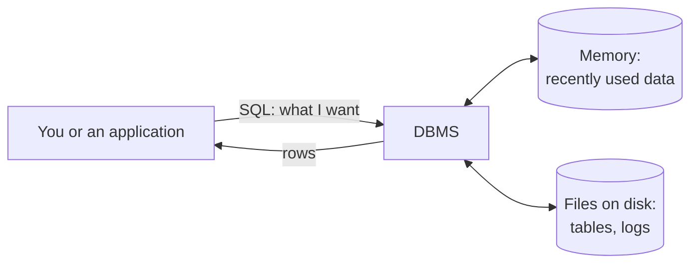

# 1.1 Data, databases and the RDBMS

!!! abstract "Chapter card"
    **Stage:** 1 · **Prerequisites:** none · **Time:** 2 hours · **Applies to:** all releases

## 1. Overview

**Data** is a recorded fact: `180`, `Apple`, `2025-03-01`. On its own a fact
means little. **Information** is data with context: *"Rahul bought 2 kg of
apples for 180 rupees a kilo on 1 March 2025."*

A **database** is an organized collection of data that is stored so it can be
found, changed and trusted. A **database management system (DBMS)** is the
software that stores the data and answers requests for it. A **relational DBMS
(RDBMS)** stores data in tables and lets you ask questions in **SQL**.

**Oracle Database** is an RDBMS. Others include PostgreSQL, MySQL, SQL Server
and Db2. The relational ideas in Stage 1 apply to all of them; the Oracle
internals from Stage 3 onward do not.

## 2. Why databases exist

Imagine FreshMart keeps orders in a spreadsheet shared by 50 employees.

| Problem with files | What it looks like | How a DBMS solves it |
|---|---|---|
| **Redundancy** | The customer's address is typed on every order row | Store the address once, refer to it by key |
| **Inconsistency** | The address is updated on some rows and not others | One copy, so nothing to disagree |
| **No concurrent access** | Two people save the file; one person's work is lost | Transactions and locking |
| **No integrity rules** | Someone types a quantity of `-5` or a product that does not exist | Constraints reject bad data |
| **No security** | Anyone who can open the file sees all customers' phone numbers | Privileges per user and per object |
| **No crash safety** | Power fails halfway through saving: the file is corrupt | Logging and recovery |
| **Slow search** | Finding one order means scanning the whole file | Indexes and a query optimizer |

A DBMS exists to give you four guarantees that files cannot: data is **shared**
safely, **correct** according to rules, **durable** after a crash, and
**findable** quickly.

## 3. How it works (beginner view)



1. You send a SQL statement that says **what** you want, not how to get it.
2. The DBMS checks that the statement is valid and that you are allowed to run it.
3. Its **optimizer** decides how to fetch the rows (which index, which order).
4. It reads the data, mostly from memory, and from disk when needed.
5. For changes, it first writes a **log record**, so the change survives a crash.

This separation is called **data independence**:

- **Physical data independence**: the DBA can move files, add an index or
  repartition a table, and your SQL keeps working unchanged.
- **Logical data independence**: a column can be added to a table, or a view
  placed in front of it, without breaking programs that do not use the change.

### The three-level (ANSI/SPARC) view

| Level | Who sees it | FreshMart example |
|---|---|---|
| **External** (views) | One user or application | The delivery app sees order, address, phone, nothing else |
| **Conceptual / logical** | Designers and developers | Tables `customers`, `orders`, `order_items` and their relationships |
| **Internal / physical** | The DBMS and DBAs | Data blocks, files, indexes, partitions |

## 4. Types of database systems

| Type | Data shape | Typical use | Examples |
|---|---|---|---|
| Relational | Tables with fixed columns | Business transactions, reporting | Oracle, PostgreSQL, MySQL |
| Document | JSON documents | Flexible content, catalogs | MongoDB; Oracle JSON collections |
| Key-value | Key and opaque value | Caches, sessions | Redis |
| Graph | Nodes and edges | Fraud rings, recommendations | Neo4j; Oracle property graphs |
| Column store | Columns stored together | Analytics | Oracle In-Memory, Snowflake |
| Vector | Embeddings | Semantic search | Oracle AI Vector Search |

Oracle calls itself a **converged database**: relational is the core, and JSON,
graph, spatial, text and vector are data types and features inside the same
engine. Chapter [4.7](../oracle-26ai/01-oracle-26ai.md) covers when those
extensions are worth using.

### OLTP and OLAP

| | OLTP (transaction processing) | OLAP (analytics) |
|---|---|---|
| Example | "Place order 1009" | "Revenue by category, last 3 years" |
| Statement | Short, touches a few rows | Long, reads millions of rows |
| Users | Thousands, concurrent | Tens |
| Design | Normalized | Star schema (chapter [4.6](../data-warehousing/01-data-warehousing.md)) |

## 5. Vocabulary you need from day one

| Term | Meaning | FreshMart example |
|---|---|---|
| **Table** | A named set of rows with the same columns | `customers` |
| **Row** (record) | One item | The row for Rahul Sharma |
| **Column** (field) | One property with one data type | `email` |
| **Primary key** | Column(s) whose value identifies exactly one row | `customer_id = 101` |
| **Foreign key** | Column that points to a primary key in another table | `orders.customer_id` |
| **Schema** | In Oracle: the set of objects owned by one database user | `FRESHMART` |
| **Data dictionary** (catalog) | Tables the database keeps about itself (metadata) | `USER_TABLES` |
| **Instance** | The running Oracle program: memory plus processes | Chapter [3.1](../oracle-architecture/01-architecture.md) |

### Try it: the database describes itself

```sql
SELECT table_name FROM user_tables ORDER BY table_name;

SELECT column_name, data_type, nullable
FROM   user_tab_columns
WHERE  table_name = 'CUSTOMERS'
ORDER  BY column_id;
```

Illustrative output of the second query (first rows):

| COLUMN_NAME | DATA_TYPE | NULLABLE |
|---|---|---|
| CUSTOMER_ID | NUMBER | N |
| CUSTOMER_NAME | VARCHAR2 | N |
| EMAIL | VARCHAR2 | N |
| PHONE | VARCHAR2 | Y |

**Metadata** is data about data. The dictionary views come in three families:
`USER_*` (objects you own), `ALL_*` (objects you can access) and `DBA_*`
(everything, needs privilege).

## 6. Common mistakes

- **Thinking "database" means "one big table".** A database is many related tables.
- **Confusing the database with the DBMS.** Oracle Database is the software; your database is the data it manages.
- **Treating a spreadsheet habit as a design.** Columns like `product1`, `product2`, `product3` are the first thing normalization removes (chapter [1.4](../data-modeling/02-normalization.md)).
- **Assuming a schema is the same in every DBMS.** In Oracle a schema equals a user; in PostgreSQL and SQL Server it is a namespace inside a database.

## 7. Check yourself

??? question "Interview questions"
    1. **(Beginner)** What is the difference between data and information? *Data is raw facts; information is data placed in context so that it answers a question.*
    2. **(Beginner)** Name four problems of file-based storage that a DBMS solves. *Redundancy, inconsistency, concurrent access, integrity, security, crash recovery: any four.*
    3. **(Intermediate)** What is physical data independence? Give an example. *Changing storage without changing SQL, for example adding an index.*
    4. **(Senior)** Is an Oracle schema a user? *A schema is the collection of objects owned by a user; they share a name. From 23ai a user can be created with no authentication (schema-only account) purely to own objects.*
    5. **(Architect)** When would you not choose a relational database? *When the access pattern is a pure key lookup at extreme scale with no joins or cross-row consistency needs, or the data has no stable structure. Even then, weigh the cost of running a second database technology.*

??? example "Exercises"
    1. List three facts FreshMart must store about a product and say which are data and which become information when combined.
    2. Run `SELECT COUNT(*) FROM user_tables;`. What does 20 tell you? *The FreshMart schema owns 20 tables.*
    3. Find the data type of `orders.total_amount` using the data dictionary.
       ```sql
       SELECT data_type, data_precision, data_scale
       FROM   user_tab_columns
       WHERE  table_name = 'ORDERS' AND column_name = 'TOTAL_AMOUNT';
       ```
       *NUMBER, 12, 2.*

## 8. Related

Next: [1.2 The relational model](02-relational-model.md).
