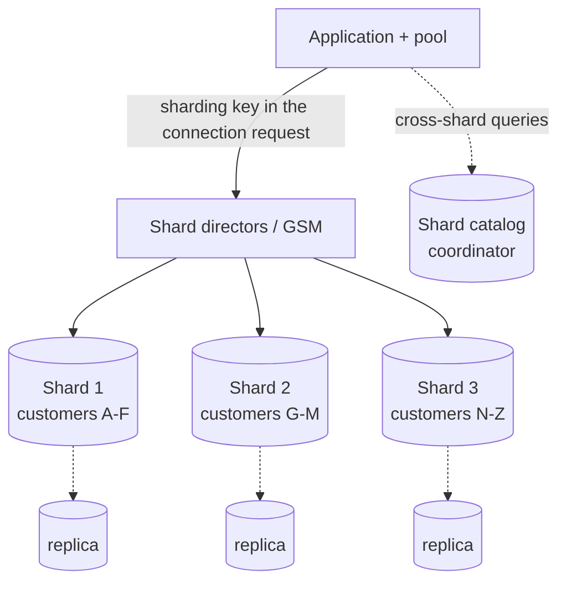

# 4.3 Distributed databases and sharding

!!! abstract "Chapter card"
    **Stage:** 4 · **Prerequisites:** 2.11, 4.2 · **Time:** 5 hours

## At a glance

| Subtopic | In one line |
|---|---|
| Why distribute | Scale, locality, isolation, sovereignty |
| CAP and PACELC | The trade-offs no product removes |
| Distributed queries and transactions | Database links, two-phase commit, XA |
| Sharding | Horizontal partitioning across databases |
| Microservice data design | Database-per-service and its consequences |
| Saga, outbox, idempotency | Consistency without distributed transactions |
| Event-driven integration | Change events as the interface |

## 1. Why, and at what cost

| Reason to distribute | Example |
|---|---|
| Scale beyond one database | Billions of rows of write-heavy data |
| Geographic latency | Users on three continents |
| Fault isolation | One tenant's failure must not affect others |
| Data sovereignty | Indian customer data stays in India |
| Organizational autonomy | Teams release independently |

The cost is always the same: you give up some of **single-database ACID**.
Joins, constraints and transactions that were free inside one database become
network calls, application code and operational procedures. Distribute because
a requirement forces it, not because it is fashionable.

## 2. CAP and PACELC

**CAP:** when a network **P**artition happens, a distributed system must choose
between **C**onsistency (refuse some requests) and **A**vailability (answer,
possibly with stale or conflicting data).

**PACELC** adds the everyday case: **E**lse (no partition), choose between
**L**atency and **C**onsistency. Synchronous replication is consistent and
slower; asynchronous is fast and may be stale.

| Oracle configuration | During a partition | Normally |
|---|---|---|
| Data Guard Maximum Protection | Consistency (primary stops) | Consistency, pays latency |
| Data Guard Maximum Availability | Availability (primary continues unprotected) | Consistency, pays latency |
| Data Guard ASYNC | Availability | Latency (replica lags) |
| GoldenGate active-active | Availability at both sites | Latency; conflicts resolved later |
| Raft-replicated shards (23ai+) | Consistency (majority side continues) | Consistency within the replication unit |

Cross-region physics: a round trip between distant regions is tens to hundreds
of milliseconds. A design that needs a synchronous cross-region call per
transaction has a latency floor no tuning removes.

## 3. Distributed queries and transactions

A statement that touches a remote table through a **database link** is a
distributed query; the optimizer decides which parts run remotely. Changes at
more than one database form a distributed transaction committed with
**two-phase commit** ([2.11](../transactions/01-transactions-concurrency.md)).

| Role | Meaning |
|---|---|
| Global coordinator | The database (or transaction manager) where the transaction started |
| Commit point site | The participant that commits first; never enters the prepared state |
| **XA** | The standard interface for an external transaction manager (JTA) to coordinate several resources |

2PC properties: atomic across participants, but **blocking** (participants hold
locks while in doubt), slower (extra round trips and forced log writes) and
available only when *all* participants are. Use it inside a tightly coupled
system when you must. Do not build service-to-service integration on it.

## 4. Sharding

**Sharding** splits one logical database horizontally into many independent
databases (**shards**) by a **sharding key**. Oracle's implementation is
*Oracle Sharding*, named **Oracle Globally Distributed Database** from 23ai.



| Concept | Meaning |
|---|---|
| **Sharded table** | Rows distributed by the sharding key |
| **Table family** | Parent and children sharded by the same key so that related rows share a shard (customer, orders, order items) |
| **Duplicated table** | Small reference table copied to every shard (products, categories) |
| **Shard catalog** | Holds the topology and coordinates DDL and cross-shard queries |
| **Shard director** | Routes a connection to the right shard from the key |
| **Chunk** | Unit of data movement when rebalancing |

| Method | Distribution | Use |
|---|---|---|
| System-managed | Consistent hash | Even spread, simple |
| User-defined | Explicit range or list | Sovereignty: India's customers in India |
| Composite | List/range, then hash | Regions, each hashed |
| Directory-based (23ai+) | A mapping table | Arbitrary placement, tenant moves |

Replication per shard: Data Guard, GoldenGate, or **Raft replication**
(:material-tag: **23ai+**): consensus-based, with automatic sub-second-range
failover and no data loss within a replication unit.

**What you gain:** linear write scaling, fault isolation (one shard down
affects only its customers), geographic placement.

**What you pay:** every OLTP request must carry the sharding key; cross-shard
queries are slower and cross-shard transactions should be rare; global unique
constraints only on the sharding key; changing the key later is a
re-architecture; operations multiply by the number of shards.

Choose the key so that **nearly all transactions touch one shard**. For a
consumer application that is usually the customer or tenant.

## 5. Microservices and data

**Database-per-service**: each service owns its data and nobody else reads its
tables. Benefits: independent releases, clear ownership, a failure boundary.

| "Database per service" can mean | Isolation | Cost |
|---|---|---|
| A schema per service in one PDB | Logical (privileges) | Lowest |
| A PDB per service in a shared CDB | Strong: own services, resource plan, clone and restore | Low: the practical default on Oracle |
| A CDB or server per service | Complete | Highest |

Consequences to design for:

| Lost | Replacement |
|---|---|
| Joins across services | API composition, or a read model built from events |
| Foreign keys across services | Reference by id; handle "not found"; periodic reconciliation |
| One ACID transaction across services | Sagas |
| A single reporting database | A warehouse or lake fed by change events |

Split services along **transaction boundaries**. If two "services" must always
change together atomically, they are one service.

## 6. Sagas

A **saga** is a sequence of local transactions. Each step commits on its own;
if a later step fails, **compensating** transactions undo the earlier ones.

| Step | Service | Action | Compensation |
|---|---|---|---|
| 1 | Order | Create order `PENDING` | Mark `CANCELLED` |
| 2 | Inventory | Reserve stock | Release reservation |
| 3 | Payment | Charge | Refund |
| 4 | Order | Mark `PLACED` | |

| Style | Coordination | Trade-off |
|---|---|---|
| **Choreography** | Each service reacts to events | Loose coupling; flow is hard to see |
| **Orchestration** | A coordinator tells each service what to do | Visible flow; coordinator is a dependency |

Sagas give **eventual** consistency and no isolation: other requests can see
the intermediate `PENDING` state, so model those states explicitly. Oracle
offers saga support in the database (`DBMS_SAGA`, :material-tag: **23ai+**) and
MicroTx as a transaction manager; lock-free reservations give automatic
compensation for numeric reservations.

## 7. The outbox pattern

Problem: a service must update its database **and** publish an event. Doing
both directly is a dual write; a crash between them loses or invents an event.

Solution: write the event into an **outbox table in the same local
transaction**, then relay it.

```sql
CREATE TABLE outbox_events (
    event_id       RAW(16)        DEFAULT SYS_GUID() PRIMARY KEY,
    aggregate_type VARCHAR2(50)   NOT NULL,
    aggregate_id   VARCHAR2(50)   NOT NULL,
    event_type     VARCHAR2(50)   NOT NULL,
    payload        VARCHAR2(4000) NOT NULL CHECK (payload IS JSON),
    created_at     TIMESTAMP      DEFAULT SYSTIMESTAMP NOT NULL,
    published_at   TIMESTAMP
);

-- Inside the order transaction:
INSERT INTO outbox_events (aggregate_type, aggregate_id, event_type, payload)
VALUES ('ORDER', :order_id, 'OrderPlaced',
        JSON_OBJECT('orderId' VALUE :order_id, 'customerId' VALUE :customer_id, 'total' VALUE :total));
COMMIT;      -- order and event are atomic
```

Relay options: a poller using `FOR UPDATE SKIP LOCKED`; log-based CDC
(GoldenGate, Debezium) reading the outbox from redo; or **Transactional Event
Queues** (TxEventQ), where enqueue is part of the transaction and a Kafka-
compatible API is available, so the queue itself is the outbox.

Delivery is **at least once**. Therefore:

## 8. Idempotency

An operation is **idempotent** if performing it twice has the same effect as
once. Retries, redelivery and failover replays make this mandatory.

| Technique | Example |
|---|---|
| Idempotency key with a unique constraint | `payments.txn_reference` is unique: a retried payment insert fails cleanly instead of charging twice |
| Processed-message table | Consumer inserts `event_id`; `DUP_VAL_ON_INDEX` means "already done" |
| Conditional state transition | `UPDATE orders SET status = 'PACKED' WHERE order_id = :id AND status = 'PLACED'` |
| Absolute, not relative, updates | "set quantity to 5" instead of "add 1" where possible |

## 9. Event-driven integration

| Approach | Coupling | Notes |
|---|---|---|
| Shared database / tables | Tightest | Every schema change is a cross-team negotiation |
| Database links | Tight | Hidden runtime dependency |
| Synchronous APIs | Runtime | Availability multiplies |
| Events (outbox, CDC, TxEventQ, Kafka) | Loose | Eventual consistency; needs schema governance for events |

Treat event schemas as public contracts: version them, evolve them compatibly,
and never expose raw table structure as the contract if you can avoid it.

## 10. Common mistakes

- Sharding to fix a problem that indexing, partitioning or a bigger server would solve.
- A sharding key that most queries do not carry.
- Microservices sharing one schema "for now".
- Distributed transactions between services.
- Dual writes without an outbox.
- Consumers that are not idempotent.
- Ignoring the read side: no plan for reporting across services.

## FreshMart example

=== "Scenario"

    FreshMart splits into three services: **Order**, **Inventory**,
    **Payment**. Checkout must never charge a customer without stock, never
    hold stock forever, and must survive any service being down for a minute.

=== "Design"

    ```mermaid
    sequenceDiagram
        participant C as Client
        participant O as Order svc (PDB orders)
        participant I as Inventory svc (PDB inventory)
        participant P as Payment svc (PDB payments)
        C->>O: POST /orders (Idempotency-Key)
        O->>O: TX: insert order PENDING + outbox OrderCreated
        O-->>I: OrderCreated
        I->>I: TX: conditional reserve + outbox StockReserved / StockRejected
        I-->>P: StockReserved
        P->>P: TX: charge (unique txn_reference) + outbox PaymentSucceeded / Failed
        P-->>O: PaymentSucceeded
        O->>O: TX: status PLACED
        Note over I,P: On PaymentFailed: Inventory releases the reservation, Order -> CANCELLED
    ```

=== "Rules"

    | Concern | Decision |
    |---|---|
    | Atomicity per step | Local transaction + outbox row |
    | Duplicate events | Each consumer records `event_id` under a unique constraint |
    | Duplicate client requests | `Idempotency-Key` header stored unique on `orders` |
    | Stuck sagas | A timeout job cancels `PENDING` orders older than 15 minutes and emits compensation |
    | Customer view | The UI shows "confirming your order" for `PENDING` |
    | Reporting | Events feed the warehouse; no cross-service joins online |

=== "Takeaway"

    The single `order_pkg.place_order` transaction of the monolith became four
    local transactions, three event types, a timeout job and an extra order
    state. That is the real price of the split. For FreshMart's scale the
    monolith's single transaction is the better design until team size or
    release independence, not load, forces the change.

## Check yourself

??? question "Interview questions"
    1. **(Senior)** Explain two-phase commit and its main weakness.
    2. **(Senior)** What is the outbox pattern and what problem does it solve?
    3. **(Principal)** How do you choose a sharding key?
    4. **(Principal)** Saga versus distributed transaction?
    5. **(Architect)** When is sharding justified over a single scaled-up database with Data Guard? *When write volume or data size exceeds what one database can serve with headroom, when regulation requires data placement by geography, or when fault isolation per tenant group is a requirement; and only if the workload has a key that keeps transactions on one shard.*

??? example "Exercises"
    1. Classify FreshMart tables as sharded (by customer), duplicated, or problematic. *`inventory` is the problem: it is keyed by warehouse, not customer.*
    2. Write the consumer-side SQL that makes handling `StockReserved` idempotent.
    3. List the compensations for each step of the checkout saga.

## Related

Next: [4.4 Scalability features](../performance-engineering/04-scalability-features.md).
