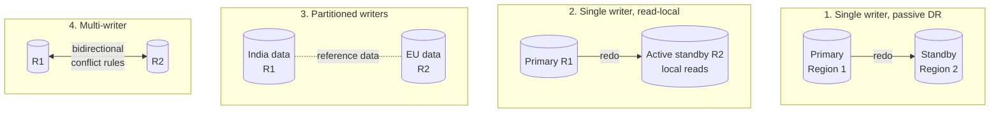
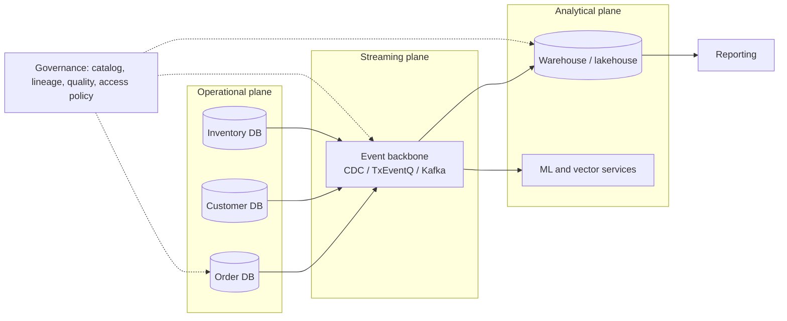

# 5.2 Global and multi-region architecture

!!! abstract "Chapter card"
    **Stage:** 5 · **Prerequisites:** 4.1 to 4.3, 5.1 · **Time:** 5 hours

## At a glance

| Subtopic | In one line |
|---|---|
| Drivers | Latency, availability, sovereignty, scale |
| Patterns | Single-writer, read-local, partitioned-writer, multi-writer |
| Data placement | Classify data by where it may live and who writes it |
| Consistency trade-offs | What users see when regions disagree |
| Sovereignty and compliance | Residency as an architectural constraint |
| Enterprise data platform | Operational, analytical and streaming planes |
| Business continuity | Beyond the database |
| Capacity forecasting | From business drivers to resources |

## 1. Why go multi-region

| Driver | Question to ask before accepting it |
|---|---|
| Latency for distant users | Is the latency in the database, or in pages, APIs and assets that a CDN and regional app tier would fix? |
| Regional disaster recovery | Is a passive standby enough? |
| Data residency law | Which data, exactly, and does it cover backups, logs and support access? |
| Scale | Has a single region with the techniques of Stage 4 really been exhausted? |
| Market or contractual requirement | What does the contract literally require? |

Multi-region multiplies cost and failure modes. Most systems that claim to
need active-active across regions need a **regional application tier with one
write region and a fast, tested failover**.

## 2. Patterns

| Pattern | Technology | Consistency | Complexity | Fits |
|---|---|---|---|---|
| 1. Single writer, passive DR | Data Guard | Strong | Low | The default |
| 2. Single writer, read-local | Active Data Guard, True Cache | Strong writes; slightly stale reads | Low to medium | Read-heavy global audiences |
| 3. Partitioned writers | Sharding (user-defined or composite), or separate regional databases | Strong within a partition | Medium to high | Sovereignty; users mostly act on their own region's data |
| 4. Multi-writer | GoldenGate active-active | Eventual; conflicts | High | Rare: continuous operation with writes anywhere |

Choose the lowest-numbered pattern that satisfies the requirement.

## 3. Data placement

Classify every entity on two axes.

| Class | Example | Placement |
|---|---|---|
| **Global reference**, rarely changes | Product catalog, tax tables | One writer; copied everywhere (duplicated tables, read replicas) |
| **Regional**, owned by one region | Customers, orders, payments of that region | Stored and written in that region only |
| **Global, frequently written** | A worldwide inventory pool, a global account balance | The hard case: one home region with latency for others, or redesign into regional allocations |
| **Derived** | Search indexes, analytics | Rebuilt per region from events |

The third class decides the architecture. Redesign it away where possible:
allocate stock per region and rebalance asynchronously; give each customer a
home region.

**Data ownership**: every entity has exactly one system and one region
authorized to change it. Everything else holds a copy. Write this down as a
table; it is the most useful artefact of a distributed design.

## 4. Consistency and what users see

| Situation | Effect | Mitigation |
|---|---|---|
| Read from a lagging replica after a write | "My change disappeared" | Route the session to the primary for a short time after writes; `STANDBY_MAX_DATA_DELAY`; wait for a known SCN |
| Regional failover with ASYNC replication | The last seconds of commits are missing | Reconciliation process; idempotent client retries; honest RPO in the SLA |
| Concurrent edits in two write regions | One edit is discarded by a rule | Ownership partitioning; show conflicts to users for important data |
| Cross-region transaction | High latency or partial failure | Sagas with visible intermediate states |
| Partition between regions | Each side must refuse or diverge | Decide per operation: block (payments) or accept and reconcile (browsing, carts) |

State these behaviors in product terms and get them approved by the business.
"Eventually consistent" is not a requirement anyone can test.

## 5. Sovereignty and compliance architecture

| Requirement type | Architectural consequence |
|---|---|
| **Residency**: data at rest must stay in a jurisdiction | Regional databases or sovereignty-aware sharding; backups, standbys, logs and test copies stay there too |
| **Access**: only staff in the jurisdiction may access | Regional operations, Database Vault realms, sovereign cloud regions, customer-held keys |
| **Transfer**: export allowed only under conditions | Tokenize or aggregate before data leaves; legal basis recorded per flow |
| **Erasure and retention** | Deletion must reach replicas, warehouses, archives; retention enforced by partition lifecycle |
| **Auditability** | Immutable audit trail per region, time-synchronized |

Keep a **data flow register**: for each flow between regions or systems, the
data classes, legal basis, protection and owner. An architect who cannot draw
where personal data travels has not finished the design.

Global analytics over sovereign data: aggregate or anonymize in-region, then
combine; or use federated queries that return only aggregates.

## 6. The enterprise data platform

| Plane | Purpose | Design concern |
|---|---|---|
| Operational | Run the business | Integrity, latency, availability |
| Streaming | Move facts between systems | Contracts, ordering, replay |
| Analytical | Understand the business | History, integration, cost |
| Governance | Make data trustworthy and lawful | Ownership, catalog, lineage, quality, policy |

A platform is these four with clear ownership, not a single product.

## 7. Business continuity

The database is one link. A continuity plan covers:

| Element | Question |
|---|---|
| Dependencies | DNS, identity provider, key management, payment gateway, messaging: do they fail over too, and in what order? |
| Runbooks and authority | Who can declare a disaster at 03:00? |
| Capacity at the surviving site | Can it carry peak, including batch? |
| Data reconciliation | How are transactions lost in the RPO window identified and handled with customers? |
| Degraded modes | What can the business do with the database read-only, or with yesterday's data? |
| Communication | Customers, regulators, staff |
| Return to normal | Failback, and running unprotected meanwhile |

**RTO/RPO design** starts from business impact analysis: cost per hour of
outage and per minute of lost data, by business process. Tier systems (for
example Tier 1: RTO 15 min / RPO 0; Tier 2: 4 h / 15 min; Tier 3: 24 h / 24 h)
and give each tier a standard architecture ([4.1](../high-availability/03-ha-dr-architecture.md)).

## 8. Capacity forecasting

1. **Find the business drivers**: customers, orders per customer, lines per order, retention years.
2. **Derive unit costs** from measurement: CPU seconds, logical reads, redo bytes and storage bytes per order (AWR ÷ business volume).
3. **Project** drivers under scenarios (base, high, launch of a new region).
4. **Convert** to peak resource demand, using peak-to-average ratios from history, not averages.
5. **Add headroom** for failure (N+1), for growth lead time (procurement or quota), and for uncertainty.
6. **Track** forecast against actuals quarterly and correct the model.

| Resource | Forecast from |
|---|---|
| CPU | Peak AAS on CPU ÷ cores; target below 60 to 70% at peak |
| Memory | SGA/PGA advisories at projected data and session counts |
| Storage | Row growth × row size × (1 + index ratio) ÷ compression, plus backups and archive logs |
| Redo and network | Redo rate at peak determines archive space, standby bandwidth and replication lag |
| Connections | Application instances × pool size, per service |

Worked numbers: [FreshMart scaling](../grocery-application/05-scaling.md).

## 9. Common mistakes

- Active-active across regions for a problem a CDN solves.
- A global write hot spot left in the model.
- Residency rules applied to the primary and forgotten for backups, standbys, logs and support exports.
- Consistency behavior undefined, discovered by customers.
- DR for the database only.
- Forecasting from average load.

## FreshMart example

=== "Scenario"

    FreshMart expands from India to the UAE and the UK. Indian and UK law
    require local storage of customer personal data. Customers shop only in
    their own country. The catalog differs by country but is managed centrally.

=== "Design"

    | Data | Class | Placement |
    |---|---|---|
    | Customers, addresses, orders, payments, carts, reviews | Regional, owned by country | One database per country region (Mumbai, Dubai, London), each with an in-country standby |
    | Inventory, warehouses, stock movements | Regional | With the country's orders |
    | Master product definitions, categories, suppliers | Global reference | Authored in Mumbai, replicated one-way to each region; country-specific price and availability stored regionally |
    | Analytics | Derived | Aggregated in-region; anonymized aggregates sent to a central warehouse |

    Pattern 3 (partitioned writers) with separate regional databases. Sharding
    was considered and rejected: no cross-country transactions exist, three
    partitions do not justify a shard catalog, and separate databases keep
    blast radius and legal boundaries simple.

=== "Consequences"

    | Topic | Decision |
    |---|---|
    | A customer who moves country | New account in the new region; data export on request. Accepted by the business |
    | Global reporting | Daily anonymized aggregates; no row-level cross-border queries |
    | Operations | One automation code base, three deployments; regional on-call for access-restricted data |
    | DR | In-country standby (RPO 0) plus encrypted backups in-country |
    | Cost | About 3x the single-region platform, partly offset by smaller regional sizes |

=== "Takeaway"

    The legal constraint and the fact that customers never transact across
    borders made the simplest partitioned design correct. The interesting
    decision was the one **not** taken: no global database, no multi-writer
    replication.

## Check yourself

??? question "Interview questions"
    1. **(Principal)** Name four multi-region data patterns and when each fits.
    2. **(Principal)** What makes "global, frequently written" data hard, and how do you design it away?
    3. **(Architect)** How does a data residency rule affect backups, DR and support processes?
    4. **(Architect)** How do you explain eventual consistency to a product owner?
    5. **(Architect)** A regulator asks you to prove that no personal data leaves the country. What evidence do you produce? *A data flow register, network and replication topology showing in-country targets only, key management and access logs, backup and standby locations, audit reports of exports, and controls (and their tests) preventing cross-border replication.*

??? example "Exercises"
    1. Classify the 20 FreshMart tables into the four placement classes.
    2. Write the consistency behaviors users see during a regional failover of the 3.9 design.
    3. Build a capacity model spreadsheet from three drivers of a system you know.

## Related

Next: [5.3 Strategy, governance and ADRs](02-strategy-governance.md).
