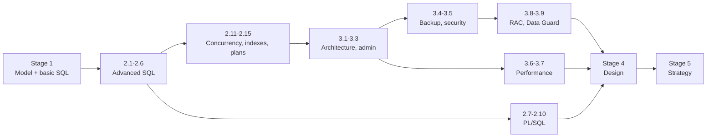

# Study plan: one chapter after another

This is the single reading order for the whole playbook. Work top to bottom.
Do not skip ahead: each chapter assumes the ones above it.

!!! tip "The rule that makes this work"
    A chapter is **done** only when you have (1) typed its examples yourself,
    (2) answered its exercises without looking, and (3) completed the lab linked
    at the end of the stage. Reading alone does not count.

## Before you start (half a day)

- [ ] [How to read a chapter](how-to-use.md)
- [ ] [Set up your lab database](setup.md) and install FreshMart
- [ ] Skim [Versions, editions and licensing](versions.md) (you will come back to it)

## Stage 1 · Foundations (about 3 to 4 weeks, 1 hour a day)

For someone who has never used a database. Goal: understand what a relational
database is and write correct basic SQL.

| # | Chapter | You learn | Hours |
|---|---|---|---:|
| 1.1 | [Data, databases and the RDBMS](../database-fundamentals/01-data-and-databases.md) | Why databases exist, what Oracle is | 2 |
| 1.2 | [The relational model](../database-fundamentals/02-relational-model.md) | Tables, keys, relational algebra | 3 |
| 1.3 | [Data modeling and ER diagrams](../data-modeling/01-data-modeling.md) | Entities, relationships, cardinality | 3 |
| 1.4 | [Normalization](../data-modeling/02-normalization.md) | 1NF to 5NF, anomalies | 3 |
| 1.5 | [SELECT: reading data](../sql-fundamentals/01-select.md) | Filtering, sorting, limiting | 3 |
| 1.6 | [NULL, expressions and functions](../sql-fundamentals/02-null-and-functions.md) | Three-valued logic, string/date/number functions | 3 |
| 1.7 | [DDL: tables and data types](../sql-fundamentals/03-ddl.md) | CREATE, ALTER, DROP, TRUNCATE | 2 |
| 1.8 | [DML and transactions basics](../sql-fundamentals/04-dml-and-transactions.md) | INSERT, UPDATE, DELETE, COMMIT | 3 |
| 1.9 | [Constraints and data integrity](../sql-fundamentals/05-constraints.md) | PK, FK, UNIQUE, CHECK | 2 |
| 1.10 | [Basic joins and aggregates](../sql-fundamentals/06-joins-and-aggregates.md) | INNER/LEFT JOIN, GROUP BY | 4 |
| 1.11 | [Your first index](../sql-fundamentals/07-first-index.md) | What an index is and when it helps | 1 |

**Checkpoint:** [Stage 1 labs](../hands-on-labs/01-stage-1.md) and the
[0-years interview bank](../interview-preparation/01-level-0.md).
Then read FreshMart [business analysis](../grocery-application/01-business-analysis.md)
and [data model](../grocery-application/02-data-model.md).

## Stage 2 · Developer (about 8 weeks)

Goal: write any query the business asks for, write maintainable PL/SQL, and
design tables that stay fast.

| # | Chapter | Hours |
|---|---|---:|
| 2.1 | [Joins in depth](../advanced-sql/01-joins.md) | 3 |
| 2.2 | [Subqueries and set operators](../advanced-sql/02-subqueries-set-operators.md) | 3 |
| 2.3 | [CTEs and hierarchical queries](../advanced-sql/03-cte-hierarchical.md) | 3 |
| 2.4 | [Advanced aggregation and PIVOT](../advanced-sql/04-aggregation-pivot.md) | 3 |
| 2.5 | [Window functions](../advanced-sql/05-window-functions.md) | 5 |
| 2.6 | [MERGE, Top-N, pagination, JSON](../advanced-sql/06-merge-topn-json.md) | 4 |
| 2.7 | [PL/SQL fundamentals](../plsql/01-fundamentals.md) | 4 |
| 2.8 | [Cursors, collections, bulk SQL](../plsql/02-cursors-collections-bulk.md) | 5 |
| 2.9 | [Procedures, packages, triggers](../plsql/03-subprograms-packages-triggers.md) | 5 |
| 2.10 | [Exceptions, dynamic SQL, advanced](../plsql/04-exceptions-dynamic-advanced.md) | 4 |
| 2.11 | [Transactions and concurrency](../transactions/01-transactions-concurrency.md) | 5 |
| 2.12 | [Indexing](../indexing/01-indexing.md) | 5 |
| 2.13 | [Partitioning](../partitioning/01-partitioning.md) | 4 |
| 2.14 | [Views, MVs and other objects](../database-objects/01-database-objects.md) | 3 |
| 2.15 | [Execution plans and SQL tuning](../performance-engineering/01-execution-plans.md) | 6 |

**Checkpoint:** [Stage 2 labs](../hands-on-labs/02-stage-2.md),
[5-years bank](../interview-preparation/02-level-5.md),
[coding challenges](../interview-preparation/06-coding-challenges.md).
Then FreshMart [implementation](../grocery-application/03-implementation.md) and
[business queries](../grocery-application/04-business-queries.md).

## Stage 3 · Senior DBA (about 10 weeks)

Goal: operate a production database. You need DBA access to a lab database.

| # | Chapter | Hours |
|---|---|---:|
| 3.1 | [Oracle architecture](../oracle-architecture/01-architecture.md) | 6 |
| 3.2 | [Storage management](../storage-management/01-storage.md) | 4 |
| 3.3 | [Administration and multitenant](../database-administration/01-administration.md) | 6 |
| 3.4 | [Backup and recovery](../backup-recovery/01-backup-recovery.md) | 8 |
| 3.5 | [Security](../security/01-security.md) | 6 |
| 3.6 | [Optimizer, statistics, SPM](../performance-engineering/02-optimizer-statistics-spm.md) | 6 |
| 3.7 | [AWR, ASH and wait analysis](../performance-engineering/03-awr-ash-waits.md) | 6 |
| 3.8 | [RAC, Clusterware and ASM](../high-availability/01-rac-asm.md) | 5 |
| 3.9 | [Data Guard](../high-availability/02-data-guard.md) | 5 |

**Checkpoint:** [Stage 3 labs](../hands-on-labs/03-stage-3-5.md),
[10-years bank](../interview-preparation/03-level-10.md), all
[runbooks](../production-runbooks/index.md) and the
[performance incidents](../performance-incidents/01-incidents.md).

## Stage 4 · Principal (about 8 weeks)

Goal: design systems, not just operate them.

| # | Chapter | Hours |
|---|---|---:|
| 4.1 | [HA and DR architecture](../high-availability/03-ha-dr-architecture.md) | 4 |
| 4.2 | [GoldenGate and replication](../high-availability/04-goldengate-replication.md) | 4 |
| 4.3 | [Distributed databases and sharding](../distributed-databases/01-distributed.md) | 5 |
| 4.4 | [Scalability features](../performance-engineering/04-scalability-features.md) | 4 |
| 4.5 | [Data movement and integration](../data-integration/01-data-integration.md) | 4 |
| 4.6 | [Data warehousing](../data-warehousing/01-data-warehousing.md) | 4 |
| 4.7 | [Oracle AI Database 26ai](../oracle-26ai/01-oracle-26ai.md) | 5 |
| 4.8 | [Spring Boot and Oracle](../spring-boot-integration/01-spring-boot.md) | 5 |
| 4.9 | [Database DevOps](../database-devops/01-devops.md) | 4 |

**Checkpoint:** [15-years bank](../interview-preparation/04-level-15.md),
FreshMart [scaling](../grocery-application/05-scaling.md) and
[production architecture](../grocery-application/06-architecture.md),
[production standards](../standards/01-standards.md).

## Stage 5 · Architect (about 4 weeks)

Goal: make and defend decisions that last five years.

| # | Chapter | Hours |
|---|---|---:|
| 5.1 | [Cloud, Exadata and Autonomous](../cloud-database/01-cloud.md) | 4 |
| 5.2 | [Global and multi-region architecture](../enterprise-architecture/01-global-architecture.md) | 5 |
| 5.3 | [Strategy, governance and ADRs](../enterprise-architecture/02-strategy-governance.md) | 5 |

**Checkpoint:** [20-years bank](../interview-preparation/05-level-20.md). Write
your own architecture decision record for a system you know.

## If you are not starting from zero

| You are | Start at | But first confirm |
|---|---|---|
| A developer who writes SQL daily | Stage 2 | You can pass the Stage 1 labs in under an hour |
| A DBA moving toward performance work | 2.11, 2.12, 2.15, then Stage 3 | You can read a plan from 2.15 |
| An architect new to Oracle | 3.1, 3.3, then Stages 4 and 5 | The [glossary](../glossary/index.md) holds no surprises |

## Dependency map

