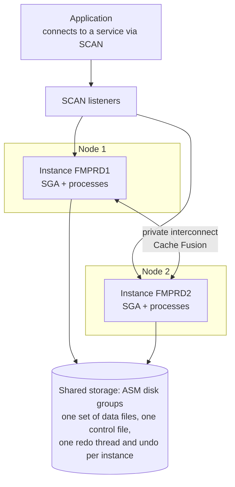

# 3.8 RAC, Clusterware and ASM

!!! abstract "Chapter card"
    **Stage:** 3 (sections 1 to 6), 4 (sections 7 to 9) · **Prerequisites:** 3.1, 3.2 · **Time:** 5 hours ·
    :material-license: RAC is an Enterprise Edition option (not available on SE2 from 19c)

## At a glance

| Subtopic | In one line |
|---|---|
| Oracle RAC | Several instances on several servers open one database |
| Grid Infrastructure | Clusterware (membership, resources) plus ASM (storage) |
| Cache Fusion | Instances ship blocks to each other over the interconnect |
| Services | How workloads are placed, balanced and failed over |
| Application continuity | Hiding failures from applications |
| ASM | Volume manager and file system built for Oracle files |
| RAC internals and tuning | Global cache waits, contention patterns |

## 1. What RAC is, and is not



**RAC protects against** server and instance failure, and allows rolling
maintenance of servers and (for most patches) of the database software.
**RAC scales** by adding nodes, for workloads that scale.

**RAC does not protect against** storage failure, site loss, data corruption or
human error: all instances share one database. That is Data Guard's job
([3.9](02-data-guard.md)). RAC is a high-availability and scalability feature,
not a disaster-recovery feature.

## 2. Grid Infrastructure

| Component | Role |
|---|---|
| **Oracle Clusterware** | Decides which nodes are cluster members; starts, monitors and relocates resources (instances, listeners, services, VIPs) |
| **Voting disks** | Tie-breaker for membership. A node that cannot reach the majority is evicted to prevent **split brain** |
| **OCR** (Oracle Cluster Registry) | Cluster configuration and resource definitions |
| **Private interconnect** | Dedicated low-latency network for heartbeats and block transfers. Redundant, never shared with public traffic |
| **VIP** | A virtual IP per node that fails over, so clients get an immediate error instead of a TCP timeout |
| **SCAN** | Single Client Access Name: one DNS name resolving to three listeners; clients never list nodes |
| **ASM** | Shared storage (section 6) |

```bash
crsctl check cluster -all
crsctl stat res -t
srvctl status database -d FMPRD
srvctl config scan
olsnodes -n -s
```

## 3. Cache Fusion

Each instance has its own buffer cache. When instance 2 needs a block that
instance 1 holds, instance 1 **ships the block over the interconnect** instead
of making instance 2 read it from disk.

| Service | Process | Coordinates |
|---|---|---|
| **GCS** (Global Cache Service) | LMS | Which instance holds which block in which mode |
| **GES** (Global Enqueue Service) | LMD, LMON, LCK | Locks and dictionary resources across instances |
| **GRD** (Global Resource Directory) | In each SGA | The bookkeeping; rebuilt (*reconfiguration*) when membership changes |

Each instance also has its own **redo thread** and **undo tablespace**. When an
instance fails, a surviving instance performs its recovery from its redo; there
is a short *brown-out* while the GRD is remastered.

## 4. Services and load balancing

A **service** names a workload. Applications connect to services, never to
instances.

```bash
srvctl add service -db FMPRD -service fm_oltp   -preferred FMPRD1,FMPRD2 \
       -failovertype AUTO -commit_outcome TRUE -notification TRUE -drain_timeout 120
srvctl add service -db FMPRD -service fm_batch  -preferred FMPRD2 -available FMPRD1
srvctl start service -db FMPRD -service fm_oltp
```

*Illustrative: check `srvctl add service -help` for your release.*

| Mechanism | What it does |
|---|---|
| Preferred / available instances | Where a service normally runs and where it may fail over |
| Connect-time load balancing | SCAN listeners send new connections to the least-loaded instance |
| Run-time load balancing | The advisory tells connection pools which instance to prefer |
| **FAN** (Fast Application Notification) | Events ("instance down", "service planned down") pushed to pools so they react in seconds |
| **Draining** | Planned maintenance stops handing out connections from an instance and lets work finish |

Running different workloads on different instances (OLTP on node 1, batch on
node 2) is called **workload isolation / affinity** and avoids most global
cache contention.

## 5. Hiding failures from applications

| Feature | Covers | Notes |
|---|---|---|
| TAF (Transparent Application Failover) | Reconnect; resume `SELECT` fetches | Legacy OCI feature; in-flight transactions are lost |
| **Application Continuity (AC)** | Replays the in-flight request, including uncommitted DML, on a surviving instance | EE with RAC or Active Data Guard licence. Needs a supporting pool (UCP, recent drivers) and request boundaries |
| **Transparent Application Continuity (TAC)** | Same, with automatic request boundary detection | 19c+, `failovertype AUTO` |
| **Transaction Guard** | Tells the application reliably whether the last commit succeeded | Prevents duplicate submissions after an outage |

With FAN, draining and TAC configured, rolling patching and node failures are
invisible to users. Without them, RAC still fails over, but applications see
errors.

## 6. ASM

**Automatic Storage Management** is a volume manager and file system for Oracle
files. It stripes files across all disks of a **disk group** and optionally
mirrors them.

| Concept | Meaning |
|---|---|
| **Disk group** | A pool of disks, for example `+DATA`, `+RECO` |
| **Redundancy** | `EXTERNAL` (storage array protects), `NORMAL` (2 copies), `HIGH` (3 copies), `FLEX` / `EXTENDED` |
| **Failure group** | Disks that share a failure mode (same controller, same site). Mirror copies go to different failure groups |
| **Rebalance** | Adding or dropping a disk redistributes data online. `ASM_POWER_LIMIT` sets its speed |
| **ASM instance** | A small instance that manages metadata; database I/O goes straight to disk. **Flex ASM** lets databases use an ASM instance on another node |
| **ACFS** | A general-purpose cluster file system on ASM |

```sql
SELECT name, type, total_mb, free_mb, usable_file_mb, offline_disks FROM v$asm_diskgroup;
SELECT group_number, operation, state, power, est_minutes FROM v$asm_operation;
```

`USABLE_FILE_MB` is the number to alert on: free space after reserving enough
to restore redundancy when a failure group is lost. Use `asmcmd` (`lsdg`,
`lsdsk`, `ls`, `du`) for file-level work. ASM is also the usual choice for
single-instance databases on Oracle Restart.

## 7. RAC performance and internals

| Wait event | Meaning | Common cause |
|---|---|---|
| `gc cr request` / `gc current request` | Waiting for a block from another instance | Normal in small amounts |
| `gc buffer busy acquire / release` | Many local sessions want the same block being transferred | Hot blocks: right-growing indexes, small hot tables |
| `gc cr/current block lost` | Blocks dropped on the interconnect | Network problem: fix immediately |
| `gc current block busy`, `... congested` | Remote instance slow to respond | LMS starved of CPU, log flush delay |

Patterns and remedies:

- **Right-hand index contention** (sequence keys inserted from all nodes): hash-partition the index, use scalable sequences (`SCALE`), raise sequence `CACHE`, or route that workload to one instance.
- **Hot small tables**: service affinity; fewer rows per block.
- **Full scans and parallel query** across instances: keep parallel servers on one instance (`PARALLEL_FORCE_LOCAL`) unless designed otherwise.
- **Interconnect**: 10/25 GbE or better, jumbo frames, redundant, private. Measure block transfer times in the AWR "Global Cache" sections; sub-millisecond is the expectation.

An application that does not scale on one large server will not scale on RAC:
RAC adds cross-instance coordination to whatever contention already exists.

## 8. Variants and related options

| Option | What it is |
|---|---|
| **RAC One Node** | One active instance that can relocate online to another node: HA and rolling maintenance without active-active |
| **Extended (stretched) cluster** | Nodes in two nearby sites with ASM mirroring between them: survives a site loss without failover, within latency limits (tens of km) |
| **Standard Edition High Availability** | Cold failover for SE2 with Clusterware (19c+) |
| **Oracle Restart** | Grid Infrastructure for a single server: restarts components, provides ASM |
| **RAC on Exadata / cloud** | Engineered interconnect (RDMA), smart storage |
| **Rolling patching** | Most RUs can be applied one node at a time with the service available |

## 9. When RAC is justified

| Justified | Not justified |
|---|---|
| A server failure must not cause more than seconds of interruption | A few minutes of failover is acceptable (Data Guard or cold failover is simpler) |
| Maintenance must be rolling | A maintenance window exists |
| The workload exceeds the largest practical single server and partitions well across instances | The workload fits one server; "more nodes" is assumed to be faster |
| The team can operate Clusterware | No clusterware skills and no support budget |

RAC adds licence cost, operational complexity and new failure modes
(evictions, interconnect faults). Start from the availability requirement, not
from the technology.

## FreshMart example

=== "Scenario"

    FreshMart at 10 million customers has an availability target of 99.95% and
    patches quarterly. A single database server failure currently means a
    Data Guard failover of about two minutes plus application reconnects.
    Should it move to RAC?

=== "Analysis"

    | Question | Answer |
    |---|---|
    | Peak load versus one server | About 60% of a 32-core server: no scalability need |
    | Yearly downtime budget at 99.95% | 4.4 hours |
    | Current unplanned failover | 2 minutes, perhaps twice a year |
    | Planned patching today | 4 × 20 minutes with Data Guard standby-first switchover |
    | With 2-node RAC | Server failure: seconds with TAC. Patching: rolling, no outage |
    | Cost | RAC option on all cores, Grid Infrastructure skills, shared storage |

=== "Decision"

    *Illustrative decision record:* the current design already meets 99.95%.
    RAC is adopted **only when** the business moves to a 99.99% target (52
    minutes a year) or patching windows are removed. Until then: keep
    single-instance primary with Data Guard and Fast-Start Failover, and invest
    in FAN-aware pools and draining, which are needed for RAC anyway.

=== "Takeaway"

    The argument is arithmetic on the downtime budget, not the customer count.
    The full tiering is in [FreshMart scaling](../grocery-application/05-scaling.md).

## Check yourself

??? question "Interview questions"
    1. **(Intermediate)** What does RAC protect against, and what not?
    2. **(Intermediate)** What is Cache Fusion?
    3. **(Senior)** What are SCAN, VIP and services for?
    4. **(Senior)** A RAC database shows high `gc buffer busy acquire` on an index. Diagnosis and fixes?
    5. **(Architect)** RAC, RAC One Node, or single instance with Data Guard: how do you choose? *From RTO for server failure, tolerance for planned downtime, real scalability need, and operational maturity. Then add Data Guard regardless for site and data protection.*

??? example "Exercises"
    1. On an Oracle LiveLabs RAC environment: stop one instance and watch a service fail over.
    2. Add a disk to an ASM disk group and observe the rebalance in `V$ASM_OPERATION`.
    3. Design services for FreshMart: OLTP, reporting, batch. Which instances are preferred for each on a 2-node cluster?

## Related

Next: [3.9 Data Guard](02-data-guard.md).
Runbook: [RAC health checks](../production-runbooks/06-dataguard-rac-capacity.md).
