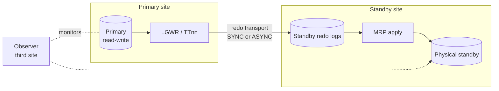
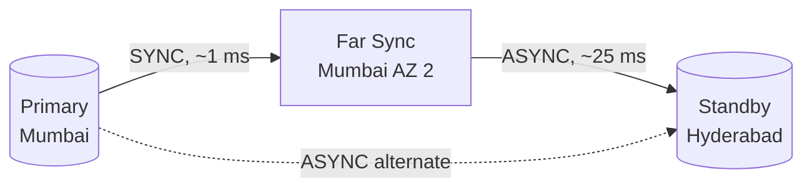

# 3.9 Data Guard

!!! abstract "Chapter card"
    **Stage:** 3 (sections 1 to 6), 4 (sections 7 to 9) · **Prerequisites:** 3.4 · **Time:** 5 hours ·
    Data Guard is included in Enterprise Edition; :material-license: **Active Data Guard** is an option

## At a glance

| Subtopic | In one line |
|---|---|
| Standby databases | Physical, logical, snapshot |
| Redo transport | SYNC or ASYNC shipping of redo to the standby |
| Redo apply | Real-time apply; apply lag |
| Protection modes | Maximum Performance, Availability, Protection |
| Role transitions | Switchover (planned) and failover (unplanned); reinstate |
| Broker and Fast-Start Failover | Management and automatic failover |
| Active Data Guard | Read-only standby while applying, and more |
| Far Sync and cascading | Zero data loss over distance |

## 1. Overview

Data Guard keeps one or more **standby databases** synchronized with a
**primary** by shipping and applying its **redo**.



It protects against what RAC and local backups cannot: loss of storage, of the
site, and physical corruption (the standby validates redo and blocks
independently). It does **not** protect against logical mistakes, which are
replicated; for those use flashback, a delayed standby, or backups.

## 2. Standby types

| Type | How it is kept in sync | Open for | Use |
|---|---|---|---|
| **Physical standby** | Redo apply: block-for-block identical | Mounted; or read-only with Active Data Guard | DR and HA. The standard choice |
| **Logical standby** | SQL apply: redo is turned into SQL | Read-write (other schemas, extra indexes) | Rolling upgrades (transient logical); reporting with different structures. Data type restrictions |
| **Snapshot standby** | A physical standby temporarily opened read-write; redo is received but not applied; changes are discarded on conversion back | Read-write | Testing against real data. RPO is unaffected; RTO grows while it is a snapshot |

## 3. Redo transport

| Mode | Primary commit waits for the standby? | Data loss on failover | Cost |
|---|---|---|---|
| **ASYNC** | No | Whatever had not been shipped (usually seconds) | Negligible |
| **SYNC AFFIRM** | Yes: until redo is written to the standby's redo log | Zero | Commit latency grows by the network round trip plus the remote write |
| **SYNC NOAFFIRM** (Fast Sync) | Yes: until received in memory | Zero unless both fail together | Lower latency than AFFIRM |

**Standby redo logs** receive the redo on the standby; create one more group
than the online log groups per thread, same size. **Real-time apply** applies
from them as redo arrives, so apply lag is normally near zero. Lost connections
are healed by automatic **gap resolution** (FAL).

## 4. Protection modes

| Mode | Transport | If the standby is unreachable | Guarantee |
|---|---|---|---|
| **Maximum Performance** (default) | ASYNC | Primary continues | Minimal data loss |
| **Maximum Availability** | SYNC | Primary continues, resynchronizes later | Zero data loss as long as the standby is in sync |
| **Maximum Protection** | SYNC AFFIRM, two or more standbys advised | **Primary shuts down** rather than commit unprotected | Zero data loss, always |

Maximum Availability is the usual "zero data loss" choice. Maximum Protection
is for the rare system where losing a transaction is worse than an outage.

## 5. Role transitions

| | **Switchover** | **Failover** |
|---|---|---|
| When | Planned: patching, site maintenance, DR test | Unplanned: primary lost |
| Data loss | None | None with SYNC in sync; otherwise the unshipped redo |
| Old primary | Becomes a standby automatically | Must be **reinstated** (Flashback Database) or rebuilt |
| Reversible | Yes: switch back | Via reinstate, then switchover |

```text
DGMGRL> SHOW CONFIGURATION;
DGMGRL> VALIDATE DATABASE fm_dr;
DGMGRL> SWITCHOVER TO fm_dr;

DGMGRL> FAILOVER TO fm_dr;              -- unplanned
DGMGRL> REINSTATE DATABASE fm_prd;      -- after the old primary is back; needs Flashback Database
```

!!! danger "Failover is a business decision"
    Failover may lose data (ASYNC) and makes the old primary unusable until
    reinstated. Follow the declared incident procedure and record the decision.
    Never open the old primary read-write afterwards: that creates two
    primaries (**split brain**).

Always enable **Flashback Database** on both primary and standby: it turns a
rebuild of many hours into a reinstate of minutes.

## 6. The broker and Fast-Start Failover

**Data Guard Broker** (`dgmgrl`, `DG_BROKER_START = TRUE`) manages the
configuration as one object: properties, health checks and one-command role
changes. Use it always.

**Fast-Start Failover (FSFO)** adds an **observer**: a lightweight process,
ideally at a third site, that watches both databases. If the primary is
unreachable from both the observer and the standby for
`FastStartFailoverThreshold` seconds, the observer fails over automatically.

| Setting | Meaning |
|---|---|
| `FastStartFailoverThreshold` | Seconds to wait before failing over (typically 30 to 60) |
| `FastStartFailoverLagLimit` | Maximum acceptable data loss in seconds for ASYNC configurations |
| `FastStartFailoverAutoReinstate` | Reinstate the old primary when it returns |
| Multiple observers (12.2+) | Observer high availability |

Clients must follow the role. Define a **role-based service** that runs only
on the current primary, and a connect string listing both sites:

```text
(DESCRIPTION=(CONNECT_TIMEOUT=5)(RETRY_COUNT=20)(RETRY_DELAY=3)(TRANSPORT_CONNECT_TIMEOUT=3)
  (ADDRESS_LIST=(ADDRESS=(PROTOCOL=TCP)(HOST=fm-prd-scan)(PORT=1521)))
  (ADDRESS_LIST=(ADDRESS=(PROTOCOL=TCP)(HOST=fm-dr-scan)(PORT=1521)))
  (CONNECT_DATA=(SERVICE_NAME=fm_oltp)))
```

## 7. Active Data Guard

| Capability | Notes |
|---|---|
| **Real-time query** | Standby open read-only while redo apply continues: reporting and read scaling |
| **DML redirection** (19c+) | Occasional writes issued on the standby are forwarded to the primary |
| **Automatic block repair** | A corrupt block on either side is fetched from the other |
| **Far Sync** | Section 8 |
| **Fast incremental backups** on the standby | Block change tracking on a standby |
| **Application Continuity** for the standby | |
| **Rolling upgrades** with `DBMS_ROLLING` | |
| **True Cache** (:material-tag: **23ai+**) | A diskless, read-only in-memory cache instance fed by redo |

Reads from a standby see data **as of the apply point**. For read-your-writes,
set `STANDBY_MAX_DATA_DELAY` or use `ALTER SESSION SYNC WITH PRIMARY`.

Offloading backups to the standby and running reports there are common ways to
justify the licence.

## 8. Far Sync and topology

Synchronous transport over a long distance makes every commit pay the
round-trip latency. A **Far Sync instance** solves this: a small instance (a
control file and standby redo logs, no data files) **near** the primary
receives redo synchronously and forwards it asynchronously to the distant
standby.



Result: zero data loss at failover to the remote site with local commit
latency. Other topologies: **cascaded standbys** (a standby forwards to further
standbys), **multiple standbys** (a local one for HA, a remote one for DR), and
a **time-delayed standby** (`DelayMins`) as a buffer against logical errors.

## 9. Operations and monitoring

```sql
SELECT name, value, time_computed FROM v$dataguard_stats
WHERE  name IN ('transport lag', 'apply lag', 'apply finish time');

SELECT database_role, protection_mode, protection_level, switchover_status, flashback_on, force_logging
FROM   v$database;
```

| Practice | Why |
|---|---|
| `FORCE LOGGING` on the primary | `NOLOGGING` operations would corrupt the standby |
| Alert on transport and apply lag | A lagging standby is a broken RPO/RTO |
| Standby sized like the primary | It must carry production after a failover |
| Regular switchover tests (at least twice a year) | Proves the procedure, the runbooks, the application connect strings and the people |
| Standby-first patching | Apply the RU to the standby, switch over, patch the old primary |
| Lost-write protection (`DB_LOST_WRITE_PROTECT`), block checksums | Detect silent corruption |
| Back up at one site, retain at both | A failover must not leave you without backups |

## 10. Common mistakes

- No standby redo logs (falls back to archive-log shipping; minutes of lag).
- No Flashback Database, so every failover ends in a rebuild.
- A standby that is smaller than production "because it is only DR".
- Connect strings that point at a host instead of a role-based service.
- Never testing switchover; discovering on the day that batch jobs, DNS or firewalls only work one way.
- Believing the standby is a backup.

## FreshMart example

=== "Scenario"

    FreshMart's objectives for the order database: RPO zero for a server or
    data-center failure, RPO under 30 seconds for a regional disaster, RTO
    under 5 minutes, and reports must not slow down checkout.

=== "Design"

    | Database | Location | Transport | Role |
    |---|---|---|---|
    | `fm_prd` | Mumbai, AZ 1 | | Primary |
    | `fm_sby` | Mumbai, AZ 2 | SYNC (Fast Sync), Maximum Availability | Local HA standby, FSFO target, read-only reporting (Active Data Guard) |
    | `fm_dr` | Hyderabad | ASYNC | Regional DR |
    | Observer | Third location | | Automatic failover with a 30-second threshold |

    Backups run on `fm_sby`. The application uses the role-based service
    `fm_oltp`; reports use `fm_ro`, which runs only on a standby.

=== "Outcome"

    | Event | Result |
    |---|---|
    | Primary server or AZ 1 lost | Observer fails over to `fm_sby` in about 30 to 60 seconds, zero data loss |
    | Mumbai region lost | Manual failover to `fm_dr`; loss limited to the ASYNC lag (seconds) |
    | Quarterly patch | Standby-first, one switchover each way, a minute or two of brown-out |
    | Heavy month-end reports | Run on `fm_sby`; checkout unaffected |

    Illustrative timings; measure in your own DR tests.

=== "Takeaway"

    Two standbys with different transport modes meet two different RPOs. The
    design costs one Active Data Guard licence set and a second full-size
    server, which is the number to put in front of the business next to the
    cost of an outage.

## Check yourself

??? question "Interview questions"
    1. **(Intermediate)** Physical versus logical versus snapshot standby?
    2. **(Intermediate)** Switchover versus failover?
    3. **(Senior)** Explain the three protection modes and what happens in each when the standby is unreachable.
    4. **(Senior)** What is Far Sync and what problem does it solve?
    5. **(Architect)** How do you design for zero data loss across 1,000 km without hurting commit latency? *A local SYNC target: a nearby standby or Far Sync instance, forwarding ASYNC to the remote site; Maximum Availability; FSFO with an observer at a third site; and an explicit statement of the double-failure case that can still lose data.*

??? example "Exercises"
    1. In a LiveLabs Data Guard environment: check lag, perform a switchover and switch back.
    2. Convert the standby to a snapshot standby, change data, convert back, and verify the changes are gone.
    3. Write the connect string and service definitions for FreshMart's OLTP and read-only workloads.

## Related

You have finished Stage 3. Next: [Stage 4](../getting-started/stage-4.md),
starting with [4.1 HA and DR architecture](03-ha-dr-architecture.md).
