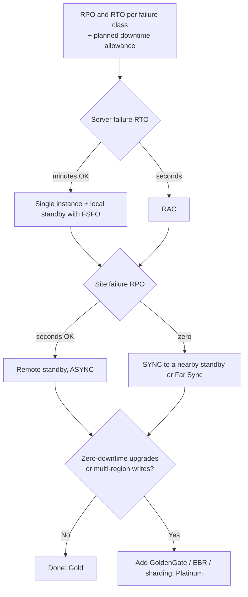

# 4.1 HA and DR architecture

!!! abstract "Chapter card"
    **Stage:** 4 · **Prerequisites:** 3.4, 3.8, 3.9 · **Time:** 4 hours

## At a glance

| Subtopic | In one line |
|---|---|
| Availability mathematics | Nines, downtime budgets, serial dependencies |
| Failure classes | What can fail and what covers it |
| Oracle MAA tiers | Bronze, Silver, Gold, Platinum reference architectures |
| Active-passive and active-active | Two shapes, very different costs |
| Planned downtime | Usually the larger part of the budget |
| Failback and DR testing | Proving the design |
| Choosing | From requirement to architecture |

## 1. Availability mathematics

| Availability | Downtime per year | Per month |
|---|---|---|
| 99% | 3.65 days | 7.3 hours |
| 99.9% | 8.8 hours | 44 minutes |
| 99.95% | 4.4 hours | 22 minutes |
| 99.99% | 52.6 minutes | 4.4 minutes |
| 99.999% | 5.3 minutes | 26 seconds |

- **Serial dependencies multiply.** An application at 99.95% on a database at 99.95% behind a network at 99.99% gives about 99.89%. The database cannot deliver an availability the rest of the stack does not.
- **Planned downtime counts** unless the SLA excludes it. Four 30-minute patch windows a year are already 2 hours.
- Define **RTO** and **RPO** *per failure class* (server, storage, site, region, human error). One pair of numbers hides the expensive cases.

## 2. Failure classes and their cover

| Failure | Frequency | Cover | Typical RTO / RPO |
|---|---|---|---|
| Instance or server | A few per year | RAC, or Data Guard FSFO, or restart | Seconds (RAC); about a minute (FSFO) / 0 |
| Storage, corruption | Rare | Data Guard, ASM redundancy, block repair | Minutes / 0 with SYNC |
| Data center or zone | Rare | Local standby in another zone | Minutes / 0 with SYNC |
| Region | Very rare | Remote standby | Minutes to an hour / seconds (ASYNC) |
| Human or application error | **Common** | Flashback, restore points, delayed standby, backups, GoldenGate | Minutes to hours / depends |
| Planned maintenance | Scheduled | Rolling patch (RAC), standby-first switchover, EBR | 0 to minutes |
| Malicious | Rising | Immutable backups, Database Vault, isolation | Hours / last clean copy |

## 3. Oracle Maximum Availability Architecture (MAA)

| Tier | Building blocks | Protects against | Indicative outage on unplanned failure |
|---|---|---|---|
| **Bronze** | Single instance (with restart), RMAN backups | Recoverable failures by restore | Hours; RPO since last backup of redo |
| **Silver** | Bronze + RAC (or RAC One Node / local standby) | Instance and server failure; rolling patching | Seconds to minutes |
| **Gold** | Silver + (Active) Data Guard | Site failure, corruption | Minutes; RPO zero or near zero |
| **Platinum** | Gold + GoldenGate, Application Continuity, Edition-Based Redefinition, sharding where needed | Almost all planned and unplanned outages, including upgrades | Seconds; zero for many planned events |

Tiers are a vocabulary for talking to the business: each step up roughly
doubles infrastructure and adds licences and operational skill. Put the price
of each tier next to the cost of an hour of outage.

## 4. Active-passive and active-active

| | Active-passive (Data Guard) | Active-active reads (Active Data Guard) | Active-active writes (GoldenGate, sharding) |
|---|---|---|---|
| Writes accepted at | One site | One site | Several sites |
| Consistency | Single source of truth | Standby slightly behind | Conflicts possible; must be designed for |
| Failover | Role change | Role change | Redirect traffic; no role change |
| Complexity | Low | Low | High |
| Use | Default | Read scaling, offload | Zero-downtime upgrades and migrations, regional write locality |

Multi-site writes are not "better HA". They exchange a simple failover for
permanent conflict management ([4.2](04-goldengate-replication.md)). Choose it
only when a role transition of a minute cannot be tolerated or users must write
locally in several regions.

## 5. Planned downtime

| Activity | Technique to avoid downtime |
|---|---|
| OS and hardware maintenance | RAC rolling; switchover to standby |
| Release Update | RAC rolling; standby-first |
| Major release upgrade | Transient logical standby (`DBMS_ROLLING`); GoldenGate; PDB relocate/refreshable clone |
| Schema change | Online DDL, online redefinition, expand-and-contract migrations |
| PL/SQL and view changes | Edition-Based Redefinition |
| Data reorganization | Online move, online partition operations |
| Application release | Rolling deploy with backward-compatible database changes |

The application must cooperate: FAN-aware connection pools, connection
draining, retries, and idempotent requests ([3.8](01-rac-asm.md)).

## 6. Failback and DR testing

A DR design is not finished until **failback** is designed: how the original
site becomes primary again (reinstate with Flashback Database, resynchronize,
switchover) and how long the business runs unprotected meanwhile.

| Test | Proves | Frequency |
|---|---|---|
| Restore test | Backups are usable; measures restore time | Quarterly |
| Switchover and run from DR | The whole stack works from the other site: DNS, firewalls, batch, interfaces, monitoring, people | Twice a year, for a full business cycle |
| Failover simulation (kill the primary) | FSFO, client failover, alerting | Yearly in production or continuously in a pre-production twin |
| Snapshot-standby test | Application releases against real data | As needed |
| Tabletop exercise | Decision making, communication, authority | Yearly |

Record for each test: achieved RTO and RPO, what failed, and the actions. An
untested DR site should be reported to the business as *no* DR site.

## 7. From requirement to architecture

Capacity rule: after any single failure, the remaining components must carry
**peak** load. Two RAC nodes each at 70% do not survive the loss of one.

## 8. Failure scenarios to walk through in a design review

1. Primary site power loss during peak. Who decides, how long, what is lost?
2. Network partition between sites: can both sides believe they are primary? (Observer placement, fencing.)
3. Standby silently lagging for a week. Who knew?
4. A bad release corrupts data logically at 09:00, found at 14:00.
5. Ransomware encrypts the primary and the standby follows. Which copy is clean, and how fast can it be restored?
6. Failover succeeded; the batch scheduler still points at the old site.
7. The DR site is used for a month. Are backups, monitoring and licences in place there?

## 9. Common mistakes

- Designing for server failure and forgetting human error.
- Buying RAC for disaster recovery.
- A DR standby with less capacity, no backups and no monitoring.
- One RTO/RPO for everything.
- Active-active adopted for prestige.
- No failback plan.

## FreshMart example

=== "Scenario"

    The board asks: "What would it take to guarantee FreshMart is never down?"
    The honest answer is a table, not a product name.

=== "Options"

    | Tier | Design | Unplanned RTO (server / site) | RPO | Planned downtime per year | Relative infrastructure and licence cost |
    |---|---|---|---|---|---|
    | A | Single instance, RMAN, restore to spare | 4 h / 8 h | 15 min | 4 h | 1x |
    | B | A + local standby, FSFO | 1 min / 8 h | 0 / 15 min | 30 min | 2.2x |
    | C | B + remote standby | 1 min / 15 min | 0 / 10 s | 30 min | 3.3x |
    | D | C with 2-node RAC at each site, TAC | 10 s / 15 min | 0 / 10 s | about 0 | 6x |
    | E | D + GoldenGate active-active | seconds / seconds | conflict-managed | 0 | 8x + engineering |

    Illustrative ratios for discussion; price them with real quotes.

=== "Decision"

    With an estimated loss of INR 4 million per hour of outage at peak and two
    expected server-level incidents a year, tier C pays for itself and tier D
    does not until patch windows disappear. Tier E solves a problem FreshMart
    does not have. The recommendation is C now, with pool and service
    configuration done to RAC standards so that D is a later infrastructure
    change, not an application change.

=== "Takeaway"

    "Never down" becomes a choice between priced options with stated residual
    risks. That is the form in which an architect should hand the decision to
    the business.

## Check yourself

??? question "Interview questions"
    1. **(Senior)** Why is RAC not a DR solution?
    2. **(Senior)** How do you compute the availability of a chain of components?
    3. **(Principal)** Describe the MAA tiers and when you would stop at each.
    4. **(Principal)** What makes a DR test meaningful?
    5. **(Architect)** How do you protect against ransomware that waits 30 days before triggering? *Immutable, air-gapped backups with retention longer than the dwell time, regular restore validation and malware scanning of restored copies, separation of backup administration from database administration, and a rehearsed clean-room recovery.*

??? example "Exercises"
    1. A service must be 99.95% available and depends on three components at 99.99%, 99.95% and 99.9%. Is the target reachable? *No: the product is about 99.84%.*
    2. Write RTO/RPO per failure class for a system you know.
    3. Draft the failback procedure after a regional failover for the FreshMart design in 3.9.

## Related

Next: [4.2 GoldenGate and replication](04-goldengate-replication.md).
