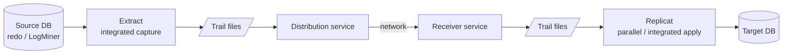

# 4.2 GoldenGate and replication

!!! abstract "Chapter card"
    **Stage:** 4 · **Prerequisites:** 3.9 · **Time:** 4 hours ·
    :material-license: GoldenGate is a separately licensed product

## At a glance

| Subtopic | In one line |
|---|---|
| Physical and logical replication | Copy blocks, or copy changes as SQL |
| Synchronous and asynchronous | Wait for the replica, or not |
| GoldenGate architecture | Extract, trail, Distribution, Replicat |
| Topologies | Unidirectional, bidirectional, hub, consolidation, cascading |
| Conflict detection and resolution | The price of multi-site writes |
| Zero-downtime migration and upgrade | The most common use |
| Monitoring and verification | Lag, heartbeat, Veridata |

## 1. Kinds of replication

| | Physical (Data Guard) | Logical (GoldenGate) |
|---|---|---|
| Unit | Redo applied to identical blocks | Row changes re-executed as SQL |
| Target | Exact copy, same version and platform family | Different version, platform, schema, even a different database or Kafka |
| Target open for writes | No | Yes |
| Subset or transform | No | Yes: tables, columns, filters, mapping |
| Every object and data type | Yes | Some restrictions; DDL replication configurable |
| Overhead and effort | Low | Higher: configuration, keys, monitoring, conflict handling |
| Primary purpose | HA and DR | Migration, integration, active-active, feeding analytics |

| | Synchronous | Asynchronous |
|---|---|---|
| Source commit | Waits for the replica | Does not wait |
| Data loss on failure | None | The lag |
| Latency added | Round trip | None |
| Distance | Short | Any |

GoldenGate is asynchronous. Zero-data-loss requirements are met with Data
Guard; the two are often combined.

## 2. GoldenGate architecture



| Component | Role |
|---|---|
| **Extract** | Reads committed changes from the redo stream (integrated capture uses the database's log mining server) and writes them to trail files |
| **Trail** | Durable, ordered files of change records; decouple capture from apply |
| **Distribution / Receiver** | Ship trails between deployments (the *data pump* of classic architecture) |
| **Replicat** | Applies changes to the target, preserving transaction integrity. *Parallel* and *integrated* modes apply concurrently with dependency awareness |
| **Checkpoints** | Each process records its position, so it restarts without loss or duplication |
| **Microservices Architecture** | Administration, Distribution, Receiver and Performance Metrics services with REST APIs and a web UI. The classic (Manager/GGSCI) architecture is deprecated in current releases |

Source prerequisites: ARCHIVELOG mode, `ENABLE_GOLDENGATE_REPLICATION = TRUE`,
**supplemental logging** (so that redo contains key columns:
`ADD TRANDATA` / `ADD SCHEMATRANDATA`), and a primary or unique key on every
replicated table. Tables without keys are replicated using all columns as the
key: slow and fragile.

## 3. Topologies

| Topology | Use |
|---|---|
| **Unidirectional** | Reporting copy, migration, feeding a warehouse or Kafka |
| **Bidirectional (active-active)** | Two writable sites |
| **Hub and spoke / peer-to-peer** | Several writable sites |
| **Consolidation** | Many sources into one warehouse |
| **Broadcast** | One source to many targets |
| **Cascading** | Through an intermediate system |

## 4. Conflicts

With two writable sites, the same row can be changed in both before the changes
cross.

| Conflict | Example |
|---|---|
| Update-update | Both sites change a customer's phone |
| Insert-insert | Both sites generate order id 5001 |
| Update-delete / delete-delete | One site deletes what the other updates |

**Avoid first, resolve second.**

| Avoidance technique | How |
|---|---|
| Partition ownership | Each row is written at one site only (by region, customer or tenant) |
| Non-overlapping keys | Sequences with different start/increment per site, or site id in the key, or GUIDs |
| No physical deletes | Soft-delete flags |
| Additive columns | Replicate deltas for counters and balances |

**Resolution** (CDR): compare before images (`COMPARECOLS`) and apply a rule
(`RESOLVECONFLICT`): latest timestamp wins, site priority, minimum/maximum,
delta for numeric columns, or a custom routine. **Automatic CDR**
(`DBMS_GOLDENGATE_ADM.ADD_AUTO_CDR`, 12.2+) maintains hidden timestamp columns
and tombstones for you.

Every resolution rule discards somebody's change. Inventory quantities,
balances and uniqueness rules cannot be made correct by "latest wins"; they
need ownership partitioning or a single writer. Check constraints and unique
keys that span sites are no longer guaranteed at commit time.

## 5. Zero-downtime migration and upgrade

```mermaid
sequenceDiagram
    participant O as Old (19c, on-premises)
    participant G as GoldenGate
    participant N as New (26ai, cloud)
    O->>G: 1. Start Extract (capture from SCN X)
    O->>N: 2. Initial load as of SCN X (Data Pump / RMAN)
    G->>N: 3. Replicat applies changes since X
    Note over O,N: 4. Lag near zero; validate data (Veridata)
    Note over O,N: 5. Optional: reverse replication N -> O ready for fallback
    O-->>N: 6. Cutover: stop writes, drain, switch connections
    N->>G: 7. Fallback path kept until sign-off
```

The outage is the time to stop the application, let the last changes apply and
repoint connections: minutes. The reverse replication gives a tested way back,
which a physical upgrade does not. **Zero Downtime Migration (ZDM)** automates
this pattern for moves to Oracle Cloud.

Initial-load consistency is the usual trap: the load must be consistent as of
the SCN where apply starts (`FLASHBACK_SCN`, or `HANDLECOLLISIONS` only during
the overlap window).

## 6. Other replication options

| Option | Notes |
|---|---|
| Materialized views over database links | Simple, read-only or updatable copies; limited scale |
| Data Guard logical standby | Mainly for rolling upgrades |
| Refreshable PDB clones | Periodic physical copies |
| Sharding / Globally Distributed Database | Built-in replication per shard ([4.3](../distributed-databases/01-distributed.md)) |
| OCI GoldenGate | Managed service |
| GoldenGate for Big Data / Distributed Applications and Analytics | Targets such as Kafka, object storage, Snowflake |
| Oracle Streams, Advanced Replication | Desupported: migrate |

## 7. Operations

| Practice | Why |
|---|---|
| **Heartbeat table** (`ADD HEARTBEATTABLE`) | End-to-end lag per path in a view |
| Alert on lag and on stopped (abended) processes | Silent stoppage is the classic failure |
| Trail retention and purge rules | Trails fill disks |
| **Veridata** or hash comparison | Replication can diverge without errors (triggers, unlogged operations, manual fixes) |
| Disable or tag triggers and cascades on the target | Otherwise effects are applied twice |
| Plan for DDL | Decide: replicate DDL, or apply schema changes to both sides by pipeline in a compatible order |
| Size redo, CPU and Streams pool | Integrated capture uses database resources |

## 8. Common mistakes

- Using GoldenGate where Data Guard is the requirement (DR), or the reverse (migration across versions).
- Active-active without ownership rules.
- Tables without primary keys.
- No data comparison before cutover.
- Sequences that collide after cutover because their values were not advanced on the target.
- Treating replication lag as constant.

## FreshMart example

=== "Scenario"

    FreshMart runs 19c on-premises and must move to 26ai on OCI. The business
    allows 10 minutes of read-only time on a Sunday night and demands a way
    back for two weeks.

=== "Plan"

    | Step | Action |
    |---|---|
    | 1 | Verify keys on all 20 tables; enable supplemental logging; `FORCE LOGGING` |
    | 2 | Start Extract; note the SCN |
    | 3 | Data Pump export with `FLASHBACK_SCN`; import into a new PDB on 26ai |
    | 4 | Start Replicat from that SCN; watch lag fall to seconds |
    | 5 | Compare row counts and hashes per table; fix differences |
    | 6 | Rehearse the cutover twice on a clone, timing each step |
    | 7 | Cutover: application read-only, wait for zero lag, advance identity/sequence values on the target, repoint the service, start reverse replication (26ai → 19c) |
    | 8 | After two weeks without fallback: stop reverse replication and retire the old system |

=== "Risk register"

    | Risk | Mitigation |
    |---|---|
    | Plan regressions on 26ai | SQL Performance Analyzer on captured workload; plan baselines carried over |
    | Features used after cutover that 19c cannot receive | No new 26ai-only data types or DDL until fallback ends |
    | Identity values behind | `START WITH LIMIT VALUE` script in the cutover runbook |
    | Lag grows during the batch window | Cut over outside it; parallel Replicat |

    Illustrative plan.

=== "Takeaway"

    Replication turns a risky big-bang upgrade into a rehearsed switch with a
    fallback. The cost is a few weeks of engineering and a temporary
    GoldenGate licence, which is the comparison to make against an 8-hour
    outage.

## Check yourself

??? question "Interview questions"
    1. **(Senior)** Data Guard versus GoldenGate: when each?
    2. **(Senior)** What is supplemental logging and why is it required?
    3. **(Principal)** How do you avoid conflicts in an active-active design?
    4. **(Principal)** Describe a zero-downtime upgrade with a fallback path.
    5. **(Architect)** A team proposes bidirectional replication of the inventory table across two regions. Your review? *Reject "latest wins" for quantities; require per-warehouse ownership so each row has one writing region, or keep a single writer with a local read replica; define the customer-visible behavior during partition.*

??? example "Exercises"
    1. List FreshMart tables that would conflict under multi-site writes and propose an ownership rule for each.
    2. Write the validation queries (count and `ORA_HASH` aggregate) to compare `orders` between source and target.
    3. Draw the topology for feeding order events to Kafka.

## Related

Next: [4.3 Distributed databases and sharding](../distributed-databases/01-distributed.md).
