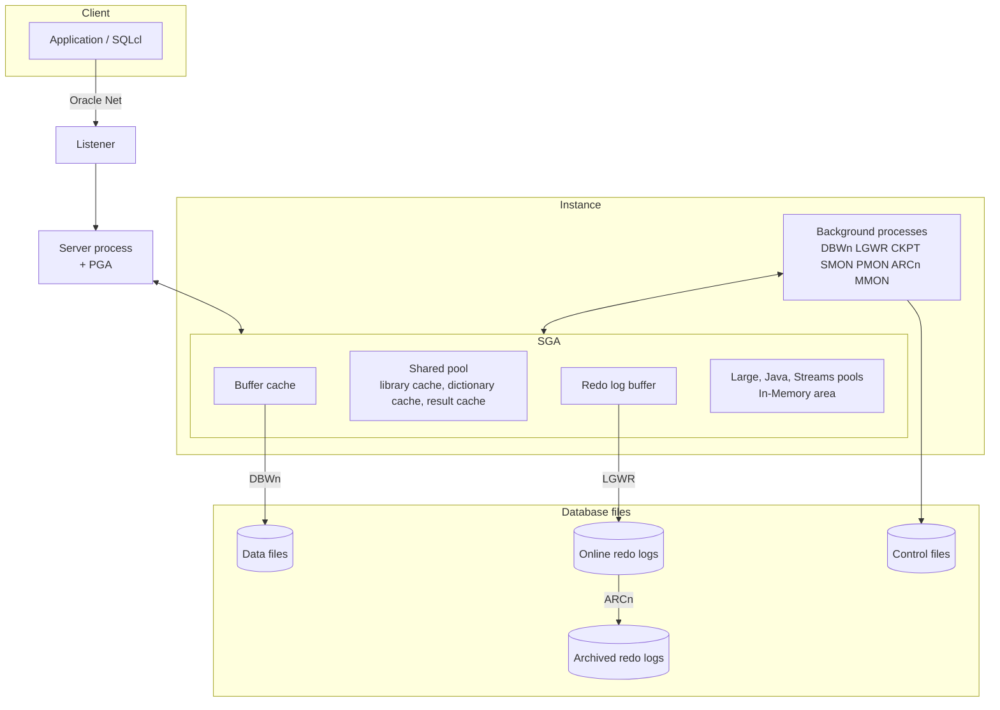

# 3.1 Oracle architecture

!!! abstract "Chapter card"
    **Stage:** 3 · **Prerequisites:** Stage 2 · **Time:** 6 hours · **Applies to:** 19c+ (multitenant only from 21c)

## At a glance

| Subtopic | In one line |
|---|---|
| Instance versus database | Memory and processes versus files |
| SGA | Shared memory: buffer cache, shared pool, redo log buffer and more |
| PGA | Private memory per process: sorts, hash joins, session state |
| Background processes | DBWn, LGWR, CKPT, SMON, PMON, ARCn, MMON and friends |
| Connections | Listener, dedicated and shared servers, pooling |
| Life of a query and of a change | Parse, optimize, execute, fetch; redo, undo, commit |
| Checkpoints and instance recovery | How a crash is survived |

## 1. Instance and database



| Term | Definition |
|---|---|
| **Database** | The files on disk: data files, control files, online redo logs (plus parameter file, password file, archived logs, backups) |
| **Instance** | The memory structures and background processes that operate on a database |
| Relationship | One instance mounts one database. In RAC, several instances open the same database |
| **CDB / PDB** | From 21c every database is a container database holding pluggable databases; the instance belongs to the CDB ([3.3](../database-administration/01-administration.md)) |

## 2. The SGA

| Component | Holds | If too small |
|---|---|---|
| **Database buffer cache** | Copies of data blocks. All reads and changes of data happen here | More physical reads (`db file sequential read`) |
| **Shared pool** | *Library cache*: parsed SQL, plans, PL/SQL code. *Data dictionary cache*: object and privilege metadata. *Server result cache* | Hard parses, `ORA-04031`, library cache contention |
| **Redo log buffer** | Change records waiting to be written by LGWR | `log buffer space` waits (rare) |
| **Large pool** | Memory for shared servers, parallel execution messages, RMAN | Shared pool gets used instead |
| **Java pool** | Java inside the database | |
| **Streams pool** | GoldenGate integrated capture/apply, Advanced Queuing | |
| **In-Memory area** | Columnar copies of tables (:material-license: Database In-Memory) | |
| **Fixed SGA** | Internal state | |

A buffer is **clean** (same as disk), **dirty** (changed, not yet written) or
**pinned** (in use). A read served from the cache is a **logical I/O** (buffer
get); one that must go to disk first is a **physical I/O**. Logical I/O is
cheap but not free: it costs CPU and latches, which is why "buffer gets per
execution" is the core measure of SQL efficiency.

## 3. The PGA

Each server process has private memory: session variables, cursor state, and
**SQL work areas** for sorts, hash joins and bitmap operations. A work area
that does not fit runs "one-pass" or "multi-pass" using the temporary
tablespace, which is much slower.

## 4. Memory management

| Mode | Parameters | Notes |
|---|---|---|
| Automatic Shared Memory Management (ASMM) | `SGA_TARGET`, `SGA_MAX_SIZE`, `PGA_AGGREGATE_TARGET`, `PGA_AGGREGATE_LIMIT` | The usual production choice; compatible with Linux HugePages |
| Automatic Memory Management (AMM) | `MEMORY_TARGET` | Simple, but cannot use HugePages; avoid for large SGAs |
| Manual | `DB_CACHE_SIZE`, `SHARED_POOL_SIZE` ... | Set minimums under ASMM when needed |

`PGA_AGGREGATE_TARGET` is a target; `PGA_AGGREGATE_LIMIT` is a hard cap after
which sessions are terminated (`ORA-04036`). Size memory with
`V$SGA_TARGET_ADVICE`, `V$PGA_TARGET_ADVICE` and AWR, then leave room for the
operating system and for process memory outside the PGA.

## 5. Background processes

| Process | Job | Triggered when |
|---|---|---|
| **DBWn** (database writer) | Writes dirty buffers to data files | Checkpoint, no free buffers, timeout |
| **LGWR** (log writer) | Writes the redo log buffer to the online redo logs | Commit, buffer one-third full, every 3 seconds, before DBWn writes |
| **CKPT** (checkpoint) | Records checkpoint positions in file headers and the control file | Log switch, timed targets |
| **SMON** (system monitor) | Instance recovery at startup, cleans temporary segments | Startup, periodically |
| **PMON** (process monitor) | Cleans up after failed sessions: rolls back, releases locks | Process failure |
| **LREG** (listener registration) | Registers services with the listener (was part of PMON before 12c) | Periodically |
| **ARCn** (archiver) | Copies filled online redo logs to archived logs | Log switch, in ARCHIVELOG mode |
| **MMON / MMNL** | Captures AWR snapshots, ASH samples, alerts | Hourly / every second |
| **RECO** | Resolves in-doubt distributed transactions | |
| **CJQ0 / Jnnn** | Scheduler job coordinator and slaves | |
| **RVWR** | Writes flashback logs | Flashback Database on |
| **LMON, LMS, LMD, LCK** | RAC global cache and enqueue services | RAC only ([3.8](../high-availability/01-rac-asm.md)) |

Two facts that explain most of Oracle's behavior:

1. **Write-ahead logging.** Redo for a change reaches disk **before** the
   changed data block does. DBWn may write late and lazily because the redo
   log can always reproduce the change.
2. **Commit is a redo write, not a data write.** `COMMIT` waits for LGWR
   (`log file sync`) and nothing else.

## 6. Connections

| Step | What happens |
|---|---|
| 1 | The client resolves a connect string (`//host:1521/service`, TNS alias, LDAP) |
| 2 | The **listener** receives the request and hands it to a server process (or redirects) |
| 3 | The session authenticates; a **session** now exists inside a **process** |

| Model | How | Use |
|---|---|---|
| **Dedicated server** | One server process per session | Default; best for pooled OLTP |
| **Shared server** | Sessions share a pool of server processes via dispatchers | Very many mostly idle sessions; rare today |
| **DRCP** (Database Resident Connection Pooling) | Server-side pool shared across clients | PHP/Python clients, many application servers; PRCP per PDB (:material-tag: **21c+**) |
| **Client-side pool** (UCP, HikariCP) | The application keeps a small set of connections open | Standard for Java ([4.8](../spring-boot-integration/01-spring-boot.md)) |
| **Connection Manager / CMAN-TDM** | Proxy with multiplexing | Network zones, very large fleets |

Creating a connection costs a process fork, memory and authentication:
milliseconds to tens of milliseconds. Applications must pool. And a pool should
be **small**: more active sessions than CPU cores only adds queueing
([incident 9](../performance-incidents/01-incidents.md)).

Connect to **services**, not SIDs. Services are how workloads are named,
measured, prioritized and failed over.

## 7. Life of a SELECT

1. **Parse.** Hash the statement text and look in the library cache. Found: *soft parse*. Not found: *hard parse* (syntax and semantic checks using the dictionary cache, then optimization).
2. **Optimize** (hard parse only). Transform the query, estimate cardinalities from statistics, choose a plan.
3. **Execute.** For each block needed: look in the buffer cache (logical read); if absent, read it from disk (physical read). If the block is newer than the query's SCN, build a consistent copy from undo.
4. **Fetch.** Return rows in batches of the client's fetch size.

## 8. Life of an UPDATE and COMMIT

1. Parse and optimize as above; locate the rows.
2. For each row: write **undo** (the old image) into an undo block; change the **data block**; both changes are described by **redo** records placed in the redo log buffer. The row is locked in the block's ITL.
3. `COMMIT`: a commit record is added; **LGWR flushes** the buffer to the online redo log; the session waits on `log file sync`; locks are released.
4. Later: **DBWn** writes the dirty data and undo blocks at its own pace.
5. The undo is kept until no longer needed for read consistency or flashback, then reused.

## 9. Checkpoints and instance recovery

A **checkpoint** marks an SCN up to which all changes are in the data files.
Oracle checkpoints incrementally and continuously; `FAST_START_MTTR_TARGET`
sets the target crash-recovery time.

After a crash (power loss, `SHUTDOWN ABORT`), startup performs **instance
recovery** automatically:

1. **Roll forward**: apply redo from the last checkpoint. This restores committed changes not yet in data files, and also uncommitted ones.
2. Open the database.
3. **Roll back**: undo the transactions that were not committed.

No data committed before the crash is lost, as long as the online redo logs
survive. That is why redo logs are multiplexed.

## 10. Performance and production notes

- Size the SGA so the important data stays cached, use HugePages on Linux, and never let the host swap.
- `log file sync` time is a direct component of commit latency: put redo on low-latency storage and avoid committing row by row.
- Shared pool health depends on bind variables; watch hard parses per second.
- `SESSIONS`, `PROCESSES` and pool sizes should be planned together.

## 11. Common mistakes

- Saying "the database is down" when the instance is down but the files are fine, or the listener is down but the instance is up.
- Sizing connection pools in the hundreds per application server.
- Using AMM (`MEMORY_TARGET`) on a large Linux server and losing HugePages.
- Believing a commit writes data blocks.
- Putting all redo members on one disk.

## FreshMart example

=== "Scenario"

    Trace what Oracle does when checkout runs
    `UPDATE inventory SET qty_reserved = qty_reserved + 2 WHERE warehouse_id = 1 AND product_id = 5`
    followed by `COMMIT`.

=== "Walkthrough"

    | # | Component | Action |
    |---|---|---|
    | 1 | Listener → server process | The pooled connection already exists; no new process |
    | 2 | Shared pool | Statement hash found: soft parse, plan reused (`INDEX UNIQUE SCAN PK_INVENTORY`) |
    | 3 | Buffer cache | Index root, leaf and table block read: 3 logical reads, 0 physical if cached |
    | 4 | Undo segment | Old `qty_reserved` value written to an undo block |
    | 5 | Data block | Row changed, ITL entry marks the transaction's lock |
    | 6 | Redo log buffer | Redo for the undo block and the data block |
    | 7 | LGWR | On `COMMIT`, flushes to the online redo log; session waits on `log file sync` |
    | 8 | DBWn | Writes the dirty blocks later |
    | 9 | ARCn | Archives the log when it fills and switches |
    | 10 | Data Guard | The same redo is shipped to the standby ([3.9](../high-availability/02-data-guard.md)) |

=== "Check it"

    ```sql
    SELECT n.name, s.value
    FROM   v$mystat s JOIN v$statname n ON n.statistic# = s.statistic#
    WHERE  n.name IN ('session logical reads', 'physical reads', 'redo size',
                      'undo change vector size', 'user commits');
    ```

    Run it before and after the statement and subtract. Expect a few logical
    reads, zero or few physical reads, and a few hundred bytes of redo.
    Illustrative: exact values depend on your system.

=== "Takeaway"

    One row change touched five memory structures and three kinds of files.
    Every performance and recovery topic in Stage 3 is a closer look at one of
    these steps.

## Check yourself

??? question "Interview questions"
    1. **(Intermediate)** Instance versus database?
    2. **(Intermediate)** What does LGWR do and when?
    3. **(Senior)** Why can DBWn write data blocks after the commit without risking data? *Write-ahead logging: the redo is already on disk.*
    4. **(Senior)** What happens during instance recovery?
    5. **(Architect)** A new service will open 4,000 connections from 200 pods. What do you propose? *Small per-pod pools sized to database CPU, plus DRCP/PRCP or CMAN-TDM to multiplex; define a service and a Resource Manager plan; load-test the connection storm case.*

??? example "Exercises"
    1. Query `V$SGAINFO` and `V$PGASTAT`; identify the largest SGA component.
    2. List background processes: `SELECT pname FROM v$process WHERE pname IS NOT NULL ORDER BY 1;`
    3. Measure the redo generated by updating all 12 product prices and rolling back. Why is it not zero? *Rollback also generates redo.*

## Related

Next: [3.2 Storage management](../storage-management/01-storage.md).
