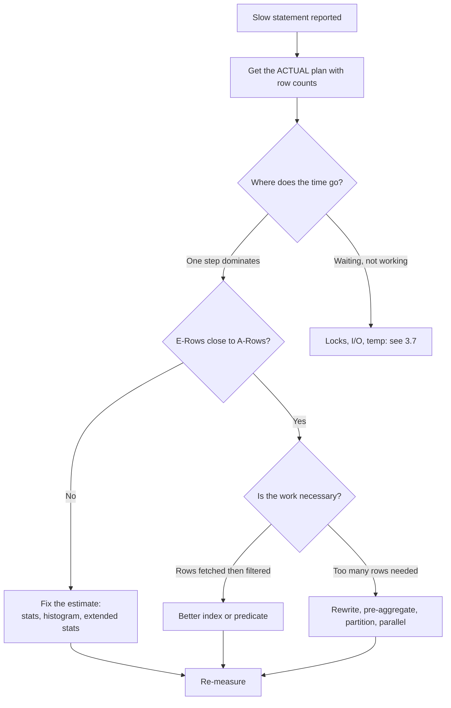

# 2.15 Execution plans and SQL tuning

!!! abstract "Chapter card"
    **Stage:** 2 · **Prerequisites:** 2.1, 2.12 · **Time:** 6 hours · **Applies to:** 19c+

## At a glance

| Subtopic | In one line |
|---|---|
| What a plan is | The steps Oracle will take to run a statement |
| `EXPLAIN PLAN` and `DBMS_XPLAN` | Estimated plan versus the plan that actually ran |
| Reading a plan | Order of operations, access and filter predicates |
| Join methods | Nested loops, hash, sort-merge |
| Estimated versus actual rows | The single most useful tuning signal |
| Bind variables and parsing | Hard parse, soft parse, bind peeking |
| A tuning method | Measure, find the wrong estimate, fix the cause |

All plans in this chapter are **illustrative**: they show the shape you should
expect, not output captured from a run.

## 1. What a plan is

SQL says *what*. The **optimizer** decides *how*: which table first, which
index, which join method. The result is an **execution plan**, a tree of row
sources. The optimizer estimates the **cost** of candidate plans from
statistics about your data and picks the cheapest.

## 2. Getting a plan

| Method | Shows | Notes |
|---|---|---|
| `EXPLAIN PLAN FOR ...` + `DBMS_XPLAN.DISPLAY` | The plan the optimizer **would** choose now | Does not run the statement; does not peek binds; can differ from reality |
| `DBMS_XPLAN.DISPLAY_CURSOR` | The plan that **did** run, from the cursor cache | The one to trust |
| `... DISPLAY_CURSOR(format => 'ALLSTATS LAST')` | Estimated **and actual** rows, time, buffers per step | Needs `/*+ GATHER_PLAN_STATISTICS */` or `STATISTICS_LEVEL = ALL` |
| `SET AUTOTRACE` (SQL*Plus/SQLcl) | Plan plus run statistics | Convenient |
| Real-Time SQL Monitoring | Live progress per step | :material-license: Tuning Pack |
| `DBMS_XPLAN.DISPLAY_AWR` | Historical plans | :material-license: Diagnostics Pack |

```sql
SELECT /*+ GATHER_PLAN_STATISTICS */ c.customer_name, o.order_id, o.total_amount
FROM   customers c
JOIN   orders o ON o.customer_id = c.customer_id
WHERE  c.city = 'Mumbai';

SELECT * FROM TABLE(DBMS_XPLAN.DISPLAY_CURSOR(format => 'ALLSTATS LAST'));
```

```text
------------------------------------------------------------------------------------------
| Id | Operation                             | Name                | Starts | E-Rows | A-Rows | Buffers |
------------------------------------------------------------------------------------------
|  0 | SELECT STATEMENT                      |                     |      1 |        |      5 |       9 |
|  1 |  NESTED LOOPS                         |                     |      1 |      4 |      5 |       9 |
|  2 |   NESTED LOOPS                        |                     |      1 |      4 |      5 |       6 |
|* 3 |    TABLE ACCESS FULL                  | CUSTOMERS           |      1 |      2 |      3 |       3 |
|* 4 |    INDEX RANGE SCAN                   | IX_ORDERS_CUST_DATE |      3 |      2 |      5 |       3 |
|  5 |   TABLE ACCESS BY INDEX ROWID         | ORDERS              |      5 |      2 |      5 |       3 |
------------------------------------------------------------------------------------------
   3 - filter("C"."CITY"='Mumbai')
   4 - access("O"."CUSTOMER_ID"="C"."CUSTOMER_ID")
```

(Three Mumbai customers have 3 + 1 + 1 = 5 orders, which is what A-Rows shows.)

## 3. Reading a plan

**Order:** the plan is a tree. A parent pulls rows from its children; children
at the same indentation run top to bottom. Rule of thumb: find the innermost,
topmost operation with no children; that runs first. Above: step 3, then step 4
for each customer row, then step 5.

| Column | Meaning |
|---|---|
| `Operation`, `Name` | What is done, to which object |
| `Rows` / `E-Rows` | **Estimated** rows produced by the step (per execution) |
| `A-Rows` | **Actual** rows produced (total over all starts) |
| `Starts` | How many times the step ran |
| `Cost` | Optimizer's relative estimate. Not time. Do not compare costs across different statements |
| `Buffers` | Logical reads (blocks read from memory), cumulative |
| `Reads` | Physical reads from disk |
| `A-Time` | Actual elapsed time, cumulative |

**Predicates** (marked `*`):

- **access**: used to *locate* rows (index range, hash key). Efficient.
- **filter**: applied *after* rows were fetched. If a step reads 1,000,000 rows and a filter keeps 10, that step is where the work is wasted.

Look in the predicate section for functions Oracle added, such as
`TO_NUMBER("PHONE")` or `INTERNAL_FUNCTION("ORDER_DATE")`: these are implicit
conversions that disabled an index.

## 4. Access paths and join methods

Access paths are in [2.12](../indexing/01-indexing.md).

| Join | How | Plan shape | Best when | Needs |
|---|---|---|---|---|
| **Nested loops** | For each outer row, probe the inner | Outer first, inner below, usually via an index | Few outer rows; OLTP | Index on the inner join column |
| **Hash join** | Build a hash table on the smaller input, probe with the larger | Build input first | Many rows, equality joins | PGA memory; spills to temp |
| **Sort-merge** | Sort both inputs, merge | `SORT JOIN` twice | Non-equality joins, pre-sorted inputs | Sort memory |
| **Cartesian** | Every pair | `MERGE JOIN CARTESIAN` | One side is truly one row | Otherwise a bug |

Nested loops cost grows with *outer rows × probe cost*. A nested loop chosen
because the optimizer expected 10 outer rows and got 1,000,000 is the most
common cause of a query that "suddenly" runs for hours.

**Adaptive plans** (12c+): the plan can contain both a nested-loops and a hash
option and choose at run time once real row counts are seen. The plan shows a
`STATISTICS COLLECTOR` and a note "this is an adaptive plan".

## 5. Query transformations

Before costing, the optimizer rewrites the query: view merging, subquery
unnesting, predicate pushing, join elimination, OR-expansion, star
transformation, and rewrite to materialized views. So the plan may not look
like your SQL text. Trust the plan.

## 6. The key signal: estimated versus actual rows

When `E-Rows × Starts` is far from `A-Rows` (10x or more), the optimizer chose
with wrong information. Find the **first** step (in execution order) where the
estimate goes wrong; later errors usually follow from it.

| Cause of a wrong estimate | Fix |
|---|---|
| Stale or missing statistics | Gather statistics |
| Skewed column without a histogram | Gather with a histogram on that column |
| Correlated columns (`city` and `state`) | Extended statistics (column group) |
| Expression or function on a column | Extended statistics on the expression; function-based index; virtual column |
| Table function, collection, or complex view | Cardinality feedback, dynamic statistics, SQL macro |
| Bind variable peeked with an unusual value | See section 7 |

Details in [3.6](02-optimizer-statistics-spm.md).

## 7. Parsing and bind variables

| Parse type | What happens | Cost |
|---|---|---|
| **Hard parse** | Syntax, semantics, optimization, plan stored in the shared pool | High CPU, shared pool latches/mutexes |
| **Soft parse** | Statement text found in the shared pool, plan reused | Low |
| No parse | The application kept the cursor open and re-executes | Lowest (statement caching) |

Statements match by **exact text**. `WHERE customer_id = 101` and
`WHERE customer_id = 102` are different statements; `WHERE customer_id = :id`
is one. Literals in a high-volume OLTP system mean a hard parse per execution:
CPU burned, shared pool flooded, concurrency lost
([incident 8](../performance-incidents/01-incidents.md)).

**Bind peeking:** at hard parse, the optimizer looks at the actual bind values
to estimate rows. The plan is then reused for other values, which may suit it
badly when data is skewed (`status = 'CANCELLED'` is rare, `'DELIVERED'` is
common).

**Adaptive cursor sharing** (11g+): for bind-sensitive statements Oracle
notices that different values perform differently and creates additional child
cursors with different plans (`V$SQL.IS_BIND_SENSITIVE`, `IS_BIND_AWARE`). It
needs a few slow executions to learn.

Guidance: binds for OLTP statements executed many times; literals are
acceptable for rare, long-running analytic queries where the best plan per
value matters more than parse cost.

## 8. Hints

A hint is a directive in a comment: `/*+ INDEX(o ix_orders_cust_date) */`,
`/*+ LEADING(c o) USE_NL(o) */`, `/*+ FULL(o) PARALLEL(o 4) */`.

- Use hints to **diagnose** ("is the other plan really faster?"), not as the fix.
- A hint freezes one decision while data keeps changing, and an invalid hint is silently ignored (check the *Hint Report* section of `DBMS_XPLAN`, 19c+).
- For a durable fix without changing code, use a SQL plan baseline or a SQL patch ([3.6](02-optimizer-statistics-spm.md)).

## 9. A tuning method



1. **Measure first.** Elapsed time, executions, rows, buffer gets per execution (`V$SQL`).
2. **Get the real plan** with actual row counts.
3. **Find the step** with the most time/buffers and the first bad estimate.
4. **Fix the cause**, in this order of preference: SQL rewrite, statistics, index, schema change, plan control, hint.
5. **Re-measure** with production-like data and binds.

Common rewrites: remove functions from indexed columns; replace `NOT IN` with
`NOT EXISTS`; replace repeated scalar subqueries with one join; replace
`UNION` with `UNION ALL`; use window functions instead of self-joins; fetch only
needed columns; replace row-by-row code with one statement.

## 10. Common mistakes

- Tuning from `EXPLAIN PLAN` alone.
- Comparing `Cost` between two different queries.
- Adding an index for every slow query without checking estimates.
- Hinting production code.
- Testing with tiny data and literals, then deploying with binds on skewed data.
- Looking at buffer cache hit ratios instead of time.

## FreshMart example

=== "Scenario"

    The product search box runs this query and takes seconds once the catalog
    reaches 2 million products:

    ```sql
    SELECT product_id, product_name, unit_price
    FROM   products
    WHERE  UPPER(product_name) LIKE UPPER(:term) || '%'
    AND    is_active = 'Y'
    ORDER  BY product_name
    FETCH  FIRST 20 ROWS ONLY;
    ```

=== "Before"

    *Illustrative: no function-based index.*

    ```text
    | Id | Operation               | Name     | E-Rows | A-Rows | Buffers |
    |  0 | SELECT STATEMENT        |          |        |     20 |   41000 |
    |* 1 |  VIEW                   |          |     20 |     20 |   41000 |
    |* 2 |   WINDOW SORT PUSHED RANK|         | 100000 |     20 |   41000 |
    |* 3 |    TABLE ACCESS FULL    | PRODUCTS | 100000 |    350 |   41000 |
       3 - filter(UPPER("PRODUCT_NAME") LIKE UPPER(:TERM)||'%' AND "IS_ACTIVE"='Y')
    ```

    Signals: a **filter** on a full scan; 41,000 buffers to return 20 rows; the
    estimate (100,000, the default 5% guess for a `LIKE` with a bind) is far
    from the 350 actual rows.

=== "After"

    FreshMart ships `ix_products_name_upper ON products (UPPER(product_name))`.

    ```text
    | Id | Operation                             | Name                   | A-Rows | Buffers |
    |* 1 |  VIEW                                 |                        |     20 |      28 |
    |* 2 |   WINDOW SORT PUSHED RANK             |                        |     20 |      28 |
    |* 3 |    TABLE ACCESS BY INDEX ROWID BATCHED| PRODUCTS               |    350 |      28 |
    |* 4 |     INDEX RANGE SCAN                  | IX_PRODUCTS_NAME_UPPER |    350 |       5 |
       4 - access(UPPER("PRODUCT_NAME") LIKE UPPER(:TERM)||'%')
    ```

    The predicate moved from **filter** to **access**. Buffers per execution
    drop by three orders of magnitude in this illustration.

=== "Takeaway"

    The fix followed from reading the predicate section, not from guessing. For
    "contains" search (`LIKE '%term%'`) no B-tree index helps: that needs an
    Oracle Text index or, for meaning-based search, vector search
    ([4.7](../oracle-26ai/01-oracle-26ai.md)).

## Check yourself

??? question "Interview questions"
    1. **(Intermediate)** `EXPLAIN PLAN` versus `DISPLAY_CURSOR`?
    2. **(Intermediate)** Access predicate versus filter predicate?
    3. **(Senior)** A query's plan flips between fast and slow. Likely causes? *Bind peeking on skewed data, statistics changes, adaptive features, or a child cursor aged out and re-parsed with an unrepresentative bind.*
    4. **(Senior)** When does the optimizer prefer a hash join over nested loops?
    5. **(Architect)** How do you keep plans stable across an upgrade? *Capture SQL plan baselines beforehand, test with SQL Performance Analyzer / Database Replay, use `OPTIMIZER_FEATURES_ENABLE` only as a temporary brake, and evolve baselines deliberately.*

??? example "Exercises"
    1. Get the actual plan for the "orders per customer" query from 1.10 and identify the join method.
    2. Add `WHERE TO_CHAR(order_date, 'YYYY') = '2025'` to a query and find the evidence in the predicate section that an index on `order_date` cannot be used. Rewrite it.
    3. Force a hash join with a hint and compare buffers with the nested-loops plan.

## Related

You have finished Stage 2. Do the [Stage 2 labs](../hands-on-labs/02-stage-2.md).
Continues in [3.6 Optimizer, statistics, SPM](02-optimizer-statistics-spm.md).
