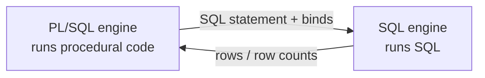

# 2.7 PL/SQL fundamentals

!!! abstract "Chapter card"
    **Stage:** 2 · **Prerequisites:** Stage 1, 2.1 to 2.6 · **Time:** 4 hours · **Applies to:** 19c+

## At a glance

**PL/SQL** is Oracle's procedural language. It adds variables, conditions,
loops and error handling around SQL, and it runs **inside the database**, next
to the data.

| Subtopic | In one line |
|---|---|
| Block structure | `DECLARE` / `BEGIN` / `EXCEPTION` / `END` |
| Variables, constants, data types | `%TYPE` and `%ROWTYPE` anchor to table columns |
| SQL inside PL/SQL | `SELECT INTO`, DML, `SQL%ROWCOUNT` |
| Control structures | `IF`, `CASE`, `LOOP`, `WHILE`, `FOR` |
| Records | A row-shaped variable |
| SQL versus PL/SQL engines | Why context switches matter |

## 1. Why PL/SQL

- **Fewer round trips.** Ten statements from an application are ten network calls; one PL/SQL call runs all ten on the server.
- **One implementation of a business transaction**, callable from Java, Python, batch jobs and tools alike.
- **Security.** Grant `EXECUTE` on a package instead of DML on tables.
- **Tight SQL integration.** SQL is checked at compile time, and dependencies on tables are tracked.

When *not* to use it: logic that needs external services, heavy string/CPU work
better scaled on application servers, or anything a single SQL statement can do.

**The golden rule:** if you can do it in one SQL statement, do it in SQL. Use
PL/SQL to orchestrate SQL, not to replace it.

## 2. Block structure

```sql
SET SERVEROUTPUT ON

DECLARE                                   -- optional: declarations
    l_customer_name customers.customer_name%TYPE;
    l_order_count   PLS_INTEGER;
    c_vip_threshold CONSTANT NUMBER := 1500;
BEGIN                                     -- required: executable statements
    SELECT c.customer_name, COUNT(o.order_id)
    INTO   l_customer_name, l_order_count
    FROM   customers c
    LEFT   JOIN orders o ON o.customer_id = c.customer_id
    WHERE  c.customer_id = 101
    GROUP  BY c.customer_name;

    DBMS_OUTPUT.PUT_LINE(l_customer_name || ' has ' || l_order_count || ' orders');
EXCEPTION                                 -- optional: error handlers
    WHEN NO_DATA_FOUND THEN
        DBMS_OUTPUT.PUT_LINE('No such customer');
END;
/
```

```text
Rahul Sharma has 3 orders
```

This is an **anonymous block**: compiled and run once, not stored. Named,
stored blocks (procedures, functions, packages) are in [2.9](03-subprograms-packages-triggers.md).
The `/` on its own line tells SQL*Plus/SQLcl to run the block.

`DBMS_OUTPUT` writes to a buffer that the client prints after the block ends.
It is a debugging aid, not a logging mechanism.

## 3. Variables and data types

```sql
DECLARE
    l_qty      NUMBER(5)        := 0;                 -- SQL type
    l_name     VARCHAR2(200);                         -- up to 32767 bytes in PL/SQL
    l_today    DATE             := SYSDATE;
    l_is_vip   BOOLEAN          := FALSE;             -- PL/SQL has always had BOOLEAN
    l_counter  PLS_INTEGER      := 0;                 -- fast machine integer
    l_price    products.unit_price%TYPE;              -- same type as the column
    l_product  products%ROWTYPE;                      -- one variable per column
    c_tax_rate CONSTANT NUMBER  := 0.05;
```

| Type | Notes |
|---|---|
| `PLS_INTEGER` / `SIMPLE_INTEGER` | Use for counters and loop indexes; faster than `NUMBER` |
| `BOOLEAN` | TRUE, FALSE or NULL. A SQL column type only from 23ai |
| `%TYPE` | Follows the column: change `unit_price` to `NUMBER(12,2)` and the code adapts |
| `%ROWTYPE` | A record matching a table or cursor row |

Anchor to the table with `%TYPE` and `%ROWTYPE` by default. Hard-coded
`VARCHAR2(50)` variables are how `ORA-06502: character string buffer too small`
appears a year later.

An uninitialized variable is `NULL`, including numbers. `l_total := l_total + 1`
stays `NULL` unless `l_total` was initialized.

## 4. SQL inside PL/SQL

| Statement | Behavior |
|---|---|
| `SELECT ... INTO` | Must return **exactly one row**. Zero rows: `NO_DATA_FOUND`. More than one: `TOO_MANY_ROWS` |
| `INSERT`, `UPDATE`, `DELETE`, `MERGE` | Zero affected rows is **not** an error. Check `SQL%ROWCOUNT` |
| `COMMIT`, `ROLLBACK`, `SAVEPOINT` | Allowed |
| DDL | Not allowed directly; needs dynamic SQL ([2.10](04-exceptions-dynamic-advanced.md)) |

PL/SQL variables used in SQL become **bind variables** automatically. Static SQL
in PL/SQL is therefore injection-safe and shares cursors.

```sql
BEGIN
    UPDATE products SET is_active = 'N' WHERE supplier_id = 99;
    DBMS_OUTPUT.PUT_LINE(SQL%ROWCOUNT || ' products deactivated');   -- 0 products deactivated
END;
/
```

Implicit cursor attributes: `SQL%ROWCOUNT`, `SQL%FOUND`, `SQL%NOTFOUND`.

!!! warning "Name clash"
    If a variable has the same name as a column, the **column wins** inside
    SQL. `WHERE customer_id = customer_id` is always true. Prefix variables
    (`l_` local, `p_` parameter, `c_` constant, `g_` package global).

## 5. Control structures

```sql
DECLARE
    l_spend NUMBER;
    l_tier  VARCHAR2(10);
BEGIN
    SELECT NVL(SUM(total_amount), 0) INTO l_spend
    FROM   orders WHERE customer_id = 101 AND status <> 'CANCELLED';

    IF l_spend >= 1500 THEN
        l_tier := 'GOLD';
    ELSIF l_spend >= 500 THEN
        l_tier := 'SILVER';
    ELSE
        l_tier := 'BRONZE';
    END IF;

    l_tier := CASE WHEN l_spend >= 1500 THEN 'GOLD'        -- same thing as an expression
                   WHEN l_spend >= 500  THEN 'SILVER'
                   ELSE 'BRONZE' END;

    DBMS_OUTPUT.PUT_LINE('Spend ' || l_spend || ' -> ' || l_tier);
END;
/
```

```text
Spend 1799 -> GOLD
```

### Loops

```sql
BEGIN
    FOR i IN 1 .. 3 LOOP                         -- numeric FOR; i is declared implicitly
        DBMS_OUTPUT.PUT_LINE('Attempt ' || i);
    END LOOP;

    FOR r IN (SELECT warehouse_name, city FROM warehouses ORDER BY warehouse_id) LOOP
        DBMS_OUTPUT.PUT_LINE(r.warehouse_name || ' - ' || r.city);    -- cursor FOR loop
    END LOOP;
END;
/
```

| Loop | Use |
|---|---|
| `FOR i IN a .. b` (`REVERSE` to count down) | Known number of iterations |
| `FOR r IN (query)` | Process each row of a query; opens, fetches and closes for you |
| `WHILE cond LOOP` | Test before each iteration |
| `LOOP ... EXIT WHEN cond; END LOOP` | Test anywhere |
| `CONTINUE [WHEN cond]` | Skip to the next iteration |

:material-tag: **21c+** extends `FOR` with steps and multiple ranges:
`FOR i IN 1 .. 10 BY 2, 20 .. 22 LOOP`.

A PL/SQL `CASE` **statement** with no matching branch and no `ELSE` raises
`CASE_NOT_FOUND`; a `CASE` **expression** returns `NULL`.

## 6. Records

```sql
DECLARE
    TYPE t_stock IS RECORD (
        product_name products.product_name%TYPE,
        available    NUMBER
    );
    l_stock t_stock;
    l_wh    warehouses%ROWTYPE;
BEGIN
    SELECT * INTO l_wh FROM warehouses WHERE warehouse_id = 1;

    SELECT p.product_name, i.qty_on_hand - i.qty_reserved
    INTO   l_stock
    FROM   inventory i JOIN products p ON p.product_id = i.product_id
    WHERE  i.warehouse_id = l_wh.warehouse_id AND i.product_id = 5;

    DBMS_OUTPUT.PUT_LINE(l_wh.warehouse_name || ': ' || l_stock.product_name
                         || ' available ' || l_stock.available);
END;
/
```

```text
Mumbai Central FC: Full Cream Milk 1L available 198
```

Records can be used whole in DML: `INSERT INTO t VALUES l_rec;` and
`UPDATE t SET ROW = l_rec WHERE ...`.

## 7. Two engines and the context switch



Each SQL statement executed from PL/SQL, and each PL/SQL function called from
SQL, crosses between engines. One crossing is cheap; a million crossings inside
a loop dominate the run time. Chapter [2.8](02-cursors-collections-bulk.md)
shows how bulk operations remove them.

## 8. Production recommendations

| DO | DON'T |
|---|---|
| Anchor variables with `%TYPE` | Hard-code lengths |
| Prefix variable names | Reuse column names |
| Put logic in packages | Leave business logic in anonymous blocks or scripts |
| Compile with warnings: `ALTER SESSION SET plsql_warnings = 'ENABLE:ALL'` | Ignore PLW messages |
| Let exceptions propagate unless you can handle them | Swallow errors with `WHEN OTHERS THEN NULL` |

## 9. Common mistakes

- `SELECT INTO` without planning for zero or many rows.
- Assuming an `UPDATE` that changed nothing raises an error.
- Uninitialized numeric variables producing `NULL` totals.
- Using `DBMS_OUTPUT` for production logging (buffered, invisible to most clients).
- Row-by-row loops doing work one SQL statement could do.

## FreshMart example

=== "Scenario"

    Operations wants a quick check for one warehouse: list each low-stock
    product and say how many units to reorder to reach twice the reorder level.

=== "PL/SQL"

    ```sql
    SET SERVEROUTPUT ON
    DECLARE
        c_warehouse_id CONSTANT warehouses.warehouse_id%TYPE := 1;
        l_name   warehouses.warehouse_name%TYPE;
        l_lines  PLS_INTEGER := 0;
    BEGIN
        SELECT warehouse_name INTO l_name
        FROM   warehouses WHERE warehouse_id = c_warehouse_id;

        DBMS_OUTPUT.PUT_LINE('Reorder list for ' || l_name);

        FOR r IN (SELECT p.product_name,
                         i.qty_on_hand - i.qty_reserved AS available,
                         i.reorder_level
                  FROM   inventory i
                  JOIN   products p ON p.product_id = i.product_id
                  WHERE  i.warehouse_id = c_warehouse_id
                  AND    i.qty_on_hand - i.qty_reserved <= i.reorder_level
                  ORDER  BY p.product_name)
        LOOP
            l_lines := l_lines + 1;
            DBMS_OUTPUT.PUT_LINE('  ' || r.product_name || ': available ' || r.available
                                 || ', order ' || (2 * r.reorder_level - r.available));
        END LOOP;

        IF l_lines = 0 THEN
            DBMS_OUTPUT.PUT_LINE('  nothing to reorder');
        END IF;
    EXCEPTION
        WHEN NO_DATA_FOUND THEN
            DBMS_OUTPUT.PUT_LINE('Unknown warehouse ' || c_warehouse_id);
    END;
    /
    ```

=== "Result"

    ```text
    Reorder list for Mumbai Central FC
      Paneer 200g: available 15, order 25
    ```

    Derived from the sample data: Paneer has 15 available against a reorder
    level of 20, so 2 x 20 - 15 = 25.

=== "Takeaway"

    The filtering and the arithmetic live in the SQL; PL/SQL only formats and
    handles the "no such warehouse" case. That division of labor is the habit
    to build.

## Check yourself

??? question "Interview questions"
    1. **(Beginner)** What are the sections of a PL/SQL block?
    2. **(Intermediate)** What happens when `SELECT INTO` finds no row? Two rows?
    3. **(Intermediate)** Why use `%TYPE`? *The code follows column changes and documents intent.*
    4. **(Senior)** What is a context switch and why does it matter? *The hand-off between the PL/SQL and SQL engines; per-row SQL in loops multiplies it.*
    5. **(Architect)** Where should business logic live: database or application? *Data-integrity rules and multi-statement transactions that must be identical for every client belong in the database; presentation, orchestration of external services and CPU-heavy logic belong in the application. Decide per rule, and document it.*

??? example "Exercises"
    1. Write a block that prints each customer's name and tier (GOLD/SILVER/BRONZE by net spend). *Rahul GOLD, Priya SILVER, others BRONZE.*
    2. Write a block that tries to select order 9999 and prints a friendly message.
    3. Use a `WHILE` loop to print the first five multiples of 7.

## Related

Next: [2.8 Cursors, collections, bulk SQL](02-cursors-collections-bulk.md).
