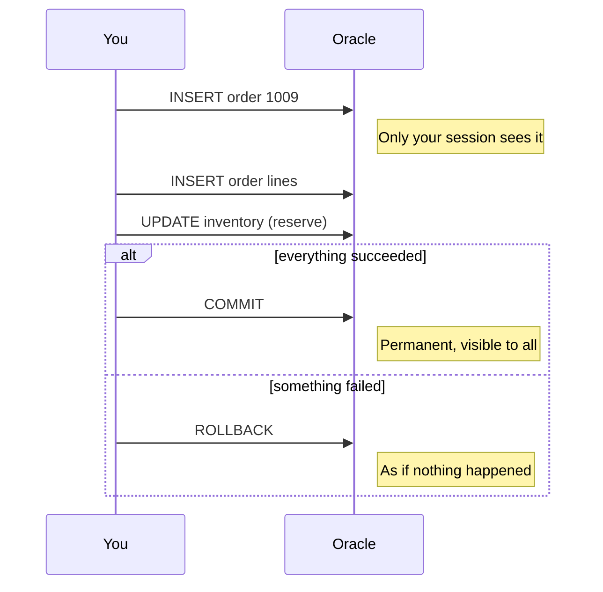

# 1.8 DML and transactions basics

!!! abstract "Chapter card"
    **Stage:** 1 · **Prerequisites:** 1.7 · **Time:** 3 hours · **Applies to:** 19c+

## At a glance

DML changes rows, and a transaction groups changes so that they all happen or none do.

| Subtopic | In one line |
|---|---|
| INSERT | One row, many rows, RETURNING |
| UPDATE | Change columns of chosen rows |
| DELETE | Remove chosen rows |
| Transactions and ACID | The guarantees |
| COMMIT, ROLLBACK, SAVEPOINT | Ending or partly undoing a transaction |
| What ends a transaction | DDL, exit, autocommit |
| How it works | Undo, redo, and who sees what |

## 1. Overview

**DML** changes rows: `INSERT` adds, `UPDATE` modifies, `DELETE` removes.
Together with `SELECT` these are the **CRUD** operations (create, read, update,
delete). Changes are grouped into **transactions** that either happen completely
or not at all.

!!! tip "Practice safely"
    Run the examples, look at the result, then `ROLLBACK;`. Your sample data
    stays intact and later chapters keep matching.

## 2. INSERT

```sql
-- One row, columns named (always name them)
INSERT INTO customers (customer_name, email, phone, city)
VALUES ('Divya Rao', 'divya.rao@example.com', '+91-9800000107', 'Bengaluru');
```

Omitted columns take their `DEFAULT` (here `status = 'ACTIVE'`,
`registered_on = today`) and the identity column generates `customer_id`.

```sql
-- Get generated values back without a second query
INSERT INTO customers (customer_name, email, city)
VALUES ('Ishaan Roy', 'ishaan.roy@example.com', 'Delhi')
RETURNING customer_id INTO :new_id;

-- Many rows from a query
INSERT INTO cart_items (cart_id, product_id, quantity)
SELECT 2, product_id, 1 FROM products WHERE category_id = 6;

-- 23ai+: several rows in one VALUES clause
INSERT INTO categories (category_name) VALUES ('Snacks'), ('Frozen'), ('Household');
```

Before 23ai, several literal rows need `INSERT ALL ... SELECT 1 FROM dual` or
one statement per row.

## 3. UPDATE

```sql
UPDATE products
SET    unit_price = unit_price * 1.10
WHERE  category_id = 4;          -- 3 rows updated: Milk, Eggs, Paneer
```

| PRODUCT | Before | After |
|---|---:|---:|
| Full Cream Milk 1L | 68 | 74.8 |
| Eggs 12 pack | 84 | 92.4 |
| Paneer 200g | 95 | 104.5 |

```sql
ROLLBACK;   -- put the prices back
```

Set several columns, or take values from a subquery:

```sql
UPDATE orders o
SET    o.subtotal = (SELECT SUM(oi.line_total)
                     FROM   order_items oi
                     WHERE  oi.order_id = o.order_id)
WHERE  o.order_id = 1001;
```

## 4. DELETE

```sql
DELETE FROM cart_items WHERE cart_id = 2 AND product_id = 8;   -- 1 row deleted
ROLLBACK;
```

!!! danger "UPDATE and DELETE without WHERE change every row"
    `DELETE FROM orders;` removes all orders. Before running a change in any
    shared database: run the same `WHERE` as a `SELECT COUNT(*)` first, check
    the count the statement reports, and only then `COMMIT`.

A delete can fail because of a child row:

```sql
DELETE FROM customers WHERE customer_id = 101;
-- ORA-02292: integrity constraint (FRESHMART.FK_ORDERS_CUSTOMER) violated - child record found
```

## 5. Transactions

A **transaction** is a unit of work. In Oracle it starts with your first change
and ends with `COMMIT` or `ROLLBACK`. There is no `BEGIN TRANSACTION` statement.



### ACID

| Property | Meaning | FreshMart example |
|---|---|---|
| **Atomicity** | All or nothing | An order is never saved without its lines |
| **Consistency** | Constraints hold before and after | Reserved stock never exceeds stock on hand |
| **Isolation** | Concurrent transactions do not see each other's unfinished work | Another shopper does not see your half-placed order |
| **Durability** | After commit, the change survives a crash | A paid order is not lost in a power failure |

### TCL statements

```sql
INSERT INTO carts (customer_id) VALUES (104);
SAVEPOINT cart_created;

INSERT INTO cart_items (cart_id, product_id, quantity) VALUES (4, 5, 2);
ROLLBACK TO SAVEPOINT cart_created;   -- undoes only the cart item

COMMIT;                               -- the cart remains
```

| Statement | Effect |
|---|---|
| `COMMIT` | Makes all changes of the transaction permanent and releases locks |
| `ROLLBACK` | Undoes all changes of the transaction and releases locks |
| `SAVEPOINT name` | Marks a point inside the transaction |
| `ROLLBACK TO name` | Undoes changes after the savepoint; the transaction stays open |

### What else ends a transaction

- Any DDL statement: implicit **commit**.
- Normal exit from SQL*Plus / SQLcl: **commit** by default. Abnormal end (crash, killed session): **rollback**.
- Many tools and JDBC have **autocommit**. JDBC autocommit is *on* by default, which commits after every statement and destroys atomicity. Frameworks such as Spring switch it off inside `@Transactional`.

### Statement-level atomicity

If one statement fails halfway (say the fourth of ten updated rows violates a
constraint), Oracle undoes **that statement only**. Earlier statements in the
transaction remain pending.

## 6. How it works (beginner view)

1. Oracle changes the row in memory and marks it locked by your transaction.
2. It saves the **old** value in **undo** so it can roll back, and so other
   sessions can still read the last committed value.
3. It writes a description of the change to the **redo log**.
4. On `COMMIT`, the redo is forced to disk. That is the moment of durability.

Consequences worth knowing now (detail in [2.11](../transactions/01-transactions-concurrency.md)):

- **Readers never block writers and writers never block readers.**
- Oracle never shows uncommitted data to other sessions (no dirty reads).
- Two sessions changing the **same row**: the second waits until the first commits or rolls back.

## 7. Real-world pattern: place an order

```sql
-- One transaction: all of it or none of it
UPDATE inventory
SET    qty_reserved = qty_reserved + 2
WHERE  warehouse_id = 1 AND product_id = 5
AND    qty_on_hand - qty_reserved >= 2;        -- must update exactly 1 row

INSERT INTO orders (customer_id, address_id, warehouse_id, subtotal, delivery_fee, total_amount)
VALUES (104, 204, 1, 136, 30, 166)
RETURNING order_id INTO :order_id;

INSERT INTO order_items (order_id, line_no, product_id, quantity, unit_price)
VALUES (:order_id, 1, 5, 2, 68);

COMMIT;
```

If the `UPDATE` reports 0 rows, there is not enough stock: roll back. The
packaged version of this logic is `order_pkg.place_order`
([FreshMart implementation](../grocery-application/03-implementation.md)).

## 8. Production recommendations

| DO | DON'T |
|---|---|
| Keep transactions short: no user think-time inside | Hold a transaction open across a web request round trip |
| Commit at business boundaries | Commit inside loops "every 1000 rows" without a restart design |
| Check the row count of every DML | Assume the `WHERE` matched what you expected |
| Use bind variables | Concatenate user input into SQL |
| Use set-based DML (one statement for many rows) | Loop row by row |

## 9. Common mistakes

- Forgetting to commit, then wondering why another session cannot see the data (or is blocked).
- Relying on tool autocommit and losing atomicity.
- Leaving a session open with an uncommitted change over lunch, blocking others.
- Treating `ROLLBACK TO SAVEPOINT` as ending the transaction. It does not; locks taken before the savepoint remain.

## FreshMart example

=== "Scenario"

    Amit (customer 103) edits his cart: he raises the apples to 2, removes the tea, changes his mind about the tea, and finally abandons all changes. Follow the cart total through one transaction.

=== "SQL"

    ```sql
    -- Cart 1 starts with: Apple x1 (180) + Assam Tea x1 (150) = 330
    UPDATE cart_items SET quantity = 2 WHERE cart_id = 1 AND product_id = 1;
    SAVEPOINT apples_changed;

    DELETE FROM cart_items WHERE cart_id = 1 AND product_id = 10;
    ROLLBACK TO SAVEPOINT apples_changed;     -- the tea is back

    ROLLBACK;                                 -- everything is back

    -- Run after each step:
    SELECT SUM(ci.quantity * p.unit_price) AS cart_total
    FROM   cart_items ci JOIN products p ON p.product_id = ci.product_id
    WHERE  ci.cart_id = 1;
    ```

=== "Result"

    | After | CART_TOTAL |
    |---|---:|
    | Start | 330 |
    | `UPDATE` apples to 2 | 510 |
    | `DELETE` tea | 360 |
    | `ROLLBACK TO SAVEPOINT` | 510 |
    | `ROLLBACK` | 330 |

    Derived from the sample data. Another session would see 330 throughout,
    because nothing was committed.

=== "Takeaway"

    A savepoint undoes part of a transaction without ending it. Until `COMMIT`, the changes exist only for the session that made them.

## 10. Check yourself

??? question "Interview questions"
    1. **(Beginner)** What does ACID stand for?
    2. **(Beginner)** When does a transaction begin and end in Oracle? *Begins at the first DML (or `SET TRANSACTION`); ends at COMMIT, ROLLBACK, DDL or session end.*
    3. **(Intermediate)** A 10-row UPDATE fails on row 4. What is the state? *The statement is rolled back entirely; earlier statements in the transaction are still pending.*
    4. **(Senior)** What makes a commit durable? *LGWR writes the redo up to the commit record to the online redo log before the commit returns; data blocks are written later by DBWn.*
    5. **(Architect)** Why are long transactions harmful? *They hold locks, keep undo from being reused (risking ORA-01555 and undo growth), delay standby apply for logical replication, and make recovery after failure longer.*

??? example "Exercises"
    1. Insert a new product in category 5, read back its generated id, then roll back.
    2. Raise the reorder level by 5 for all inventory in warehouse 2. How many rows? *6.* Roll back.
    3. In one transaction: create a cart for customer 105, add two items, set a savepoint, add a third, roll back to the savepoint, and confirm two items remain before a final rollback.

## 11. Related

Next: [1.9 Constraints](05-constraints.md). In depth:
[2.11 Transactions and concurrency](../transactions/01-transactions-concurrency.md).
