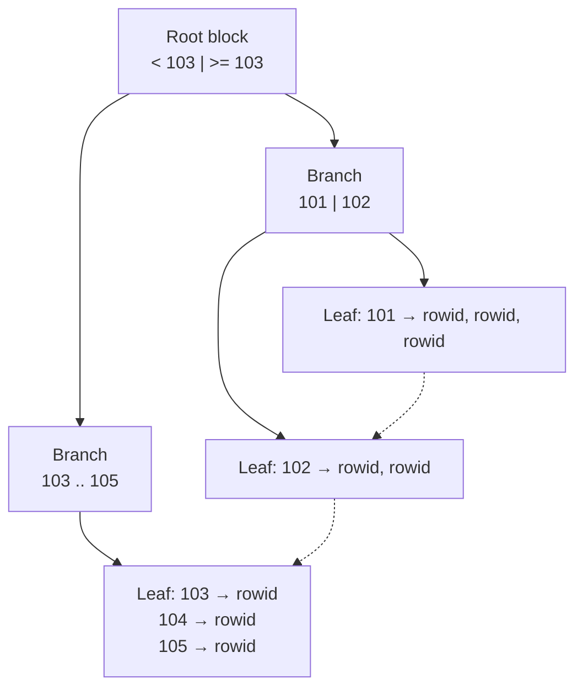

# 1.11 Your first index

!!! abstract "Chapter card"
    **Stage:** 1 · **Prerequisites:** 1.10 · **Time:** 1 hour · **Continues in:** [2.12 Indexing](../indexing/01-indexing.md)

## At a glance

An index is a sorted structure that lets Oracle go straight to the rows it needs.

| Subtopic | In one line |
|---|---|
| B-tree structure | Root, branches, leaves, rowids |
| Creating and dropping | Syntax; you never name an index in a query |
| Seeing the effect | Full scan versus index range scan |
| Automatic indexes | Primary and unique keys yes, foreign keys no |
| Cost | Every index slows writes |
| When it helps | Selectivity and what blocks index use |

## 1. Overview

An **index** is a separate, sorted structure that lets Oracle find rows without
reading the whole table, like the index at the back of a book: look up the word,
get the page numbers, go straight there.

## 2. Why

To find the orders of customer 101 without an index, Oracle reads every block of
`orders` (a **full table scan**). With 8 rows that is instant. With 80 million
rows it is the difference between milliseconds and minutes.

## 3. How it works

The default index is a **B-tree** (balanced tree).



- **Leaf blocks** hold the indexed values in sorted order, each with a **rowid**: the physical address of the table row.
- **Branch blocks** guide the search. The tree stays shallow: three or four levels reach hundreds of millions of rows.
- Leaves are linked, so a range (`BETWEEN`, `>`) is read by walking sideways.

A lookup is: descend the tree (a few block reads), then fetch each matching row
from the table by rowid.

## 4. Syntax

```sql
CREATE INDEX ix_orders_cust_date ON orders (customer_id, order_date DESC);
CREATE UNIQUE INDEX uq_customers_email_ix ON customers (email);   -- usually via a constraint instead
DROP INDEX ix_orders_cust_date;

SELECT index_name, uniqueness FROM user_indexes WHERE table_name = 'ORDERS';
```

You never reference an index in a query. The optimizer decides whether to use it.

## 5. Seeing the difference

```sql
EXPLAIN PLAN FOR
SELECT order_id, order_date, total_amount FROM orders WHERE customer_id = 101;

SELECT * FROM TABLE(DBMS_XPLAN.DISPLAY);
```

*Illustrative plans (costs and row counts will differ on your system):*

=== "Without the index"

    ```text
    | Id | Operation         | Name   | Rows |
    |  0 | SELECT STATEMENT  |        |    3 |
    |* 1 |  TABLE ACCESS FULL| ORDERS |    3 |
       1 - filter("CUSTOMER_ID"=101)
    ```

=== "With ix_orders_cust_date"

    ```text
    | Id | Operation                           | Name                | Rows |
    |  0 | SELECT STATEMENT                    |                     |    3 |
    |  1 |  TABLE ACCESS BY INDEX ROWID BATCHED| ORDERS              |    3 |
    |* 2 |   INDEX RANGE SCAN                  | IX_ORDERS_CUST_DATE |    3 |
       2 - access("CUSTOMER_ID"=101)
    ```

On a table this small the optimizer may well prefer the full scan: reading one
or two blocks directly is cheaper than going through an index. That is correct
behavior, not a fault.

## 6. What gets an index automatically

| Created by | Index |
|---|---|
| `PRIMARY KEY` constraint | Unique index on the key |
| `UNIQUE` constraint | Unique index on the columns |
| `FOREIGN KEY` constraint | **Nothing.** You must create it yourself |

## 7. The cost of an index

| Benefit | Cost |
|---|---|
| Fast lookups, ranges and sorted retrieval | Every `INSERT`, `DELETE`, and `UPDATE` of an indexed column must maintain the index |
| Enforces uniqueness | Extra storage, extra redo and undo |
| Can answer a query alone if it holds all needed columns | More indexes means more choices for the optimizer to get wrong |

A table with ten indexes does eleven writes for each insert.

## 8. When an index helps, and when it does not

| Helps | Does not help |
|---|---|
| The condition selects a small share of the rows | The condition matches most of the table |
| Column is used in joins or `WHERE` | Column is wrapped in a function: `UPPER(email) = ...` |
| `ORDER BY` matches the index order | Leading wildcard: `LIKE '%milk'` |
| Foreign key columns | Implicit type conversion on the column |
| | `IS NULL` on a single-column B-tree index |

**Selectivity** is the share of rows a condition returns. An index on
`customers.email` (one row per value) is highly selective. An index on
`orders.status` (five values) alone is not: a fifth of the table is too much to
fetch row by row.

## 9. Beginner guidance

- Index foreign keys.
- Index the columns your most frequent queries filter on.
- For a query filtering on two columns, one **composite** index on both usually beats two single-column indexes. Put equality columns first ([2.12](../indexing/01-indexing.md)).
- Do not index everything. Measure, then add.

## FreshMart example

=== "Scenario"

    Login looks a customer up by email on every sign-in. Check that this is an index lookup and not a table scan.

=== "SQL"

    ```sql
    EXPLAIN PLAN FOR
    SELECT customer_id, customer_name
    FROM   customers
    WHERE  email = 'priya.nair@example.com';

    SELECT * FROM TABLE(DBMS_XPLAN.DISPLAY(format => 'BASIC +PREDICATE'));
    ```

=== "Result"

    ```text
    | Id | Operation                   | Name               |
    |  0 | SELECT STATEMENT            |                    |
    |  1 |  TABLE ACCESS BY INDEX ROWID| CUSTOMERS          |
    |* 2 |   INDEX UNIQUE SCAN         | UQ_CUSTOMERS_EMAIL |
       2 - access("EMAIL"='priya.nair@example.com')
    ```

    Illustrative plan. The query returns customer 102, Priya Nair.

=== "Takeaway"

    Nobody created this index by hand: the unique constraint on `email` did. `INDEX UNIQUE SCAN` means at most one row, found in a few block reads however large the table grows. Note that `WHERE UPPER(email) = ...` would not use it.

## 10. Check yourself

??? question "Interview questions"
    1. **(Beginner)** What is an index? *A sorted structure of column values and row addresses that avoids full scans.*
    2. **(Beginner)** Why not index every column? *Each index slows DML and uses space.*
    3. **(Intermediate)** Why might Oracle ignore an index? *Low selectivity, a function on the column, stale statistics, a small table, or a type mismatch.*
    4. **(Senior)** What is a rowid? *The address of a row: data object number, relative file, block and row slot.*
    5. **(Architect)** How do you decide an index is worth its cost? *Measure the read benefit on real workloads against the added DML cost and redo, test with an invisible index, and monitor usage after release.*

??? example "Exercises"
    1. List the indexes on `order_items` and say why each exists. *`PK_ORDER_ITEMS` (primary key), `UQ_ORDER_ITEMS_PRODUCT` (unique constraint), `IX_ORDER_ITEMS_PRODUCT` (foreign key to products).*
    2. Which FreshMart query benefits from `ix_products_name_upper`? *`WHERE UPPER(product_name) LIKE 'APPLE%'`: case-insensitive prefix search.*
    3. Would you index `customers.status`? *Not alone: three values. It may be useful as a trailing column in a composite index.*

## 11. Related

You have finished Stage 1. Do the [Stage 1 labs](../hands-on-labs/01-stage-1.md),
then start [Stage 2](../getting-started/stage-2.md).
