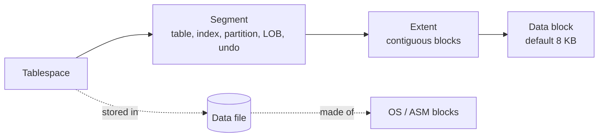

# 3.2 Storage management

!!! abstract "Chapter card"
    **Stage:** 3 · **Prerequisites:** 3.1 · **Time:** 4 hours · **Applies to:** 19c+

## At a glance

| Subtopic | In one line |
|---|---|
| Logical hierarchy | Block → extent → segment → tablespace |
| Physical files | Data files, temp files, control files, redo logs, archived logs |
| Tablespace types | Permanent, undo, temporary; bigfile and smallfile |
| Space management | Locally managed extents, ASSM, high-water mark |
| Undo | Retention, `ORA-01555`, sizing |
| Redo and archive | Groups, members, switches, ARCHIVELOG mode |
| LOBs | SecureFiles storage |
| Monitoring and reclaiming | Usage queries, shrink, move |

## 1. Logical and physical structure



| Logical | Meaning |
|---|---|
| **Data block** | Smallest unit of I/O (`DB_BLOCK_SIZE`, usually 8 KB). Header, row directory, free space, row data |
| **Extent** | A run of contiguous blocks allocated to a segment |
| **Segment** | All the extents of one object that needs storage. A partitioned table has one segment per partition |
| **Tablespace** | A named container of segments, made of one or more data files |

Inside a block: `PCTFREE` (default 10%) is reserved for rows to grow.
A row that grows beyond its block **migrates** (a pointer stays behind); a row
too large for any block is **chained**. Both cost extra I/O. `INITRANS` sets
the initial number of ITL slots (concurrent transactions per block).

## 2. Files

| File | Purpose | Lose it and... |
|---|---|---|
| **Data files** | Table, index and undo data | Restore and recover that file |
| **Temp files** | Sort and hash spill, temporary tables | Recreate; no recovery needed |
| **Control file** | Database structure, checkpoint and backup metadata | With multiplexed copies: copy a survivor. All lost: restore from backup |
| **Online redo logs** | Recent changes; needed for crash recovery | A lost *current* group without a mirror means data loss |
| **Archived redo logs** | History of filled redo logs | Recovery cannot pass the gap |
| **SPFILE / password file** | Parameters; SYSDBA authentication | Restore or recreate |

Multiplex control files (2 to 3 copies) and redo log members (2 per group) on
separate storage. With ASM, redundancy is handled by the disk group
([3.8](../high-availability/01-rac-asm.md)). **Oracle Managed Files**
(`DB_CREATE_FILE_DEST`) lets Oracle name and place files.

## 3. Tablespaces

| Type | Holds | Notes |
|---|---|---|
| `SYSTEM`, `SYSAUX` | Data dictionary; AWR, optimizer history, and other components | Never put application data here |
| Permanent | Application tables and indexes | |
| Undo | Undo segments | One active per instance (per PDB with local undo) |
| Temporary | Work-area spill | Use tablespace groups or per-application temp tablespaces to isolate |

```sql
CREATE TABLESPACE fm_data DATAFILE SIZE 10G AUTOEXTEND ON NEXT 1G MAXSIZE 200G;
ALTER  TABLESPACE fm_data ADD DATAFILE SIZE 10G AUTOEXTEND ON NEXT 1G MAXSIZE 31G;
ALTER  DATABASE DATAFILE '/u02/oradata/FM/fm_data01.dbf' RESIZE 20G;
```

| | Smallfile | Bigfile |
|---|---|---|
| Data files | Up to 1022 per tablespace, each up to about 32 GB at 8 KB blocks | Exactly one, up to about 32 TB at 8 KB |
| Use | Traditional | With ASM/OMF; fewer files to manage. Default for most tablespaces from 23ai |

All tablespaces are **locally managed**: extent allocation is tracked in bitmaps
in the file itself, with `AUTOALLOCATE` (system-chosen extent sizes, default)
or `UNIFORM` sizes. **Automatic Segment Space Management (ASSM)** tracks free
space inside segments with bitmaps instead of freelists and is the default.

## 4. Space allocation and the high-water mark

The **high-water mark (HWM)** is the boundary of blocks ever formatted for a
segment. A full table scan reads every block below it.

- `INSERT` moves the HWM up.
- `DELETE` does **not** move it down: a table that held 10 million rows and now holds 10 is still scanned in full.
- `TRUNCATE`, `ALTER TABLE ... MOVE` and `SHRINK SPACE` reset it.
- Direct-path insert (`/*+ APPEND */`) writes above the HWM, which is why it is fast and why the space below is not reused.

## 5. Undo management

Undo serves three purposes: **rollback**, **read consistency**, and
**flashback** queries.

| Parameter / setting | Meaning |
|---|---|
| `UNDO_MANAGEMENT = AUTO` | Automatic undo (the only sensible mode) |
| `UNDO_TABLESPACE` | Active undo tablespace |
| `UNDO_RETENTION` | Seconds to *try* to keep committed undo. With an autoextending undo tablespace Oracle tunes it upward for the longest query |
| `RETENTION GUARANTEE` | Never overwrite unexpired undo; DML fails instead (`ORA-30036`) |

Undo extents are **active** (open transaction), **unexpired** (committed,
within retention) or **expired** (reusable).

**`ORA-01555: snapshot too old`** means a query needed undo that was already
overwritten. Fixes, in order: make the query faster; stop fetching across
commits; size the undo tablespace for (peak undo rate × longest query), using
`V$UNDOSTAT`; raise `UNDO_RETENTION`; consider `RETENTION GUARANTEE` for
flashback-critical systems. LOBs have their own retention (`RETENTION` /
`PCTVERSION`).

## 6. Redo and archiving

- Online redo logs are a **circular** set of at least two groups. LGWR fills one, **switches** to the next, and the filled one is archived.
- In **NOARCHIVELOG** mode filled logs are overwritten: you can recover only to the last full backup. Production runs in **ARCHIVELOG** mode.
- Size logs so that switches happen a few times an hour at peak, not every few seconds (`V$LOG_HISTORY`). Undersized logs cause `checkpoint not complete` waits.
- If the archive destination fills, the database **hangs** on the next switch (`ORA-00257`). Monitor the fast recovery area (FRA, `DB_RECOVERY_FILE_DEST_SIZE`) and back up and delete archived logs on a schedule.

Reducing redo: `NOLOGGING` with direct-path operations skips most redo for the
data, but the objects are unrecoverable from earlier backups until backed up
again, and a standby will hold corrupt blocks unless `FORCE LOGGING` is on.
Data Guard environments run with `FORCE LOGGING`, which overrides `NOLOGGING`.

## 7. LOB storage

LOBs (`CLOB`, `BLOB`, and large `JSON`) are stored as **SecureFiles** (default
since 12c). Small values (up to about 4000 bytes by default)
are stored **in the row**; larger ones go to a separate LOB segment
with its own index.

| Option | Effect |
|---|---|
| `ENABLE / DISABLE STORAGE IN ROW` | Keep small LOBs in the table block or not |
| `COMPRESS`, `DEDUPLICATE` | :material-license: Advanced Compression |
| `ENCRYPT` | :material-license: Advanced Security |
| `CACHE / NOCACHE`, `LOGGING / NOLOGGING` | Buffer cache and redo behavior |

LOB segments are often the largest objects in a schema and are easy to overlook
in sizing and in space reports (`DBA_LOBS`, `DBA_SEGMENTS`).

## 8. Monitoring and reclaiming space

```sql
-- Tablespace usage including autoextend headroom
SELECT tablespace_name,
       ROUND(used_space      * 8192 / 1024 / 1024 / 1024, 1) AS used_gb,
       ROUND(tablespace_size * 8192 / 1024 / 1024 / 1024, 1) AS max_gb,
       ROUND(used_percent, 1)                                AS pct_of_max
FROM   dba_tablespace_usage_metrics
ORDER  BY used_percent DESC;

-- Largest segments
SELECT owner, segment_name, segment_type, ROUND(bytes / 1024 / 1024) AS mb
FROM   dba_segments ORDER BY bytes DESC FETCH FIRST 20 ROWS ONLY;
```

(The first query assumes an 8 KB block size.)

| Method | Online? | Notes |
|---|---|---|
| `ALTER TABLE t SHRINK SPACE [CASCADE]` | Yes | Needs `ENABLE ROW MOVEMENT` and ASSM; moves rows, generates redo; brief lock at the end |
| `ALTER TABLE t MOVE ONLINE` | Yes (12.2+, EE) | Rebuilds the segment; indexes maintained |
| `ALTER TABLE t MOVE` | No | Indexes become `UNUSABLE` and must be rebuilt |
| `DBMS_REDEFINITION` | Yes | Most flexible; can change structure |
| `ALTER TABLESPACE ... SHRINK` / `DBMS_SPACE.SHRINK_TABLESPACE` | | Bigfile tablespace shrink :material-tag: **23ai+** |
| `ALTER DATABASE DATAFILE ... RESIZE` | Yes | Only down to the highest used block |
| `PURGE RECYCLEBIN` | | Dropped objects hold space until purged |

Run **Segment Advisor** (`DBMS_ADVISOR`, automatic maintenance task) to find
segments worth shrinking. Do not reorganize by habit: space freed inside a busy
table is reused by new rows.

## 9. Production recommendations

- Separate tablespaces by lifecycle (hot data, archive, LOBs), not by "tables versus indexes" for performance.
- Autoextend with a sensible `MAXSIZE`, and alert on percent of **max**, not of current size.
- Alert on FRA usage, temp usage, undo usage and filesystem/ASM free space.
- Keep `DB_BLOCK_CHECKSUM` (and consider `DB_BLOCK_CHECKING`, `DB_LOST_WRITE_PROTECT`) at Oracle MAA-recommended values.

## 10. Common mistakes

- Expecting `DELETE` to shrink a table.
- Application segments in `SYSTEM` or `USERS`.
- Unlimited autoextend filling the filesystem, or autoextend off and a 3 a.m. `ORA-01653`.
- Tiny redo logs.
- `NOLOGGING` loads on a database with a standby and no `FORCE LOGGING`.

## FreshMart example

=== "Scenario"

    After a cleanup job deleted 95% of `audit_log`, the nightly audit report (a
    full scan) is as slow as before, and the tablespace is 88% full.

=== "Diagnosis"

    ```sql
    SELECT blocks, num_rows, ROUND(blocks * 8 / 1024) AS mb, avg_row_len
    FROM   user_tables WHERE table_name = 'AUDIT_LOG';

    -- Space actually needed, as an estimate
    SELECT ROUND(num_rows * avg_row_len / 1024 / 1024) AS needed_mb
    FROM   user_tables WHERE table_name = 'AUDIT_LOG';
    ```

    *Illustrative result:* 2,560,000 blocks (20 GB) allocated; about 1 GB
    needed. The HWM is still where it was before the delete.

=== "Fix"

    ```sql
    ALTER TABLE audit_log ENABLE ROW MOVEMENT;
    ALTER TABLE audit_log SHRINK SPACE CASCADE;      -- online
    -- or, EE 12.2+:  ALTER TABLE audit_log MOVE ONLINE;
    EXEC DBMS_STATS.GATHER_TABLE_STATS(USER, 'AUDIT_LOG');
    ```

    Long term: partition `audit_log` by month and **drop** expired partitions
    instead of deleting rows.

=== "Takeaway"

    Deleting rows frees space *inside* the segment for future inserts; it
    returns nothing to the tablespace and does not speed up scans. For data
    with a retention period, design the purge as partition maintenance from
    the start.

## Check yourself

??? question "Interview questions"
    1. **(Intermediate)** Block, extent, segment, tablespace: define each.
    2. **(Intermediate)** What is the high-water mark?
    3. **(Senior)** Causes and fixes for `ORA-01555`?
    4. **(Senior)** What happens when the archive destination is full?
    5. **(Architect)** How do you plan storage for a database growing 40% a year with 7-year retention? *Model growth per segment class, tier by age with partitioning and compression, read-only tablespaces for backup savings, capacity alerts on trend, and a tested archive/purge process.*

??? example "Exercises"
    1. Find the five largest segments in your schema.
    2. Create a table, insert 100,000 rows, delete them, and compare `blocks` before and after `SHRINK SPACE`.
    3. Query `V$LOG` and `V$LOG_HISTORY`: how many switches per hour does your lab database do?

## Related

Next: [3.3 Administration and multitenant](../database-administration/01-administration.md).
Runbooks: [space, undo, redo](../production-runbooks/02-space-undo-redo.md).
