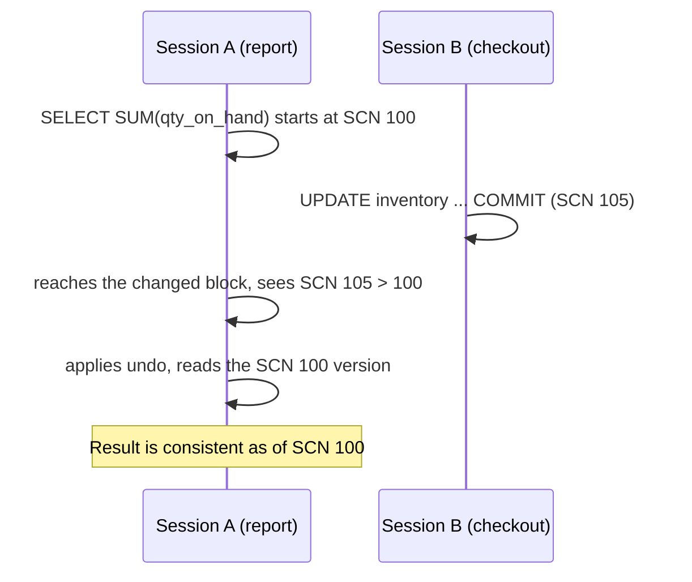

# 2.11 Transactions and concurrency

!!! abstract "Chapter card"
    **Stage:** 2 · **Prerequisites:** 1.8 · **Time:** 5 hours · **Applies to:** 19c+

## At a glance

| Subtopic | In one line |
|---|---|
| Multiversion read consistency | Readers see a consistent snapshot built from undo |
| Isolation levels | `READ COMMITTED`, `SERIALIZABLE`, `READ ONLY` |
| Read phenomena | Dirty, non-repeatable and phantom reads; lost updates |
| Locks | Row locks (TX) and table locks (TM) |
| Pessimistic locking | `SELECT ... FOR UPDATE` with `NOWAIT`, `WAIT n` or `SKIP LOCKED` |
| Optimistic locking | Version column checked at update time |
| Deadlocks | Detection, `ORA-00060`, prevention |
| Distributed transactions | Two-phase commit |

## 1. Multiversion read consistency (MVCC)

Every committed change advances the **system change number (SCN)**, Oracle's
logical clock. A query notes the SCN at which it starts. When it meets a block
changed after that SCN, it uses **undo** to rebuild the block as it was.



Consequences:

- **Readers do not block writers; writers do not block readers.** Queries take no row locks.
- A query never sees uncommitted data and never sees a mix of "before" and "after".
- If the undo needed has been overwritten, the query fails with **`ORA-01555: snapshot too old`**. Causes: long queries, undersized undo, or fetching across commits ([3.2](../storage-management/01-storage.md)).

## 2. Isolation levels and read phenomena

| Phenomenon | Meaning | READ COMMITTED | SERIALIZABLE |
|---|---|---|---|
| Dirty read | Seeing uncommitted data | Never in Oracle | Never |
| Non-repeatable read | Re-reading a row gives a different value | Possible | Prevented |
| Phantom read | Re-running a query finds new rows | Possible | Prevented |
| Lost update | Two sessions overwrite each other | Possible (application must prevent) | Second writer gets `ORA-08177` |

Oracle offers three modes. There is no `READ UNCOMMITTED`, and no
`REPEATABLE READ` level (`SERIALIZABLE` covers it).

| Mode | Snapshot taken | Notes |
|---|---|---|
| `READ COMMITTED` (default) | At the start of each **statement** | Right for almost all OLTP |
| `SERIALIZABLE` | At the start of the **transaction** | Updating a row changed since then raises `ORA-08177: can't serialize access`; the application must retry. It is snapshot isolation: write skew is still possible |
| `READ ONLY` | At the start of the transaction | No DML; consistent multi-query reports |

```sql
SET TRANSACTION ISOLATION LEVEL SERIALIZABLE;   -- must be the first statement
SET TRANSACTION READ ONLY;
ALTER SESSION SET ISOLATION_LEVEL = SERIALIZABLE;
```

**Statement restart:** in `READ COMMITTED`, if an `UPDATE` finds that a row it
selected was changed by another transaction that then committed, Oracle rolls
the statement back and runs it again with a new snapshot. Triggers may therefore
fire more than once for one statement.

## 3. Locks

| Lock | Name | Taken by | Blocks |
|---|---|---|---|
| Row lock | TX | `INSERT`, `UPDATE`, `DELETE`, `MERGE`, `SELECT FOR UPDATE` | Other writers of the **same row** |
| Table lock, row-exclusive | TM (mode 3, RX) | Any DML | DDL on the table |
| Table lock, share | TM (mode 4, S) | Unindexed foreign key checks, `LOCK TABLE ... IN SHARE MODE` | All DML on the table |
| Table lock, exclusive | TM (mode 6, X) | Most DDL | Everything except queries |

Oracle specifics:

- Row locks are stored **in the data block** (in the interested transaction list, ITL), not in a lock manager. A million locked rows cost no extra memory.
- There is **no lock escalation**: row locks never turn into a table lock.
- Locks are held until `COMMIT` or `ROLLBACK`.
- A blocked session waits on `enq: TX - row lock contention`, indefinitely by default.

## 4. Lost updates

Two support agents open Rahul's profile. Both read phone `...0101`. Agent A
saves a new phone; agent B, still showing the old screen, saves a new city
**and the old phone**. A's change is lost. Two fixes:

### Pessimistic locking

Lock the row when you read it with intent to change.

```sql
SELECT qty_on_hand, qty_reserved
FROM   inventory
WHERE  warehouse_id = 1 AND product_id = 5
FOR UPDATE WAIT 5;          -- wait up to 5 seconds, then ORA-30006
```

| Variant | If the row is locked |
|---|---|
| `FOR UPDATE` | Wait forever |
| `FOR UPDATE NOWAIT` | Fail at once with `ORA-00054` |
| `FOR UPDATE WAIT n` | Wait n seconds, then `ORA-30006` |
| `FOR UPDATE SKIP LOCKED` | Return only rows that are free |
| `FOR UPDATE OF t.col` | In a join, lock only the rows of that table |

`SKIP LOCKED` builds a work queue: each worker claims different rows.

```sql
DECLARE
    CURSOR c IS
        SELECT order_id FROM orders
        WHERE  status = 'PLACED'
        ORDER  BY order_date
        FOR UPDATE SKIP LOCKED;
    l_id orders.order_id%TYPE;
BEGIN
    OPEN c;
    FOR i IN 1 .. 10 LOOP                 -- claim at most 10 orders
        FETCH c INTO l_id;
        EXIT WHEN c%NOTFOUND;
        UPDATE orders SET status = 'PACKED' WHERE order_id = l_id;
    END LOOP;
    CLOSE c;
    COMMIT;
END;
/
```

With `SKIP LOCKED`, rows are locked as they are fetched, so a cursor that stops
after N fetches claims N rows. `FETCH FIRST n ROWS` cannot be combined with
`FOR UPDATE` (`ORA-02014`). For real queues consider Transactional Event Queues
(`DBMS_AQ`).

Use pessimistic locking for short, high-contention operations inside one
database call. Never hold the lock across user think-time.

### Optimistic locking

Do not lock on read. Detect a conflict when writing.

```sql
UPDATE customers
SET    phone = :new_phone
WHERE  customer_id = :id
AND    row_version = :version_read_earlier;      -- trigger increments row_version

-- SQL%ROWCOUNT = 0  ->  someone else changed the row: reload and retry or tell the user
```

Alternatives to a version column: `ORA_ROWSCN` (needs `ROWDEPENDENCIES` for row
precision) or a hash of the columns read. JPA's `@Version` implements exactly
this ([4.8](../spring-boot-integration/01-spring-boot.md)).

| | Pessimistic | Optimistic |
|---|---|---|
| Conflict handling | Prevented by waiting | Detected, then retried |
| Best when | Conflicts are frequent; work is short | Conflicts are rare; user think-time is involved |
| Risk | Blocking, deadlocks, abandoned locks | Retries under contention |

### Avoid the read entirely

The safest pattern is a single conditional statement, as `order_pkg` uses:

```sql
UPDATE inventory
SET    qty_reserved = qty_reserved + :qty
WHERE  warehouse_id = :wh AND product_id = :p
AND    qty_on_hand - qty_reserved >= :qty;
```

The check and the change are atomic: no gap between reading and writing.

:material-tag: **23ai+** **Lock-free reservations**: a numeric column declared
`RESERVABLE` lets concurrent transactions add or subtract without blocking each
other; the change is journaled and applied at commit, and a check constraint on
the column is enforced against pending reservations. It targets hot inventory
and balance rows.

## 5. Deadlocks

Session A holds row 1 and wants row 2; session B holds row 2 and wants row 1.
Oracle detects the cycle within seconds, picks one session and rolls back its
**current statement** with `ORA-00060: deadlock detected`. The transaction is
still open: the application must roll back and retry. A trace file with a
deadlock graph is written ([runbook](../production-runbooks/01-instance-sessions-locks.md)).

| Cause | Prevention |
|---|---|
| Rows locked in different orders | Always lock in a consistent order (`order_pkg` sorts by `product_id`) |
| Unindexed foreign keys | Index them |
| Bitmap indexes on OLTP tables | Use B-tree indexes |
| ITL shortage in a hot block | Raise `INITRANS` |
| Long transactions | Keep them short |

## 6. Distributed transactions

A transaction that changes data in two databases (through a database link or
XA) is committed with **two-phase commit (2PC)**:

1. **Prepare**: the coordinator asks every participant to promise it can commit. Each writes a prepare record and holds its locks.
2. **Commit**: when all have promised, the coordinator commits and tells the rest.

If the coordinator fails between the phases, participants are **in-doubt** and
keep their locks until the `RECO` process resolves them or a DBA forces the
outcome (`DBA_2PC_PENDING`, `COMMIT FORCE`). 2PC couples the availability of
every participant; modern designs avoid it between services
([4.3](../distributed-databases/01-distributed.md)).

## 7. Production recommendations

| DO | DON'T |
|---|---|
| Keep transactions short; one business action per transaction | Hold transactions open during user input or remote calls |
| Use conditional single-statement updates where possible | Read, compute in the application, then write without a check |
| Set lock timeouts (`WAIT n`) and retry | Let sessions queue forever |
| Lock in a consistent order | Lock "whatever comes first" |
| Monitor blockers and long transactions | Kill sessions as a first response |

## 8. Common mistakes

- Assuming `READ COMMITTED` prevents lost updates.
- Using `SERIALIZABLE` without retry logic for `ORA-08177`.
- `SELECT ... FOR UPDATE` from a web tier that then waits for the user.
- Catching `ORA-00060` and continuing without rolling back.
- Committing inside a loop to "release locks" and creating half-done business states.

## FreshMart example

=== "Scenario"

    Two shoppers each try to buy the last 15 packs of Paneer in warehouse 1 at
    the same moment: one wants 10, the other 8. Only one of them can succeed.

=== "SQL (two sessions)"

    ```sql
    -- Session 1                              -- Session 2
    UPDATE inventory
    SET    qty_reserved = qty_reserved + 10
    WHERE  warehouse_id = 1
    AND    product_id = 7
    AND    qty_on_hand - qty_reserved >= 10;
    -- 1 row updated (not committed)
                                              UPDATE inventory
                                              SET    qty_reserved = qty_reserved + 8
                                              WHERE  warehouse_id = 1
                                              AND    product_id = 7
                                              AND    qty_on_hand - qty_reserved >= 8;
                                              -- waits: row is locked by session 1
    COMMIT;
                                              -- resumes: 0 rows updated
    ```

=== "Result"

    | Step | Session 1 | Session 2 | Paneer reserved |
    |---|---|---|---:|
    | Start | | | 0 of 15 |
    | S1 update | 1 row | | 10 (uncommitted) |
    | S2 update | | blocked | |
    | S1 commit | | re-evaluates the row: 15 - 10 = 5 < 8 | 10 |
    | S2 result | | 0 rows → "insufficient stock" | 10 |

    Illustrative of Oracle's documented behavior: after the blocker commits,
    the waiting statement re-reads the current row and re-checks its `WHERE`.

=== "Takeaway"

    No explicit lock, no version column, no oversell. The conditional update
    turns a race into a correct "first wins" outcome, and the constraint
    `ck_inventory_reserved` remains as the last line of defense.

## Check yourself

??? question "Interview questions"
    1. **(Intermediate)** Why do readers not block writers in Oracle? *Queries read a consistent version reconstructed from undo and take no row locks.*
    2. **(Intermediate)** Which isolation levels does Oracle support?
    3. **(Senior)** What does Oracle do on a deadlock, and what must the application do? *Rolls back one statement with ORA-00060; the application should roll back the transaction and retry.*
    4. **(Senior)** What causes `ORA-01555`? *Undo needed for a consistent read was overwritten: long query, small undo or low retention, fetch across commit.*
    5. **(Architect)** How would you design inventory reservation for a flash sale with one very hot product? *Conditional updates are correct but serialize on one row. Options: lock-free reservations (23ai), splitting stock into buckets, a queue with asynchronous confirmation, or admission control in front. Choose by required throughput and the cost of telling a customer "sold out" late.*

??? example "Exercises"
    1. In two sessions, reproduce a blocked update, then find the blocker in `V$SESSION` (`blocking_session`).
    2. Reproduce a deadlock with two rows of `inventory`, and read the trace file.
    3. Implement an optimistic update of `customers.city` using `row_version`.

## Related

Next: [2.12 Indexing](../indexing/01-indexing.md). Operations:
[blocking and deadlock runbooks](../production-runbooks/01-instance-sessions-locks.md).
